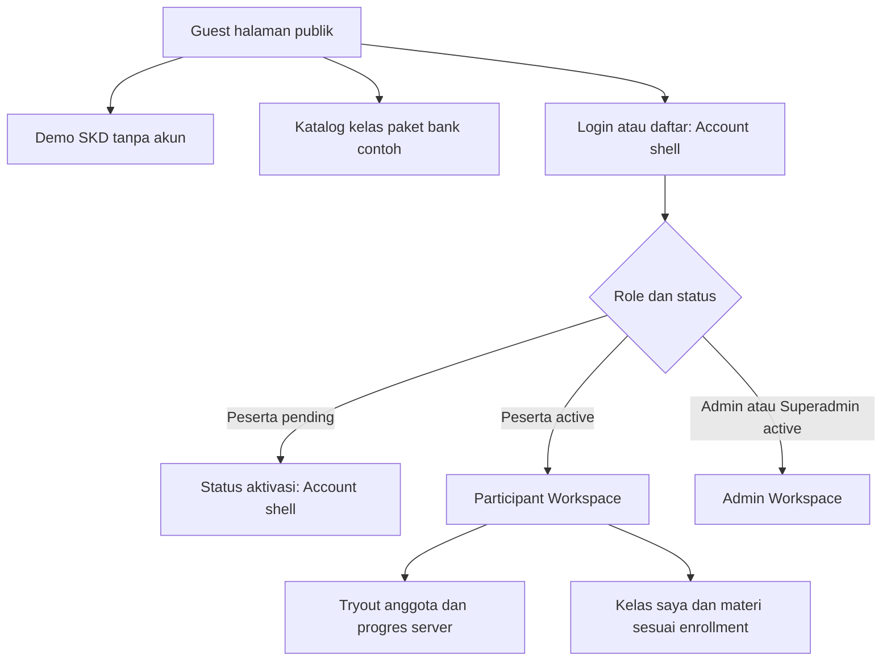

# SIAPEGAWAI — Design System & Visual Implementation Contract

**Versi:** 1.0 — usulan untuk persetujuan visual, 8 November 2026  
**Status:** DRAFT REVIEW; keputusan yang berasal dari prototipe v4 ditandai **[BASELINE DISETUJUI]**, arahan terbaru pengguna **[KEPUTUSAN BARU]**, dan detail baru yang masih dapat diubah **[USULAN]**.  
**Berlaku bagi:** Laravel 13 + Blade + Tailwind/Vite, desktop/mobile, Guest, Peserta, Admin Operasional, Superadmin.  
**Referensi primer:** `siapegawai.zip` v4 (`index.html`, `css/styles.css`, `js/app.js`, `DESIGN-NOTES.md`, `QC-v4.md`), enam screenshot acuan v4 (Beranda, Latihan SKD, Bank soal, Kelas, Paket, Progres), `IMPLEMENTATION-PLAN.md` v2.1.  
**Referensi evaluasi:** `panduan-deteksi-ui-ai-chatgpt.md`, `panduan-deteksi-ui-ai-gemini.md` (rubrik heuristik kualitas UI; **bukan** alat autentikasi asal-usul desain).

---

## 1. Aturan yang mengikat sebelum coding

1. **[BASELINE DISETUJUI]** Desain v4 adalah *visual source of truth* untuk **enam halaman yang sudah ada**, termasuk pola responsif dalam CSS sumber. Laravel hanya mengubah mekanisme route, state, data, izin, dan penyimpanan; **bukan kesempatan mendesain ulang**.
2. **[BASELINE DISETUJUI]** North star: **"Editorial untuk memperkenalkan brand; fungsional untuk mengerjakan tugas belajar"**. Prinsip produk: **Credible, Calm, Purposeful**. Variasi antarhalaman adalah desain yang disengaja, bukan inkonsistensi.
3. **[KEPUTUSAN BARU]** Area publik dan area setelah login memakai *shell/layout* yang berbeda; aplikasi peserta dan panel admin juga dibedakan secara operasional. Halaman `/login` dan `/daftar` memiliki shell akun ringkas, bukan hero website publik. **Role tetap mengatur izin di backend, bukan folder controller**.
4. **[KEPUTUSAN BARU]** Komponen UI dan notifikasi harus disiapkan dengan CSP yang ketat: sumber CSS/JS eksternal melalui Vite, tanpa handler JavaScript inline atau atribut style dinamis sewenang-wenang; kebijakan CSP dipasang dan diuji melalui header.
5. **[KEPUTUSAN BARU]** Gunakan notifikasi toast untuk umpan balik aksi (Toastr adalah kandidat library sesuai permintaan, **gated oleh audit keamanan**), dalam **satu adapter UI** dan styling sesuai Siapegawai; toast bukan dialog konfirmasi atau satu-satunya tempat error form.
6. **[USULAN]** Untuk setiap pekerjaan UI tulis matriks **Preserved / Adapted / New**. `Preserved` diuji terhadap v4; `Adapted` memerlukan alasan fungsional/keamanan; `New` memerlukan persetujuan visual sebelum implementasi skala besar. Tidak ada perubahan diam-diam.
7. **[USULAN]** Prioritaskan *visual fidelity* daripada abstraksi komponen generik. Komponen yang sama boleh memiliki varian terdefinisi (marketing, latihan, tabel) tanpa menyalin satu hero ke seluruh halaman.

### Hierarki sumber kebenaran

Untuk halaman acuan: **Screenshot + source v4** → `DESIGN-NOTES.md`/`QC-v4.md` → dokumen ini → Implementation Plan → implementasi Laravel. Konflik diselesaikan melalui keputusan desain yang dicatat, **bukan** dengan mengikuti CSS patch yang dibuat belakangan. Untuk halaman **baru** (auth/admin/member), dokumen ini + mockup yang kelak disetujui adalah kontraknya; v4 hanya menyediakan identitas dan pola komponen, **bukan** screenshot yang tidak ada.

---

## 2. Foundations: token dan aturan penggunaan

### 2.1 Warna — ekstraksi persis dari `css/styles.css` v4

| Token sumber v4 | Nilai | Peran, bukan dekorasi |
|---|---|---|
| `--navy` | `#0B1B40` | Identitas, CTA primer, navigation active, panel footer |
| `--navy-soft` | `#17315C` | Hover/secondary dark |
| `--gold` | `#B88928` | Aksen editorial, angka, garis aktif |
| `--gold-light` | `#F0DFB7` | Aksen ringan; bukan tombol default |
| `--ink` | `#17243A` | Heading dan teks utama |
| `--muted` | `#596575` | Deskripsi/subteks |
| `--faint` | `#8B93A0` | Keterangan sekunder, bukan body text panjang |
| `--line` | `#E2E4E7` | Divider dan border fungsional |
| `--canvas` | `#F8F7F4` | Bidang editorial, bukan semua konten |
| `--paper` | `#FFFFFF` | Surface utama |
| `--sage` | `#E8EFE8` | Surface feedback positif |
| `--green` | `#2F765A` | Success/benar, setelah kontras dicek |
| `--red` | `#B44B42` | Error/destruktif, setelah kontras dicek |

**[BASELINE DISETUJUI]** Tidak memakai gradien/glow/glass blur sebagai fondasi baru. Gold adalah aksen yang terukur, bukan badge di setiap seksi. Untuk toast/status/aksesibilitas, warna saja tidak cukup; label dan ikon memiliki makna yang jelas.

### 2.2 Tipografi

- **[BASELINE DISETUJUI]** `Plus Jakarta Sans`, fallback `system-ui`; bobot 400/500/600/700/800. **Tidak mengganti** menjadi Instrument Sans/Inter hanya karena bundel Laravel awal.
- Source v4 `body`: 16px, line-height 1.6; paragraf 1.7. Heading punya letter-spacing `-0.052em`, line-height `1.16`.
- Heading *editorial* v4: `h1 clamp(43px, 5.25vw, 70px)`, `h2 clamp(29px, 3.3vw, 43px)`; **hanya untuk konteks editorial**. Dalam v4 halaman tugas memiliki skala sendiri (`.page-intro`, `.exam-question-area h2` 21px, `.bank-item h2/h3` 17px).
- Keterangan gold `.eyebrow`: 11px, uppercase, letter-spacing `0.14em`; **gunakan selektif**. Form, ujian, dan admin tidak wajib memiliki eyebrow.
- **[USULAN]** Simpan font dalam paket statis/self-hosted melalui Vite untuk CSP produksi; cek hak lisensi file font, subset dan berat yang diperlukan. Jangan meminta sumber Google Fonts di runtime bila tidak diperlukan.

### 2.3 Layout dan ritme

- **[BASELINE DISETUJUI]** Kontainer publik: maksimum `1180px`, lebar `min(1180px, 100% - 64px)` pada desktop (responsif mengikuti breakpoint prototipe, jangan paksa mobile gutter 32px per sisi).
- **[BASELINE DISETUJUI]** `--radius: 8px`; tombol primer asli radius `6px`, filter `4px`, navigasi nomor ujian `4px`; jangan mengubah semuanya menjadi `rounded-2xl`.
- **[BASELINE DISETUJUI]** Kartu hanya ketika benar-benar menjadi panel tugas (mis. soal, nomor soal), bukan pada setiap fitur atau metrik. Border halus dan pemisahan garis lebih dominan daripada shadow.
- **[BASELINE DISETUJUI]** Tombol utama minimal tinggi `48px`, teks 14px bold; CTA sekunder sering berupa *text link* daripada tombol kotak kedua.
- **[USULAN]** Spacing referensi 4/8/12/16/24/32/48/64/96, tetapi **nilai spesifik v4 tidak diseragamkan paksa** saat proses *preservation*; setiap penyimpangan dicatat sebagai `Adapted`.
- **[USULAN]** Admin menggunakan densitas sedang/tinggi (tabel/toolbar/filter dekat area data). Peserta fokus pada satu tugas. Marketing memberi ruang baca lebih lapang hanya pada seksi editorial.

### 2.4 Logo, ilustrasi, ikon

- Header publik menggunakan **`logo-accent.svg`** sesuai `index.html` v4; footer navy menggunakan **`logo-white.svg`**. `logo-navy.svg` adalah aset tersedia tetapi bukan alasan mengganti varian header tanpa persetujuan.
- Aset figur resmi: `group-khaki.webp`, `group-korpri.webp`, `group-white.webp`; jangan tambah gambar figur tiruan. Setiap ilustrasi harus punya konteks halaman dan alt yang sesuai.
- Tabler Icons lokal, outline konsisten, baseline ukuran/stroke stabil. Jangan mencampur emoji, filled icons, dan outline tanpa fungsi.
- Aturan placeholder ber-ID dari Implementation Plan tetap berlaku hanya untuk *private staging*; jangan publikasikan wireframe di produksi.

---

## 3. Layout architecture — [KEPUTUSAN BARU]

**Pemisahan mengikuti konteks route/tugas, bukan sekadar `auth()->check()` secara global.** Pengguna login yang sedang membaca `/paket` tetap berada di **layout publik**. Sebaliknya, `/tryout/...` tidak berubah menjadi halaman marketing karena user belum login: route mengalihkan ke autentikasi secara aman.

| Layout | Route dan fungsi | Navigasi/shell | Perlakuan footer |
|---|---|---|---|
| **Public** `layouts/public.blade.php` | `/`, `/latihan-gratis*` (semua tahap demo publik), `/bank-soal`, `/kelas` dan `/kelas/{slug}` yang memang katalog publik, `/paket`, `/tentang`, `/kontak`, `/privasi`, `/syarat-layanan` | Utility bar + wordmark aksen + nav Beranda/Latihan/Bank/Kelas/Paket; active underline navy-gold v4 | Footer empat kolom v4, copy disesuaikan fakta produksi |
| **Account** `layouts/account.blade.php` | `/login`, `/daftar`, `/lupa-password`, `/reset-password/{token}`, `/pendaftaran/lanjut-whatsapp`, `/aktivasi`, verifikasi email | Wordmark dan tautan kembali; *tidak* ada menu marketing penuh atau hero besar, layar fokus form/status | Footer legal minimal; tautan kebijakan dan bantuan |
| **Participant Workspace** `layouts/workspace.blade.php` + varian peserta | `/dashboard`, `/tryout`, `/tryout/{slug}`, `/tryout/sesi/{attempt}`, `/progres`, `/bank-soal-saya`, `/kelas-saya`, `/profil` | Navigasi belajar/progres/kelas sendiri/profil/logout, identitas peserta; **tidak** meniru navbar website publik | Footer ringkas atau tidak ditampilkan saat CAT, sesuai tugas |
| **Admin Workspace** `layouts/admin.blade.php` (boleh mewarisi basis workspace) | `/admin/*`, `/superadmin/*` | Navigasi registrasi/peserta/soal/tryout/kelas/paket/akses; menu superadmin tambahan yang terotorisasi; dashboard data-first, bukan marketing hero | Tidak ada footer marketing; dukungan/audit versi opsional ringkas |

**Ketentuan akses spesifik:**
- **Guest** boleh mengerjakan *demo* 9 soal (tanpa akun) dan membaca bank soal contoh, katalog kelas/paket, serta halaman informasi. Ini sengaja **tetap publik**.
- **Tryout anggota** (berbeda dari demo), penyimpanan progres ke DB, kelas yang diikuti, materi privat, akses paket, dan bank soal anggota harus memakai `auth`, status `active`, ownership, `Policy`, serta grant/enrollment bila relevan.
- `/kelas` adalah **katalog informasi publik**; `/kelas-saya` dan materi yang benar-benar diikuti adalah **private workspace**. Kelas belum aktif tidak boleh diberi CTA palsu.
- `/progres` **berubah makna** dari riwayat browser prototipe ke riwayat peserta di DB pada produk Laravel. Guest tidak melihat sejarah milik orang lain. Jika suatu hari riwayat demo lokal diperkenalkan lagi, namakan eksplisit dan pisahkan dari progres server; **bukan** alasan membuka `/progres` private.
- Login Superadmin mengarah ke `/admin` atau `/superadmin` dalam **admin workspace**, tidak lagi menggunakan header, footer dan hero public. Permintaan user menentukan pemisahan shell; otorisasi tetap di middleware dan policy.
- Halaman publik bisa mengubah CTA kanan menjadi “Dashboard”/“Panel Admin” untuk pengguna login, namun **tidak mengubah arsitektur layout**.

### Diagram alur shell



---

## 4. Page-specific visual contract

### 4.1 `PUB-01` Beranda — **PRESERVED**

Dari v4: utility top bar navy, header white + logo accent, hero cream dua kolom (`1fr 1.02fr`, gap 47px), kiri heading bertingkat dengan kata gold “jelas.”, dua CTA berlainan bobot, tiga benefit pendek; kanan panel ilustrasi putih dengan eyebrow, angka `01.`, gambar `group-khaki.webp`, pita navy di bawah. Susunan seksi **tidak boleh otomatis ditukar menjadi card grid**:
1. hero editorial;
2. manifesto empat kolom (label dan tiga fakta layanan);
3. tiga langkah belajar dengan garis divider;
4. demonstrasi soal dengan disclosure;
5. jalur belajar SKD/SKB sebagai baris horizontal;
6. figur Nara/Bima/Laras panel navy;
7. CTA penutup lembut dan footer navy.

**Adaptasi wajib**: copy jujur terhadap fitur yang benar-benar tersedia; “riwayat di browser” dari prototipe tidak boleh ditampilkan sebagai fitur server. Tidak boleh menambah testimoni/angka prestasi/gradient tanpa bukti.

### 4.2 `PUB-02/03/04` Demo SKD — **PRESERVED visual, ADAPTED backend**

- *Intro* singkat, menunjukkan 9 soal/TWK-TIU-TKP/12 menit dan kebijakan skor internal.
- Saat mengerjakan, **tanpa hero marketing**: breadcrumb dan judul “Latihan SKD singkat” ringkas di header putih; timer tersendiri kanan; area soal dua kolom: panel soal `minmax(0, 1fr)` + sidebar `258px` (v4).
- Toolbar panel: kategori, “Soal X dari 9”, jumlah terjawab; opsi mempunyai huruf A/B/C/D dalam kotak dan state selected/hover; tombol **Sebelumnya** dan **Berikutnya berdampingan dalam footer panel**, tanda tinjau di sisi lain; sidebar nomor 1–9 + legend + aksi submit. Jangan mengulang susunan tombol vertikal atau mengubah opsi menjadi radio polos tanpa letter tile.
- Tetap menggunakan input radio native, focus-visible, state answered/current/flagged; timer, submit/timeout, hasil dan pembahasan tetap benar. Konfirmasi submit via dialog, bukan toast.
- Server menentukan skor demo; source kunci tidak dibocorkan sebelum hasil. Hasil tidak menjadi riwayat akun tanpa login.
- Untuk *tryout anggota* private, **gunakan komponen CAT yang setara**, tetapi ditempatkan dalam `Participant Workspace` dengan server timer, autosave, hak akses; tidak menyertakan header/footer publik saat ujian.

### 4.3 `PUB-05` Bank soal — **PRESERVED visual, ADAPTED data**

Breadcrumb + judul “Bank soal & pembahasan” tidak berukuran hero; bar filter **pilihan langsung** `Semua / TWK / TIU / TKP / SKB` di kiri dan pencarian di kanan; jumlah hasil dinamis. Soal disusun sebagai **baris artikel dengan divider**, label kategori kecil, kode, pertanyaan, jawaban **dua kolom**, disclosure “Lihat kunci dan pembahasan”. Bukan kumpulan card berbayang dan bukan dropdown kategori + submit tanpa persetujuan. State pencarian kosong, reset, loading, error dan pagination backend bila diperlukan.

### 4.4 `PUB-06/07` Kelas — **PRESERVED katalog; ADAPTED konten**

Breadcrumb, intro menjelaskan status, baris SKD/SKB dengan informasi silabus dua kolom, bagian status program dan figur `group-white.webp` bila aset relevan. **Tidak ada tombol pendaftaran aktif pada kelas `planned`**. Halaman detail hanya menjanjikan jadwal/pengajar bila disahkan. Materi setelah enrollment menggunakan workspace, bukan frame katalog ini.

### 4.5 `PUB-08` Paket — **PRESERVED katalog; ADAPTED bisnis**

Katalog informasional: penawaran gratis yang benar-benar tersedia diutamakan, gagasan paket berbayar tetap “Dalam perencanaan” sampai ada keputusan bisnis. Baris dan divider editorial, bukan otomatis tiga paket pricing-card, ticker promo, badge “Popular”, CTA bayar atau nominal rekaan. Ketika nanti admin menerbitkan paket, susunan, status, manfaat dan CTA WhatsApp manual menyesuaikan data.

### 4.6 `STU-06` Progres — **PRESERVED pola informasi, ADAPTED sumber data**

Tiga metrik **tanpa kotak card berlebih**, garis atas, riwayat sebagai baris dengan divider dan tautan pembahasan. Pada Laravel sumbernya `exam_attempts` milik peserta aktif, **bukan** lagi `localStorage`; jangan tampilkan “hapus riwayat” kalau histori tryout tersimpan tidak boleh dihapus semaunya. Empty state jujur, tidak membuat statistik fiktif.

### 4.7 Halaman baru — **NEW, perlu persetujuan mockup**

- Account: form terbaca dan ringkas (width terkontrol), label/error dekat field, bantuan yang relevan, tidak ada hero marketing besar. `pending`, `suspended`, dan verifikasi email punya state informatif.
- Participant Dashboard: data sesi/akses dari DB, “lanjutkan tryout”/“kelas saya”; informasi dominan, bukan angka dan chart hiasan.
- Admin: tabel operasional, status, filter, row actions, dialog konfirmasi; dashboard ringkas sesuai antrean nyata. Tidak memakai ornamen karakter tiap halaman.
- Superadmin: sama-sama workspace, namun navigasi settings/admin users/audit terpisah sesuai izin.

---

## 5. Component contract

| Komponen | State/aturan yang wajib | Yang dilarang |
|---|---|---|
| `BrandLogo` | varian `accent` pada public, `white` pada footer navy; ukuran original proporsional | teks logo imitasi / ganti varian otomatis |
| `Button` | `primary`, `outline`, `text`, `destructive` dengan hover/focus/disabled/loading; min tinggi 48px untuk CTA primer | glow, pill besar dan gradient tanpa dasar |
| `PageHeading` | `editorial`, `section`, `task`, `workspace` sebagai **varian nyata**, bukan satu hero global | heading 55–70px di bank, ujian, admin dan form |
| `FormInput` | label terhubung, `required`, hint, error dekat input, focus-visible | placeholder sebagai satu-satunya label |
| `QuestionOption` | huruf A-D, radio native, selected/hover/focus, tidak mengubah jawaban tanpa aksi user | kotak generik tanpa indikator huruf |
| `QuestionNavigator` | current/answered/unanswered/flagged, legend, label aksesibilitas | warna menjadi satu-satunya indikator |
| `QuestionDisclosure` | `<details>/<summary>`/setara keyboard-accessible | click handler hanya pada div |
| `Status` | semantic pending/active/suspended/available/planned; teks status nyata | badge dekoratif atau klaim layanan palsu |
| `Table/DataTable` | header bermakna, empty/loading/error, sort/filter hanya kolom aman | chart/KPI dummy, raw HTML user tanpa escaping |
| `Modal` | konfirmasi destruktif, fokus terjaga/dikembalikan, Escape yang aman | menggantikan keputusan penting dengan toast |
| `Toast` | success/info/warning/error, antrian, accessible live region, tanpa rahasia | HTML bebas dari pesan backend |

**[USULAN]** Naming CSS semantik `sg-*` untuk komponen setelah dimigrasikan dari selector prototipe; penggantian nama class tidak boleh mengubah output visual yang sudah disetujui. Tailwind tetap digunakan untuk sistem build/tokens, tidak berarti setiap elemen harus berisi utility panjang.

---

## 6. Notification/toast design — [KEPUTUSAN BARU + USULAN TEKNIS]

### Keputusan library

- **Permintaan:** “toast dari toastr”. **Kandidat implementasi sesuai permintaan:** `toastr` 2.1.4 di-bundle **lokal melalui npm + Vite**, **bukan CDN**, tetapi **belum dinyatakan lolos gerbang keamanan**. **Penting:** Toastr klasik bergantung pada **jQuery** (fakta dependency package), jadi `jquery` menjadi dependency eksplisit; kalau DataTables memakai jQuery, berbagi satu instance. Hindari memuat jQuery dua kali.
- **Peringatan keamanan terverifikasi:** Toastr 2.1.4 menggunakan `escapeHtml: false` secara default dan ada laporan XSS pada pemrosesan message/title; sumber advisory menyatakan tidak tersedia rilis perbaikan. Jika disetujui untuk dipakai, wajib menyetel `escapeHtml: true`, membatasi message/title menjadi teks biasa, dan menguji payload HTML berbahaya dalam test; **jangan mengandalkan flag itu saja** tanpa audit implementasi. Jika gagal audit, keputusan library dibuka kembali; tampilan visual toast tetap mengikuti desain yang sama.
- **Jangan** mengakses `toastr` langsung dari setiap fitur. Buat `resources/js/ui/notify.js` dengan API internal `notify.success(message)`, `notify.error(message)`, `notify.warning(message)`, `notify.info(message)`; implementasi library bisa diganti tanpa mengubah controller/view.
- Alternatif **[BELUM DIPUTUSKAN]**: *Notyf* lebih kecil dan tidak membutuhkan jQuery, namun karena permintaan spesifik menyebut Toastr, **jangan diam-diam menggantinya**. Alasan teknis/perbandingan harus disetujui lebih dahulu.

### Tampilan dan perilaku

| Varian | Fungsi | Perilaku awal **[USULAN]** |
|---|---|---|
| Success | Aksi tersimpan, aktivasi selesai, perubahan profil berhasil | Toast pojok kanan atas desktop, tidak menutupi tombol; 4–5 detik |
| Info | Perubahan status ringan dan arahan | Durasi singkat, tidak mengganggu navigasi |
| Warning | Autosave tertunda, kondisi belum lengkap | Hingga jelas tindakan berikutnya; pesan ringkas |
| Error | Gagal menyimpan/koneksi | Lebih lama atau tetap terlihat hingga ditutup; sediakan cara pemulihan |

- Visual menggunakan **surface putih/paper**, border tipis, **garis/ikon status** navy/gold/green/red, radius kecil (≤8px), shadow minimal, tipografi 13–14px Plus Jakarta Sans. **Jangan gunakan preset Toastr mencolok** atau gerakan animasi yang berlebihan; override CSS terpusat setelah library CSS.
- Maksimum 3 toast bersamaan, tidak ditumpuk tanpa batas; deduplikasi pesan sama; keyboard focus tidak dicuri; penghormatan `prefers-reduced-motion`; mobile lebar aman, tidak menghalangi form/submit.
- Untuk screen reader: pesan success/info di live region sopan (`status`), kegagalan kritis bisa `alert` **sesuai audit adapter**. Verifikasi markup `toastr` aktual dan jangan menganggap aksesibilitasnya otomatis lulus.
- Form validation **tetap menampilkan error di tiap field + ringkasan**, toast hanya pendamping. Hak akses ditolak/timer habis perlu pesan permanen di konteks yang relevan, tidak cukup toast sementara.
- **Konfigurasi minimal bila memakai Toastr:** `toastr.options.escapeHtml = true; toastr.options.preventDuplicates = true;` dari entrypoint JS Vite, bukan inline pada Blade. Jangan sertakan tombol/HTML dari pesan user.
- Toast harus membawa teks aman saja. **Jangan gunakan HTML tak tersanitasi** dari `session()`, input user, query string atau respons API sebagai isi pesan. Render sebagai text, escape dan batasi panjang. Tidak mengandung nomor WA pribadi, email, token atau materi privat.
- Setelah POST-Redirect-GET, success flash server diubah ke toast **sekali saja** oleh adapter pada halaman tujuan; refresh tidak mengulang toast. Response validasi 422 menampilkan error inline; permintaan AJAX memberikan status yang konsisten, tanpa mengasumsikan sukses sebelum response berhasil.

### Perintah dependency (ketika coding dimulai)

```powershell
npm install toastr jquery
```

Cek package-lock, bundle size, license, CSP behavior, dan versi existing DataTables; **ini catatan rencana, belum klaim dependency telah dipasang**.

---

## 7. Frontend security & CSP design contract

**Semua kebijakan di bawah merupakan persyaratan implementasi + uji browser; contoh header bukan config siap-pakai tanpa audit pada staging.**

1. **Asset pipeline:** CSS di `resources/css/**` dan JS di `resources/js/**`, build melalui `@vite`; SVG/figur/fonts self-hosted dan dikompresi. Tidak ada remote runtime font/script yang tidak disetujui. Script per halaman di-import oleh entrypoint/conditional boot, bukan `<script>` inline.
2. **Default larangan:** tidak ada `onclick=`, `onchange=`, `onerror=`, `<script>...</script>`, `<style>...</style>`, `style="..."` untuk state UI biasa, `javascript:` link, `eval()`, dan `new Function()` dalam source aplikasi. Pakai class (`is-selected`, `is-error`, `data-*`) + event listener.
3. **CSP nonce:** Laravel mendukung `Vite::useCspNonce()` agar tag Vite mendapatkan nonce. Nonce tidak otomatis mengizinkan handler inline dan atribut style; kebijakan final `script-src`/`style-src` harus diuji dengan fitur nyata. `unsafe-inline` dan `unsafe-eval` **bukan workaround produksi**. Jika suatu library inject `<style>` runtime, refactor/override atau evaluasi library.
4. **Contoh arah CSP produksi** (belum enforce, perlu menyesuaikan kebutuhan): `default-src 'self'; object-src 'none'; base-uri 'none'; frame-ancestors 'none'; form-action 'self'; script-src 'self' 'nonce-{per-response}'; style-src 'self' 'nonce-{per-response}'; img-src 'self' data:; font-src 'self'; connect-src 'self'`. Tambahkan `upgrade-insecure-requests` hanya pada HTTPS hosting yang memang siap. HTTPS/HSTS ditangani sesuai lingkungan deployment. Hindari memasukkan domain asing sekadar meredam pesan console.
5. **Rollout:** mulai `Content-Security-Policy-Report-Only`, tinjau console/report server, uji semua archetype/route (public, account, CAT, admin/DataTables, toast), perbaiki root cause, baru enforce di staging dan production. Dev HMR websocket berbeda dengan produksi; jangan menyalin kebijakan development ke production.
6. **Output aman:** Blade `{{ }}` default escaped; hindari `{!! !!}` untuk data user; JS gunakan `textContent`/DOM API, bukan `innerHTML` untuk feedback; input soal/pembahasan admin tetap berisiko XSS. Pastikan library toast tidak menginterpretasi HTML tidak tepercaya.
7. **CSRF & form:** form mutasi memiliki `@csrf`, method semestinya, validasi server, Policy; tidak mengirim role/status atau hak akses dari hidden input seolah tepercaya. AJAX menyertakan CSRF token dengan cara aman (mis. meta csrf-token dan read via JS; bukan inline JS). Fitur sensitif memakai konfirmasi **server-validated**.
8. **Autentikasi & data:** session cookie `HttpOnly`, `Secure` pada HTTPS, `SameSite` sesuai kebutuhan; rotasi session saat login, logout invalidate; rate limit login/registrasi/password reset dan MFA admin sebelum produksi. Jangan menaruh auth token di localStorage. Materi private tidak ditaruh di `public/`.
9. **Perlindungan browser:** `X-Content-Type-Options: nosniff`, CSP `frame-ancestors 'none'`, `Referrer-Policy` sesuai privasi, `Cache-Control: private, no-store` pada hasil pribadi/form reset/admin; uji bahwa konten tidak muncul saat Back setelah logout pada caching browser.
10. **Tautan eksternal:** WhatsApp `wa.me` adalah outbound navigation (`rel="noopener noreferrer"` untuk tab baru), bukan koneksi AJAX yang harus diberi `connect-src`; jangan masukkan token/password/rahasia ke URL/chat template.
11. **Accessibility security:** pesan kesalahan autentikasi tidak mengungkap apakah akun tertentu ada; toast tidak membocorkan rincian pengecualian, stack trace atau PII; jangan membedakan halaman banned/pending lewat data sensitif dalam HTML yang hanya disembunyikan CSS.
12. **Supply chain:** npm audit + review dependency aktif; pin lockfile dan jangan CDN "latest". Toastr 2.1.4 adalah library lama, sehingga audit dependency/jQuery dan cek perilaku CSP/DOM menjadi syarat sebelum diterapkan.

**CSP tidak menggantikan escaping, Policy, CSRF atau validasi server.** Desain frontend harus mempermudah penerapan keamanan, bukan menjadi lapisan keamanan satu-satunya.

---

## 8. UX, responsivitas, dan aksesibilitas (quality gate)

- **Viewport uji:** 320, 375, 768, 1024, 1366, 1440px + ukuran desktop lebar; tidak ada overflow horizontal. Prototipe v4 melaporkan tes di enam lebar; **implementasi Laravel wajib diuji ulang**, bukan mengandalkan laporan tes prototipe.
- **Interaksi keyboard:** tab order, visible focus, modal/confirmation, Escape, radio group, form help text, nomor soal, menu mobile; zoom 200%, `prefers-reduced-motion`, audit kontras teks dan status.
- **States:** normal, hover, focus, pressed, disabled, loading, empty, no-results, validation error, server error, unauthorized, expired, offline/autosave, success. “UI terlihat bagus” tidak lulus bila state ini hilang.
- **Microcopy:** konkret, singkat, terkait aksi nyata. Tidak membuat klaim 10K+ peserta, mentor resmi, passing grade BKN, atau pembayaran instan. CTA menjelaskan tujuan, bukan generic “Explore”.
- **SEO/semantik:** satu h1 kontekstual, landmark `<header>`, `<nav>`, `<main>`, `<aside>`, `<footer>` yang sesuai; alt bermakna, judul halaman dan canonical sesuai route; link dan button semantis.
- **Sebelum merge:** *functional test PASS* **dan** visual comparison PASS. Quality gate visual dipisahkan dari PHPUnit.

### Daftar visual regression minimum

| Halaman | Pemeriksaan utama |
|---|---|
| Beranda | enam/sembilan detail hero, urutan seksi, aset karakter, CTA, footer |
| Demo CAT | compact header, toolbar, huruf opsi, two-column/sidebar, responsif, keyboard |
| Bank soal | filter pills, search, dua kolom opsi, divider, disclosure, no-result |
| Kelas & Paket | list editorial, status jujur, tidak berubah ke card pricing generik |
| Progres peserta | metrik garis, list histori, data pengguna benar, tidak ada dummy |
| Login/Daftar | account layout, form error, legal links, without public hero |
| Admin | nav workspace, tabel/aksi data-first, no marketing footer, authorization |
| Toastr | 4 severity, desktop/mobile, escaped content, repeat/reload, screen reader |
| Security | tidak ada inline script/style, CSP report-only bersih sebelum enforce |

---

## 9. Aturan migrasi dan strategi koreksi

1. **Jangan membuang backend yang lulus test** (11 tes, 54 assertions menurut log user pada 8 Nov 2026). Frontend patch **belum lulus visual acceptance**. Hasil 11/11 tidak menjadi persetujuan UI.
2. Buat cabang Git sebelum perubahan dan pertahankan backup yang dibuat `INSTALL.ps1`; jangan memakai patch UI lama sebagai rujukan estetika.
3. Pulihkan **public baseline** terlebih dahulu: assets/logo+font → header/footer → Beranda → Demo CAT → Bank Soal → Kelas/Paket, masing-masing dengan perbandingan screenshot v4. **Data/URL Laravel tetap berlaku**.
4. Setelah itu buat *mockup/wireframe spesifik* untuk **account, participant workspace, admin workspace**; hindari langsung membuat 30 view baru tanpa persetujuan.
5. Pindahkan halaman yang sudah login ke shell baru, pertahankan controller per fitur. Test otorisasi dan status pending/active/suspended.
6. Integrasikan adapter Toastr dan halaman feedback; audit CSP/library lalu aktifkan CSP secara bertahap.
7. Baru lanjutkan Question CMS/tryout engine serta fitur S4–S8 dalam implementation plan.

### Decision log

| ID | Keputusan | Status |
|---|---|---|
| DS-01 | v4 menjadi visual source of truth untuk enam halaman | **[BASELINE DISETUJUI]** |
| DS-02 | Kunci palet, logo, font, radius, dan spesifikasi v4 | **[BASELINE DISETUJUI]** |
| DS-03 | Public vs account vs member vs admin shell | **[KEPUTUSAN BARU]** |
| DS-04 | Demo publik terpisah dari tryout private; katalog kelas dari kelas-saya | **[KEPUTUSAN BARU]**, konsisten dengan MVP |
| DS-05 | CSS/JS eksternal dari Vite + CSP audit | **[KEPUTUSAN BARU]**, selaras dengan plan lama |
| DS-06 | Toast notifikasi bergaya Siapegawai diminta; Toastr kandidat, **belum lolos audit security/CSP** | **[KEPUTUSAN BARU / LIBRARY GATED]** |
| DS-07 | Jangka waktu/durasi/penempatan toast dan adapter `notify` | **[USULAN]** |
| DS-08 | Struktur 4 layout Blade dan urutan koreksi UI | **[USULAN IMPLEMENTASI]** |
| DS-09 | Mockup halaman baru auth/member/admin sebelum implementasi | **[USULAN GATE QC]** |

---

## 10. Referensi teknis yang diverifikasi

- Laravel 13: CSP nonce dalam Vite — https://laravel.com/docs/13.x/vite
- OWASP: Content Security Policy Cheat Sheet — https://cheatsheetseries.owasp.org/cheatsheets/Content_Security_Policy_Cheat_Sheet.html
- MDN: CSP implementation — https://developer.mozilla.org/en-US/docs/Web/Security/Practical_implementation_guides/CSP
- Toastr klasik (mewajibkan jQuery, 2.1.4, default `escapeHtml: false`) — https://github.com/CodeSeven/toastr , https://www.npmjs.com/package/toastr , https://app.unpkg.com/toastr@2.1.4/files/toastr.js
- Laporan risiko XSS Toastr 2.1.4 — https://security.snyk.io/package/npm/toastr/2.1.4
- Notyf (alternatif dependency-free, belum dipilih) — https://www.npmjs.com/package/notyf

**Catatan:** dokumen ini adalah spesifikasi desain dan rencana integrasi; **belum memasang Toastr, mengaktifkan CSP, atau mengganti source Laravel secara otomatis**.
