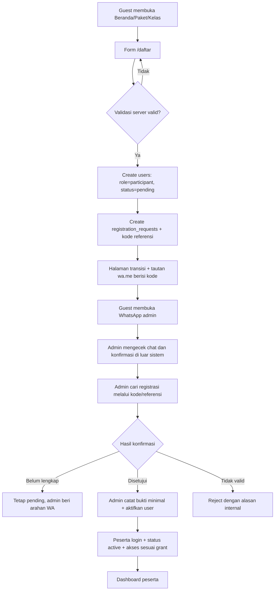
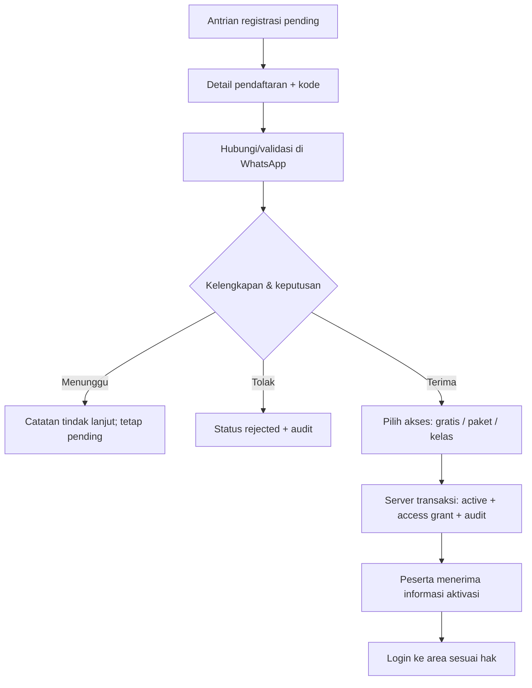
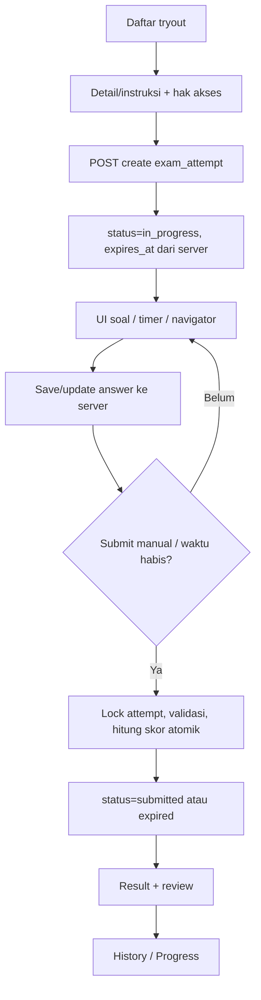
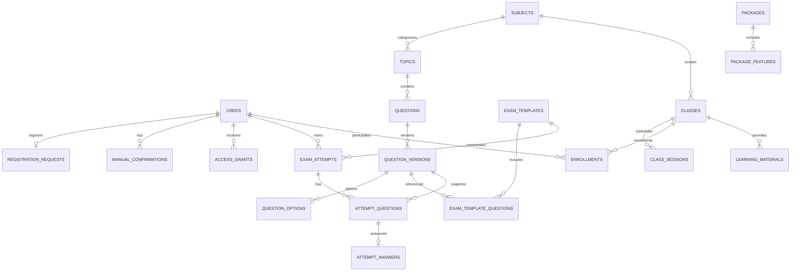

# Siapegawai — Production Implementation Plan (Feature-first + Visual Contract v4)

> **Versi dokumen:** **2.3 / revisi perencanaan disetujui 10 November 2026** (turunan utuh dari v2.2, 8 November 2026; publikasi Git belum terverifikasi)  
> **Tanggal acuan:** 10 November 2026 untuk perubahan v2.3; bagian historis v2.2 tetap menggunakan tanggal 8 November 2026  
> **Tahap:** *Living implementation blueprint*, status **APPROVED — persetujuan perencanaan oleh pemilik produk; Git publication pending**. **Bukti historis v2.2:** patch awal, 31 route, 11 tes/54 assertions dan Vite build PASS pada 8 November 2026 (bukan angka baseline terbaru). **Bukti laporan Git 9 November 2026:** 87 tes/653 assertions dan Vite build PASS pada SHA terlapor `3a15e6e`. Commit `df190d4` telah diverifikasi ada di GitHub, dengan parent `3a15e6e` dan perubahan dokumentasi; **belum terverifikasi sebagai HEAD lokal maupun HEAD remote `main` saat ini**. Tidak ada tes Laravel/MySQL baru yang dijalankan. **Aplikasi belum dapat dinyatakan siap produksi.**  
> **Sumber baseline:** arsip `siapegawai.zip` (prototipe v4), `DOKUMENTASI-SIAPEGAWAI.md`, `Siapegawai_UI_Design_Direction_dan_Quality_Control.md`, dan `pedoman_keamanan_aplikasi_berbasis_risiko.md`  
> **Keputusan pengguna terbaru:** Laravel 13 **bermula dari project kosong dan kini telah menerima patch awal**; MySQL untuk target aplikasi, MariaDB 10.4 pada development saat ini; Tailwind CSS, Yajra DataTables, Tabler Icons; empat jenis aktor; pembayaran di luar aplikasi; registrasi diteruskan ke WhatsApp. **Controller dan views dikelompokkan per fitur, bukan per role; Yajra DataTables dilayani oleh `index()` dan route yang sama dengan halaman Blade.** **Keputusan desain baru:** prototipe v4 mengikat visual enam halaman, layout publik/account/peserta/admin dipisah berdasarkan konteks route, CSS/JS melalui Vite dan CSP, notifikasi memakai pola toast Siapegawai lewat wrapper, dengan Toastr sebagai kandidat library setelah audit security/CSP. Detail ada di `docs/design/DESIGN-SYSTEM-AND-VISUAL-CONTRACT.md`.

## Catatan perubahan v2.3 — disetujui pemilik produk, menunggu publikasi Git

**Dokumen induk ini mempertahankan teks historis v2.2** kecuali koreksi yang dijelaskan secara eksplisit. Revisi 2.3 hanya mengakomodasi: (1) identitas **S7.3 Latihan Kelas / `CLS-PRACTICE`**, menggantikan istilah rancangan **Quiz Kelas / `CLS-QUIZ`**; (2) **Quiz Kilat / `QQ-CORE`** sebagai roadmap baru, bukan scope S7.3; (3) arah **Analisis Kemampuan** lintas domain dengan analisis per domain tetap terpisah; (4) kewajiban **Git completion gate + handover** pada setiap tahap; (5) rekonsiliasi penamaan tahap historis. Detail baru terintegrasi pada §§1.4, 7.6–7.8, 8.7, 10.7, 13.3–13.5, 14.2, 17A–17C, serta lampiran §§18–20.

**Status bukti dan batas revisi:** belum ada perubahan source, migration, installer, Git lokal, database, ataupun deployment. Tidak ada fitur baru yang dianggap terpasang. Rujukan implementasi faktual tetap laporan v1.4 (9 November 2026), laporan Git, dan pemeriksaan source lokal saat eksekusi; plan v2.2 adalah blueprint historis, bukan inventaris pasti schema Laravel v1.4.

**Koreksi tertulis pada dokumen historis:** tabel rencana S3, anotasi halaman ROOT-02, dan security baseline yang menyebut MFA diselaraskan dengan keputusan produk terbaru **login email + password tanpa OTP/MFA**. Ini perubahan *kebijakan rencana*, bukan klaim perubahan kode atau hilangnya risiko keamanan. Wajib menjaga kontrol sesi, rate limit, audit, status akun, dan CSRF.

**Hierarki dan keterlacakan:** untuk kondisi historis dan status nyata gunakan laporan v1.4 + bukti Git/terminal + source pada SHA yang diverifikasi; untuk perilaku produk baru gunakan feedback pemilik 10 November 2026; untuk visual enam halaman gunakan source/screenshot prototipe v4 + kontrak visual; untuk pilihan teknis S7.3 gunakan draft S7.3 *sebagai usulan*, bukan keputusan final. Laporan historis v1.4 **tidak diedit/ditulis ulang**.

### Rekonsiliasi istilah / nomor tahap

| Label lama | Label kini | Perlakuan |
|---|---|---|
| `S7.3 / CLS-QUIZ` (draft 01, report §10.2) | **`S7.3 / CLS-PRACTICE` — Latihan Kelas** | Nama fitur dan work item baru. ID lama dicatat sebagai alias historis untuk tracing; tidak otomatis menjadi nama tabel/class final. |
| `S7.4 / CLS-MON` | `S7.4 / CLS-MON` | Tetap; monitoring hasil Latihan Kelas setelah S7.3. |
| `S7.5 / CLS-MEDIA` | `S7.5 / CLS-MEDIA` | Tetap; materi PDF/video privat tidak masuk S7.3. |
| `S8` pada plan 2.2 | **`REL`**, historis `S8` | Tetap tanggung jawab release readiness, jangan tertukar. |
| `S8 / CAT-ADV` laporan v1.4 | **`CAT-ADV`** (label S8 pada roadmap lanjutan) | Upgrade skor tetap terpisah, tidak mengubah CAT existing tanpa spesifikasi. |
| `S9 / PKG-OPS` | **`PKG-OPS`** (termasuk fondasi entitlement yang diperlukan QQ) | Payment gateway tetap bukan scope otomatis. |
| Baru | **`QQ-SPEC` → `QQ-CORE` → `QQ-ANALYTICS`** | Quiz Kilat terpisah; nomor tahap numerik ditetapkan kemudian. |
| Baru | **`ANL-DOMAIN` → `ANL-UNIFIED`** | Analisis per jenis lebih dahulu; analisis terpadu lanjutan. |

---

## Perubahan v2.2 dan urutan sumber desain

**[KEPUTUSAN BARU — 8 November 2026]:** perubahan ini **melengkapi**, bukan menggantikan scope bisnis v2.1: (a) v4 menjadi visual baseline yang wajib dipertahankan; (b) layout publik dan area login dipisah; (c) demo gratis & katalog contoh tetap publik, tryout anggota & kelas yang diikuti tetap private; (d) CSP frontend diterapkan dengan CSS/JS terpisah dan diuji; (e) Toastr sebagai mekanisme umpan balik aksi dengan satu adapter dan kebutuhan jQuery disadari; (f) visual regression adalah acceptance gate tambahan.

**PENTING:** Dokumen desain terpisah `docs/design/DESIGN-SYSTEM-AND-VISUAL-CONTRACT.md` adalah spesifikasi detail yang mengikat. Jika narasi generik dalam plan lama berkonflik dengan screenshot/source v4, maka **visual v4 + dokumen design contract menang**, dengan perubahan dicatat melalui keputusan desain. Screenshot untuk layout akun/peserta/admin **belum ada** sehingga tidak boleh diklaim sudah disetujui.

## Cara membaca keputusan

- **[SETUJU / input pemilik]**: telah diputuskan dalam diskusi; jangan diganti tanpa keputusan baru.
- **[USULAN implementasi]**: pilihan operasional yang dibuat agar proses coding dapat dimulai; boleh disesuaikan melalui issue/ADR.
- **[BELUM TERSEDIA]**: tidak boleh ditampilkan seolah sudah berfungsi, bisa dibeli, atau terverifikasi.
- **[MVP]**: bagian rilis pertama yang harus benar-benar bekerja; **[LANJUTAN]**: tidak menahan rilis pertama.
- **P0**: menghambat alur nyata atau menyesatkan; **P1**: penting bagi alur utama; **P2**: penyempurnaan.

Dokumen ini **menggantikan prioritas dan cakupan plan pertama**, khususnya mengenai role dan pembayaran. Detail keamanan pada plan sebelumnya tetap dapat dibaca sebagai referensi, tetapi **fitur dan alur pengguna di dokumen ini menjadi sumber kebenaran pengerjaan MVP**.

---

## 1. Definisi produk dan batas MVP

**Siapegawai** adalah platform belajar persiapan CPNS independen untuk mencoba latihan, mempelajari pembahasan, melihat progres, dan mengakses kelas/materi jika tersedia. Prinsip brand tetap **Credible, Calm, Purposeful**; desain **editorial untuk pengenalan, fungsional untuk kegiatan belajar**. Tidak ada klaim berafiliasi dengan BKN atau menjamin kelulusan.

### 1.1 Kondisi v4 yang benar-benar ada

| Area prototipe | Implementasi pada arsip v4 | Keputusan untuk Laravel |
|---|---|---|
| Beranda | Hero, CTA, brand assets Nara/Bima/Laras, teaser soal | Halaman Blade publik, CMS ringan untuk konten tertentu |
| Latihan SKD | 9 soal demo (3 TWK, 3 TIU, 3 TKP), timer **12 menit**, jawaban, tandai ragu, hasil/pembahasan | Dua mode: **demo publik** tanpa riwayat akun + **tryout peserta** tersimpan server |
| Bank Soal | 12 soal contoh: 9 SKD dan 3 SKB umum, kategori, search, disclosure pembahasan | Katalog publik contoh + katalog peserta terkurasi dengan pagination |
| Progres Saya | Riwayat `localStorage` browser, tidak terhubung server | Dashboard/riwayat `exam_attempts` per pengguna, bukan bergantung localStorage |
| Kelas | Draft silabus SKD/SKB; **bukan kelas aktif** | Halaman publik status, daftar kelas berstatus aktif jika admin menerbitkan; konten peserta setelah diberi akses |
| Paket | Gratis sebagai arah produk; opsi berbayar masih konsep | Halaman publik paket **berstatus**; akses diaktifkan admin setelah konfirmasi WhatsApp; **tanpa checkout** |
| Autentikasi / admin | Belum ada | Dibangun dari nol di project Laravel yang sudah dibuat |

**Bukan migrasi satu file HTML ke Blade.** Prototipe dijadikan referensi visual/behavior; data, route, validasi, state, hak akses, dan business logic dikelola Laravel.

### 1.2 Definisi “siap pakai” untuk rilis pertama (MVP)

MVP dianggap operasional bila: Guest memahami layanan, bisa mencoba demo, dapat registrasi dan tersambung WhatsApp; Admin Operasional melihat registrasi dan melakukan aktivasi manual; akun Peserta aktif bisa login, mengikuti tryout dan melihat hasil/progres pribadi; admin bisa mengelola bank soal, paket, kelas, serta hak akses; Superadmin mengelola akun admin dan pengaturan sistem; hasil nyata tersimpan di database; fitur yang belum aktif diberi status jelas. Pengujian dan backup dasar harus lulus.

**Tidak masuk MVP:** pembayaran otomatis, invoice resmi, gateway/webhook, AI pembuat soal, leaderboard nasional, forum peserta, role Tutor/Editor, Zoom API, integrasi CAT BKN, aplikasi mobile native, aplikasi multi-tenant, dan marketplace soal. Tidak membuat halaman/tombol mati untuk fitur ini.

### 1.3 Yang perlu diputuskan sebelum mengiklankan layanan berbayar

Harga, isi paket, masa berlaku akses, jenis kelas, silabus final, SOP konfirmasi pembayaran di WhatsApp, nomor WhatsApp resmi, syarat/ketentuan, kebijakan privasi, dan mekanisme bantuan peserta. Data demo prototipe **bukan** soal produksi otomatis: wajib review substansi.

---

### 1.4 Empat produk belajar/evaluasi — keputusan produk 10 November 2026

| Domain | Tujuan | Waktu dan feedback | Konteks penyimpanan dan analisis | Status 10 Nov 2026 |
|---|---|---|---|---|
| **CAT/Tryout** | Simulasi pengerjaan ujian | Deadline per sesi; hasil/pembahasan sesuai engine saat ini | Riwayat dan analisis CAT sendiri | **Sudah diimplementasikan** pada laporan v1.4, tanpa klaim skor resmi CPNS |
| **Latihan Kelas (Class Practice)** | Evaluasi terkait kelas/materi | Durasi untuk keseluruhan sesi, jawaban dan pembahasan setelah selesai | Attempts dan hasil **terpisah dari CAT**, izin enrollment kelas | **S7.3 PLANNED**, nama disetujui, pilihan teknis detail masih terbuka |
| **Quiz Kilat (Quick Quiz)** | Kecepatan memahami soal, mengambil keputusan, lalu mengevaluasi — **“Do First, Then Evaluate to Be Better.”** | **Timer individual per soal**, jawaban terkunci, feedback langsung **tetap 3 detik**, review lengkap setelah selesai | Attempts, respons per soal, quota, analisis sendiri; tidak dicampur skor CAT | **ROADMAP BARU**, tidak termasuk S7.3 |
| **Analisis Kemampuan** | Menilai capaian sesuai karakter domain; jangka panjang analisis lintas modul | Bukan mode pengerjaan | Pisahkan metrik per domain; integrasi bertahap tanpa meratakan skor berbeda | Analisis CAT ada secara awal; analisis QQ dan terpadu masih PLANNED |

Tidak ada generator soal otomatis QQ, tidak ada mode peserta merakit quiz, tidak ada perubahan ke login atau engine CAT hanya untuk mendukung fitur baru. Detail teknis QQ (schema, route, timer-server, range detik, pemotongan kuota) diputuskan pada gate `QQ-SPEC`, bukan ditetapkan oleh dokumen ini.

---

## 2. Tech stack dan batas implementasi

| Komponen | Keputusan | Catatan implementasi |
|---|---|---|
| Backend | **Laravel 13** [SETUJU] | Mulai dari project kosong yang sudah ada; **jangan** `composer create-project` lagi |
| PHP | PHP **8.3+** sesuai Laravel 13 | Pin versi PHP dan composer lock |
| DB target | **MySQL** [SETUJU] | Migration kompatibel MySQL/MariaDB; InnoDB, `utf8mb4`, UTC pada timestamp |
| DB lokal saat ini | **MariaDB 10.4** [SETUJU] | Bisa untuk pengembangan awal, tetapi EOL; jadwalkan upgrade. Jalankan migrasi/tes pada MySQL target sebelum rilis |
| Templating | **Blade** | SSR untuk beranda, auth, katalog, dashboard; alur ujian interaktif dengan JS terpisah |
| CSS | **Tailwind CSS + Vite** [SETUJU] | Design tokens Siapegawai; jangan menyebarkan class acak tanpa sistem |
| Tabel admin | **Yajra DataTables v13** [SETUJU] | Gunakan server-side untuk list besar; bukan untuk setiap tabel peserta |
| Ikon | **Tabler Icons** [SETUJU] | SVG lokal dari paket resmi, ukuran/stroke konsisten, tanpa CDN wajib |
| JS | Vanilla ES modules sebagai default | Per halaman via Vite; DataTables.js dan adapter Toastr sesuai kebutuhan. Tidak ada JS custom inline |
| Autentikasi | Laravel session web + fasilitas auth Laravel | Jangan simpan access token di `localStorage`; tidak butuh JWT untuk MVP same-origin |
| Email | Driver mail Laravel; provider SMTP saat production | Verifikasi email direkomendasikan; aktivasi oleh admin **terpisah** dari verifikasi email |
| File | Storage Laravel, public assets dan materi privat dipisahkan | Tampilkan hanya file dengan policy izin yang sesuai |
| Notifikasi UI | **Kandidat: Toastr 2.1.4 + jQuery; dibundle melalui Vite hanya jika audit security/CSP lulus** [KEPUTUSAN BARU / implementasi diusulkan] | Toastr klasik membutuhkan jQuery dan default `escapeHtml: false` memiliki laporan XSS; gunakan `escapeHtml: true`, wrapper `notify`, CSS override, audit ketergantungan sebelum dipasang. Tidak boleh CDN |
| Layout | **Public / Account / Participant Workspace / Admin Workspace** [KEPUTUSAN BARU] | Shared design tokens, shell berbeda berdasarkan route; controller dan views tetap feature-first |
| Cache/Queue | Driver database terlebih dahulu | Redis opsional setelah kebutuhan operasional terukur |

**Kompatibilitas:** Laravel 13 mendukung MariaDB 10.3+ pada dokumentasi framework, tetapi MariaDB 10.4 mencapai akhir pemeliharaan Juni 2024. Hindari fitur SQL khusus MySQL 8 yang membuat migrasi MariaDB lokal gagal, namun **jangan menurunkan keamanan produksi** agar mengikuti database lama. Yajra DataTables 13 tersedia untuk Laravel 13/PHP 8.3+. Lihat rujukan resmi di bagian akhir.

**Pilihan arsitektur:** *modular monolith* yang pragmatis. Satu Laravel app, **controller, Form Request, JS, dan Blade dikelompokkan per fitur**; otorisasi tetap di route/middleware/Policy, bukan dibentuk dengan membuat folder controller per role. Tidak membuat microservice atau SPA/API terpisah tanpa kebutuhan nyata.

---

## 3. Aktor, status akun, dan matriks akses

### 3.1 Empat aktor saja

1. **Guest**: belum login; **bukan** record role pada `users`.
2. **Peserta**: akun publik yang mendaftar; dapat berstatus pending/active/suspended/rejected, tetapi **role-nya tetap Peserta**.
3. **Admin Operasional**: mengelola kegiatan sehari-hari (registrasi, verifikasi manual, konten, soal, kelas, paket, akses peserta).
4. **Superadmin**: mengelola Admin Operasional, pengaturan sistem, audit dan tindakan sensitif. Dapat mengakses fungsi operasional saat diperlukan.

**Tidak ada role lain di MVP**, termasuk Tutor, Editor, Reviewer, Finance, Customer Support. Tugas review soal dan konfirmasi akses ditangani Admin Operasional dengan jejak audit. Pemisahan tugas bisa diusulkan pada versi berikutnya, tetapi tidak boleh diam-diam ditambahkan sekarang.

### 3.2 Status tidak sama dengan role

`users.role = participant|operational_admin|superadmin` (atau `user_roles` yang ekuivalen). `users.status = pending|active|suspended|rejected`. Guest tidak tersimpan. `email_verified_at` dan `activated_at` adalah atribut **terpisah** dari status; `package_access` dan `class_enrollment` juga terpisah. Peserta yang telah mengisi formulir tetapi masih `pending` **belum memperoleh akses area berbayar/tryout peserta**, hanya halaman status pendaftaran dan fitur publik.

| Fitur / izin | Guest | Peserta pending | Peserta aktif | Admin Operasional | Superadmin |
|---|:---:|:---:|:---:|:---:|:---:|
| Beranda, kelas, paket, artikel publik | ✓ | ✓ | ✓ | ✓ | ✓ |
| Demo SKD 9 soal / bank soal publik | ✓ | ✓ | ✓ | ✓ | ✓ |
| Registrasi akun | ✓ | — | — | — | — |
| Login / logout | ✓ | ✓ | ✓ | ✓ | ✓ |
| Status pendaftaran & tombol WA ulang | — | ✓ (milik sendiri) | Riwayat status | — | — |
| Dashboard peserta dan progres server | — | — | ✓ | —* | —* |
| Tryout anggota & hasil milik sendiri | — | — | ✓ jika akses sesuai | —* | —* |
| Materi/kelas khusus | — | — | ✓ bila hak akses diberikan | Sesuai tugas | Sesuai tugas |
| Daftar registrasi, setujui/tolak, suspend peserta | — | — | — | ✓ | ✓ |
| CRUD kategori/topik/soal/tryout/silabus/paket | — | — | — | ✓ | ✓ |
| Grant/revoke akses peserta secara manual | — | — | — | ✓, wajib alasan | ✓, wajib alasan |
| Kelola akun Admin Operasional | — | — | — | — | ✓ |
| Ubah nomor WA, branding/settings penting | — | — | — | — | ✓ |
| Audit log dan konfigurasi keamanan | — | — | — | Terbatas pada prosesnya | ✓ |

`*` Admin tidak membuka hasil pribadi menggunakan halaman peserta biasa; jika perlu dukungan, akses terbatas melalui tampilan administrasi dengan kebutuhan jelas dan audit.

### 3.3 Status & hak akses yang tepat

- `pending`: akun berhasil dibuat, peserta diarahkan ke WA; login boleh masuk halaman **Menunggu aktivasi**, bukan dashboard penuh.
- `active`: identitas/registrasi dikonfirmasi, mendapat akses fitur sesuai `access_grants` dan `enrollments`.
- `suspended`: login dapat dibatasi atau hanya melihat info akun ditangguhkan; tidak bisa melakukan tryout baru.
- `rejected`: pendaftaran ditolak dengan alasan internal; informasi publik tidak boleh membocorkan alasan sensitif.
- Penonaktifan/aktivasi harus tercatat: aktor, waktu, sumber konfirmasi, alasan, perubahan sebelumnya→sesudahnya.
- **[USULAN]** Verifikasi email menjadi prasyarat akses penuh bila mail production tersedia. Status aktif tetap **diputuskan admin**, bukan otomatis karena user telah klik tautan email/WA.

---

## 4. Sitemap final dan inventaris halaman (per route)

### 4.1 Navigasi dan kelompok area

```text
Siapegawai
├── PUBLIK (Guest dan pengguna login)
│   ├── Beranda
│   ├── Latihan SKD gratis (demo 9 soal)
│   ├── Bank soal contoh + pembahasan
│   ├── Kelas (katalog & status)
│   ├── Paket (katalog & status)
│   ├── Tentang / FAQ / Kontak WhatsApp
│   └── Syarat layanan + Privasi
├── AKUN
│   ├── Daftar → WhatsApp admin
│   ├── Login / lupa password / reset password
│   ├── Verifikasi email (jika diaktifkan)
│   └── Status aktivasi / kontak admin
├── PESERTA AKTIF
│   ├── Dashboard
│   ├── Daftar tryout
│   ├── Instruksi → pengerjaan → konfirmasi → hasil
│   ├── Riwayat / Progres
│   ├── Bank soal anggota / pembahasan
│   ├── Kelas saya / materi
│   └── Profil / keamanan akun
├── ADMIN OPERASIONAL
│   ├── Dashboard operasional
│   ├── Registrasi & aktivasi
│   ├── Peserta & pemberian akses
│   ├── Kategori / topik / bank soal
│   ├── Paket tryout / susunan soal / publikasi
│   ├── Kelas / materi / enrollment
│   ├── Katalog paket & status
│   └── Log tindakan operasional (terbatas)
└── SUPERADMIN
    ├── Dashboard sistem
    ├── Akun admin operasional
    ├── Konfigurasi WhatsApp & identitas produk
    ├── Pengaturan akses dan batasan aplikasi
    └── Audit penuh / status sistem
```

**Visual contract v4 tetap wajib dipertahankan ketika hash routing dihapus dan diganti Laravel SSR.**

**Tidak lagi satu `index.html` yang mengganti isi dengan hash route.** Di Laravel, setiap halaman penting memiliki URL bernama, method di **controller fitur yang relevan**, Blade view fitur, Form Request dan Policy sesuai konteks. **Role menentukan izin akses, bukan pemisahan direktori controller/view.** Elemen UI bersama melalui `layouts` dan `components`.

### 4.2 Tabel URL dan akses publik

| ID | Route GET utama (usulan) | Halaman | Akses | Keterangan |
|---|---|---|---|---|
| PUB-01 | `/` | Beranda | Publik | Hero, manfaat yang benar-benar ada, preview nyata, CTA demo |
| PUB-02 | `/latihan-gratis` | Pengantar demo SKD | Publik | 9 soal, 12 menit, rubrik contoh, mulai |
| PUB-03 | `/latihan-gratis/kerjakan` | Pengerjaan demo | Publik | Tidak menyimpan progres akun; JS state untuk sesi halaman |
| PUB-04 | `/latihan-gratis/hasil` | Hasil demo | Publik / hanya state demo saat ini | Hasil contoh dan pembahasan, tidak dapat ditautkan sebagai data pribadi |
| PUB-05 | `/bank-soal` | Bank soal publik | Publik | Soal sample, search/filter, pembahasan |
| PUB-06 | `/kelas` | Katalog kelas | Publik | Status `planned`/`open`/`closed` yang sesuai DB |
| PUB-07 | `/kelas/{slug}` | Detail kelas | Publik | Silabus, penyelenggaraan, status pendaftaran; tanpa tombol palsu |
| PUB-08 | `/paket` | Katalog paket | Publik | Gratis/berbayar/manual, fitur & durasi, CTA WhatsApp bila nyata |
| PUB-09 | `/tentang` | Tentang & FAQ | Publik | Identitas produk, independen dari BKN |
| PUB-10 | `/kontak` | Kontak | Publik | Tombol ke WA resmi, jam layanan jika terkonfirmasi |
| PUB-11 | `/privasi` | Kebijakan privasi | Publik | Harus berisi kebijakan nyata sebelum menerima data |
| PUB-12 | `/syarat-layanan` | Syarat layanan | Publik | Aktivasi manual, akses, bantuan, pembatalan sesuai bisnis |

`/latihan-gratis/hasil`: hasil demo dapat dirender dari `session()` singkat di server atau state JS selama tab aktif, tanpa membuat URL berbasis ID anonim yang membuka data orang lain. **[USULAN]** Jika tidak ingin menyimpan hasil demo di server, tampilkan hasil pada route pengerjaan yang sama sebagai state view; route PUB-04 menjadi konseptual, bukan kewajiban endpoint mandiri.

### 4.3 Tabel route akun dan peserta

| ID | Route GET utama | Halaman | Akses | Hasil tugas |
|---|---|---|---|---|
| AUTH-01 | `/daftar` | Registrasi | Guest | POST buat akun `pending` + nomor referensi |
| AUTH-02 | `/pendaftaran/lanjut-whatsapp` | Transisi/fallback WhatsApp | Baru daftar / pending | Arahan jelas + tombol buka WA dan nomor referensi |
| AUTH-03 | `/login` | Masuk | Guest | Redirect berdasarkan role dan status |
| AUTH-04 | `/lupa-password` | Minta reset | Guest | Email reset dengan respons aman |
| AUTH-05 | `/reset-password/{token}` | Reset kata sandi | Pemegang token | Ganti password dan invalidasi sesi sesuai kebijakan |
| AUTH-06 | `/verifikasi-email` | Instruksi verifikasi email | Login belum verifikasi | Kirim ulang secara terbatas |
| AUTH-07 | `/aktivasi` | Menunggu aktivasi | Peserta pending | Status, referensi, buka WA ulang |
| STU-01 | `/dashboard` | Dashboard peserta | Peserta aktif | Ringkasan latihan terakhir, akses tersedia, langkah berikutnya |
| STU-02 | `/tryout` | Daftar tryout anggota | Peserta aktif | Filter kategori/status, hanya tryout berhak akses |
| STU-03 | `/tryout/{slug}` | Detail & instruksi tryout | Peserta aktif + berhak | Durasi, soal, rubrik, batas percobaan, mulai |
| STU-04 | `/tryout/sesi/{attempt}` | Pengerjaan CAT | Pemilik attempt | Jawab, autosave, tandai ragu, timer, submit |
| STU-05 | `/tryout/sesi/{attempt}/hasil` | Hasil dan pembahasan | Pemilik attempt | Skor internal, breakdown, review |
| STU-06 | `/progres` | Riwayat dan perkembangan | Peserta aktif | List attempts, filter, ringkasan, reset? (tidak menghapus hasil resmi sembarang) |
| STU-07 | `/bank-soal-saya` | Bank soal anggota | Peserta aktif + akses | Pencarian, materi, pembahasan terbatas sesuai hak |
| STU-08 | `/kelas-saya` | Daftar kelas yang diikuti | Peserta aktif | Materi yang benar-benar diberikan |
| STU-09 | `/kelas-saya/{enrollment}` | Detail kelas peserta | Pemilik enrollment | Modul, jadwal, tautan pertemuan jika tersedia |
| STU-10 | `/profil` | Profil dan pengaturan akun | Login | Data dasar, password, email; akun pending boleh akses terbatas |

**Semua route anggota dilakukan policy authorization pada resource**, bukan hanya middleware `auth`.

### 4.4 Tabel route admin

| ID | Route GET utama | Halaman | Role | Tindakan utama |
|---|---|---|---|---|
| ADM-01 | `/admin` | Dashboard operasional | Operasional/Superadmin | Antrian registrasi, soal draft, tryout aktif, kelas |
| ADM-02 | `/admin/registrasi` | DataTable registrasi | Operasional/Superadmin | Filter `pending/active/rejected`, cari, buka detail |
| ADM-03 | `/admin/registrasi/{user}` | Detail registrasi | Operasional/Superadmin | Periksa data terbatas, buka kontak WA, catat konfirmasi manual, approve/reject |
| ADM-04 | `/admin/peserta` | DataTable peserta | Operasional/Superadmin | Cari peserta, status akun, akses |
| ADM-05 | `/admin/peserta/{user}` | Detail peserta | Operasional/Superadmin | Suspend/reactivate, grant/revoke paket, kelas |
| ADM-06 | `/admin/kategori` | DataTable kategori/topik | Operasional/Superadmin | CRUD TWK/TIU/TKP/SKB/formasi jika tersedia |
| ADM-07 | `/admin/soal` | DataTable bank soal | Operasional/Superadmin | Search, draft, review substansi, publish, archive |
| ADM-08 | `/admin/soal/buat` | Form soal | Operasional/Superadmin | Pertanyaan, pilihan, kunci/bobot, pembahasan, validasi |
| ADM-09 | `/admin/soal/{question}/edit` | Form edit/versioning | Operasional/Superadmin | Revisi terkendali, jangan ubah history tryout |
| ADM-10 | `/admin/tryout` | DataTable tryout | Operasional/Superadmin | Buat/susun/publish/unpublish |
| ADM-11 | `/admin/tryout/buat` | Form tryout | Operasional/Superadmin | Nama, kategori, waktu, soal, batas percobaan, status |
| ADM-12 | `/admin/tryout/{exam}/edit` | Susunan soal | Operasional/Superadmin | Atur soal/urutan, review jumlah dan rubrik |
| ADM-13 | `/admin/kelas` | DataTable kelas | Operasional/Superadmin | CRUD status kelas, silabus, kapasitas |
| ADM-14 | `/admin/kelas/{class}/edit` | Detail/form kelas | Operasional/Superadmin | Jadwal, materi, enrollment dan akses |
| ADM-15 | `/admin/paket` | DataTable paket | Operasional/Superadmin | Nama, manfaat, harga **jika final**, status dan durasi |
| ADM-16 | `/admin/akses` | DataTable grant/aktivasi akses | Operasional/Superadmin | Riwayat grant manual & pencabutan (audit) |
| ADM-17 | `/admin/log-aktivitas` | Log operasional terbatas | Operasional/Superadmin | Telusuri keputusan registrasi, publikasi konten, grant |
| ROOT-01 | `/superadmin` | Dashboard sistem | Superadmin | Kesehatan sistem, ringkasan audit |
| ROOT-02 | `/superadmin/admin` | DataTable akun admin | Superadmin | Buat/nonaktifkan akun admin operasional |
| ROOT-03 | `/superadmin/pengaturan` | Pengaturan sistem | Superadmin | Nomor WA, template pesan, branding, peraturan akses |
| ROOT-04 | `/superadmin/audit` | Audit penuh | Superadmin | Tindakan kritis dan inspeksi metadata terproteksi |

**Catatan khusus Yajra:** hanya daftar administrasi yang perlu DataTables AJAX server-side. **Tidak ada route `/admin/.../data` dan tidak ada `app/DataTables/` khusus pada rancangan default.** `index()` di controller fitur mengembalikan HTML untuk request halaman dan JSON Yajra untuk request AJAX pada URL yang sama. CRUD lain tetap method di controller fitur yang sama; tabel publik dan progres peserta gunakan pagination Blade biasa bila lebih ringan. Routing tetap dikelompokkan menurut **otorisasi/URL** (`/admin`, `/superadmin`) tanpa mensyaratkan namespace controller berdasarkan role.

---

### 4.5 Shell/layout berdasarkan konteks route [KEPUTUSAN BARU]

| Konteks | Route contoh | Shell yang wajib |
|---|---|---|
| Guest/public catalog & demo | `/`, `/latihan-gratis*`, `/bank-soal`, `/kelas`, `/kelas/{slug}`, `/paket`, halaman informasi | `layouts/public.blade.php` — header/footer v4, editorial sesuai halaman |
| Autentikasi & status pendaftaran | `/login`, `/daftar`, `/lupa-password`, `/reset-password/*`, `/aktivasi`, `/pendaftaran/lanjut-whatsapp` | `layouts/account.blade.php` — form/status, tanpa hero atau footer marketing |
| Peserta aktif/fitur member | `/dashboard`, `/tryout*`, `/progres`, `/bank-soal-saya`, `/kelas-saya*`, `/profil` | `layouts/workspace.blade.php` — menu tugas peserta. CAT dapat memakai varian *focus* tanpa footer |
| Admin & Superadmin | `/admin*`, `/superadmin*` | `layouts/admin.blade.php` — menu data-first sesuai izin, **bukan** public header/hero |

**Tegas:** Shell dipilih berdasarkan **route + kebutuhan tugas**, bukan otomatis dari `auth()->check()` pada semua halaman; orang login yang berkunjung ke `/paket` masih membaca katalog publik. Katalog `/kelas` dapat dilihat Guest, sedangkan enrollment/materi `/kelas-saya*` private. `/latihan-gratis*` tetap Guest, **berbeda dari `/tryout/sesi/{attempt}` yang butuh auth dan ownership**. Guest tidak mengakses `/progres` DB milik peserta. Semua keamanan tetap pada middleware/Policy; shell hanya menampilkan navigasi yang sesuai.

**View dan controller tetap per fitur**, bukan `Controllers/Admin/...` vs `Controllers/Participant/...`. Layout boleh dibedakan karena ini *presentation shell*, bukan struktur business logic.

---

## 5. Spesifikasi halaman: tujuan, komponen, state, dan ilustrasi

Prinsip: **satu halaman = satu tugas utama**; UI harus menjelaskan status data kosong/error/loading, bukan hanya *happy path*. Ilustrasi diinventarisasi **per halaman**, tanpa menambahkan gambar hanya untuk mengisi ruang.

### 5.1 Halaman PUBLIK

| Halaman | Tugas pengguna & isi layar | CTA utama / keluaran | State wajib | Ilustrasi |
|---|---|---|---|---|
| PUB-01 Beranda | Headline “Belajar CPNS, dengan arah yang jelas.”, nilai produk, preview soal **nyata**, tiga langkah belajar, jalur SKD/SKB, status kelas/paket | `Coba latihan SKD` → PUB-02; `Lihat bank soal` | Konten normal, gagal memuat preview | **ILL-PUB-01:** gunakan grup karakter existing; alternatif placeholder bila komposisi belum cocok |
| PUB-02 Latihan gratis | `9 soal / 12 menit / TWK TIU TKP`, keterangan skor internal contoh dan tanpa akun | `Mulai latihan` → PUB-03 | Normal, belum tersedia/maintenance | **Tidak perlu**; fungsi lebih penting |
| PUB-03 Mengerjakan | Satu soal, opsi radio, timer, navigasi 1–9, ragu, jumlah dijawab, submit | Kumpulkan → konfirmasi → PUB-04 | Dipilih, belum dijawab, flagged, submit belum lengkap, timeout | **Tidak perlu** |
| PUB-04 Hasil demo | Jumlah benar dari 9, rincian per kategori, pembahasan, CTA latihan ulang | `Ulangi` / `Lihat bank soal` | Hasil tersedia, state hilang saat tab/session selesai | **Tidak perlu** |
| PUB-05 Bank soal publik | Search, kategori, jumlah hasil dinamis, daftar, disclosure pembahasan | `Lihat pembahasan`, `Reset filter` | Loading, no results, gagal memuat, pagination | **Tidak perlu** |
| PUB-06 Kelas | Kartu/list status kelas, silabus ringkas, label `Rencana`/`Dibuka`/`Ditutup` | `Lihat detail` | Tidak ada kelas aktif, hanya rencana | **ILL-PUB-06** opsional untuk cerita kegiatan belajar; bukan foto tutor fiktif |
| PUB-07 Detail kelas | Tujuan, untuk siapa, materi, jadwal yang sudah terkonfirmasi, cara akses | `Hubungi WhatsApp` bila kelas aktif; status rencana tanpa CTA daftar | Rencana, aktif, penuh, selesai | **ILL-PUB-07** hanya bila ada foto/ilustrasi kelas yang sah |
| PUB-08 Paket | Tabel perbandingan manfaat/masa akses dan cara aktivasi, status harga | `Daftar akun` atau `Tanya via WA`; tidak ada `Bayar` | Gratis/aktif/direncanakan/harga belum final | **Tidak perlu** |
| PUB-09 Tentang/FAQ | Produk independen, ruang lingkup, mekanisme verifikasi manual, FAQ | `Hubungi admin` | Normal | **ILL-PUB-09** opsional identitas brand |
| PUB-10 Kontak | Nomor/tombol WA resmi, info kontak terverifikasi, jam layanan jika ada | `Chat via WhatsApp` → `wa.me` | WA belum dikonfigurasi → tampilkan bantuan alternatif; jangan tautan kosong | **Tidak perlu** |
| PUB-11 Privasi | Data pendaftaran, tujuan penggunaan, pihak ketiga WA, retensi, hak pengguna | Link ke kebijakan/permintaan data jika prosesnya nyata | Dokumen belum disahkan → **blokir publikasi form registrasi** | **Tidak perlu** |
| PUB-12 Syarat layanan | Alur aktivasi, aturan penggunaan, refund/pembatalan jika ada transaksi manual | Baca, kembali daftar | Isi final belum disahkan → blokir promosi komersial | **Tidak perlu** |

### 5.2 Halaman AKUN & PESERTA

| Halaman | Tugas pengguna & komponen | CTA utama / keluaran | State wajib | Ilustrasi |
|---|---|---|---|---|
| AUTH-01 Daftar | Nama, email, nomor WA, password + konfirmasi, persetujuan privasi; jangan minta NIK | `Daftar & lanjut WhatsApp` → buat akun pending & referensi | Validasi field, email sudah dipakai, rate-limit, sukses | **ILL-AUTH-01** opsional karakter kecil di panel samping desktop; mobile disembunyikan |
| AUTH-02 Lanjut WA | Referensi pendaftaran, penjelasan pesan WA **belum otomatis terkirim**, tombol buka WA & salin referensi | `Buka WhatsApp` | WhatsApp tidak terpasang, popup diblokir, nomor admin belum aktif | **Tidak perlu** |
| AUTH-03 Login | Email/password, lupa password, bantuan akun pending | Masuk → `/aktivasi` atau `/dashboard` atau area admin sesuai role | Salah data generik, locked/rate-limit, email unverified | **Tidak perlu** |
| AUTH-04/05 Reset password | Form email dan password baru sesuai signed/reset token | Kirim email, ubah password | Kadaluarsa, dikirim ulang, notifikasi berhasil | **Tidak perlu** |
| AUTH-06 Verifikasi email | Pesan, tombol kirim ulang, kapan diperlukan | Verifikasi email | Sudah/belum, throttled, expired | **Tidak perlu** |
| AUTH-07 Aktivasi pending | Label `Menunggu konfirmasi admin`, nomor referensi, langkah WA, status terakhir | `Lanjutkan via WhatsApp` | Pending, rejected, suspended; tanpa menampilkan data sensitif | **Tidak perlu** |
| STU-01 Dashboard | Sambutan, status akses, sesi terakhir, materi relevan, CTA ke tryout | `Lanjutkan latihan`/`Pilih tryout` | Belum ada aktivitas, akses belum diberikan, error ringan | **Tidak perlu** |
| STU-02 Daftar tryout | List berdasarkan kategori, durasi, jumlah soal, batas dan kuota percobaan | `Lihat detail tryout` | Kosong, sudah pernah, belum berhak | **Tidak perlu** |
| STU-03 Detail tryout | Instruksi, aturan timer/scoring, jumlah soal, batas attempt, akses | `Mulai tryout` → POST create attempt | Tidak berhak, kuota habis, belum terbit | **Tidak perlu** |
| STU-04 Sesi CAT | Timer berdasar expiry server, option, navigasi, autosave, ragu, submit | `Kumpulkan jawaban` → konfirmasi/hasil | Saving/saved/offline, expired, double submit, unauthorized | **Tidak perlu** |
| STU-05 Hasil | Total benar/skor internal, per materi, review jawaban & pembahasan | `Latihan lagi`/`Lihat progres` | Belum submitted, hasil belum tersedia, tidak punya akses | **Tidak perlu** |
| STU-06 Progres | Grafik sederhana **data nyata**, list riwayat, tanggal, kategori, link hasil | `Lihat hasil` | Empty state, filter tanpa hasil, data history | **Tidak perlu** |
| STU-07 Bank soal anggota | Search/filter materi, status akses, disclosure pembahasan sesuai paket | `Pelajari pembahasan` | Tidak punya akses, no results, loading | **Tidak perlu** |
| STU-08/09 Kelas saya | Daftar kelas aktif/enrolled, modul, jadwal, tautan resmi jika ada | `Buka materi`/`Lihat jadwal` | Belum terdaftar, kelas selesai, jadwal belum tersedia | **ILL-STU-08** hanya untuk empty state opsional |
| STU-10 Profil | Nama, WA, email, keamanan akun, logout | `Simpan perubahan` | Validasi, step-up password untuk perubahan sensitif, sukses/gagal | **Tidak perlu** |

### 5.3 Halaman ADMIN & SUPERADMIN

| Halaman | Kebutuhan UI | CTA penting & batasan | Ilustrasi |
|---|---|---|---|
| ADM-01 / ROOT-01 dashboard | Ringkasan **berdasarkan query nyata**, antrian pending, error operasional | Aksi cepat ke tugas administratif; jangan pakai KPI dummy | Tidak perlu |
| ADM-02/03 registrasi | DataTable filter pending, detail referensi, nomor WA, waktu, audit | `Setujui`/`Tolak` dengan dialog konfirmasi, catatan wajib, status transisi atomik | Tidak perlu |
| ADM-04/05 peserta | DataTable, detail akun, grant akses kelas/paket, suspend, alasan | Jangan mengubah status/akses berdasarkan input dari client saja | Tidak perlu |
| ADM-06 kategori | Tabel kategori, form tambah/edit, status aktif | Atur TWK/TIU/TKP, topik SKB; referensi tak boleh dihapus paksa | Tidak perlu |
| ADM-07/08/09 soal | DataTable soal, form pilihan dan kunci, pembahasan, status review dan versi | Publikasi wajib validasi key/opsi, pembahasan, kategori | Tidak perlu |
| ADM-10/11/12 tryout | Tabel, form, daftar soal, susunan/rubrik, preview | Publish hanya jika jumlah, durasi, versi soal lengkap | Tidak perlu |
| ADM-13/14 kelas | DataTable kelas, silabus, status, enrolment/manual access | Tidak publikasikan jadwal atau foto tutor tanpa konfirmasi | **ILL-ADM-14** tidak disarankan, form butuh ruang kerja |
| ADM-15 paket | Tabel status paket, benefit, harga jika final, masa akses | Tidak membuat order/checkout; paket `draft` tidak terlihat sebagai aktif | Tidak perlu |
| ADM-16 akses | Tabel grant kelas/paket/tryout dan audit konfirmasi eksternal | Grant/revoke memerlukan referensi sumber, actor, waktu, alasan | Tidak perlu |
| ADM-17 log | DataTable filter tindakan dan waktu | Read-only; tidak bisa mengubah audit | Tidak perlu |
| ROOT-02 admin | DataTable akun Admin Operasional, form buat/deactivate/reset | Tidak bisa dibuat dari registrasi publik; login email/password dan kontrol sesi/audit tanpa MFA sesuai keputusan produk saat ini | Tidak perlu |
| ROOT-03 pengaturan | Form nomor WhatsApp, template chat, identitas brand, konfigurasi fitur | Mask sebagian rahasia; validasi nomor & izin superadmin | Tidak perlu |
| ROOT-04 audit | Filter audit perubahan role/status, log error non-PII dan anomaly | Read-only, akses tercatat | Tidak perlu |

**Catatan desain:** halaman admin berbasis tabel/form **di shell workspace admin sendiri**, bukan layout kartu identik seperti marketing. Komponen tombol, input, toast, empty state, dialog dan ikon tetap memakai design tokens yang sama agar identitas produk menyatu.

---

## 6. Standar placeholder ilustrasi **per halaman**

### 6.1 Aturan sebelum desain diimplementasikan

1. **Gunakan aset brand yang sudah ada**: `logo-navy.svg`, `logo-white.svg`, `logo-accent.svg`, `group-khaki.webp`, `group-korpri.webp`, `group-white.webp`. Nama file dari prototipe adalah referensi saat migrasi; di Laravel pindahkan ke `public/assets/brand/` secara selektif.
2. Jika suatu halaman butuh ilustrasi yang belum tersedia, **jangan generate gambar otomatis**. Tampilkan **kotak border dengan dua garis diagonal** (model wireframe) dan catatan `ILL-XXX`, ukuran/aspect ratio, lokasi dan brief visual.
3. **Tidak semua halaman butuh gambar**. Tryout, hasil, form, tabel, dan dashboard lebih baik menampilkan komponen/isi nyata.
4. Catatan kebutuhan ilustrasi disimpan bersama halaman (misalnya `docs/design/ILLUSTRATION-REGISTER.md`) dan direferensikan lewat ID di PR UI.
5. Saat ilustrasi final dikirim, baru gantikan placeholder dengan `img`/`picture`, `alt` sesuai fungsi, versi mobile/desktop bila perlu; jangan mengubah alur halaman untuk menyesuaikan gambar.
6. **Saat produksi** jangan tampilkan placeholder wireframe yang menyesatkan. Jika aset belum siap, hilangkan panel non-esensial atau ganti UI yang benar; kecuali situs sengaja masih private staging.

### 6.2 Bentuk placeholder visual

```text
┌────────────────────────────────────────┐
│╲                                    ╱│
│  ╲                                ╱  │
│    ╲   ILL-PUB-06: gambaran kelas ╱    │
│      ╲                        ╱      │
│        ╲                    ╱        │
│          ╲                ╱          │
│            ╲            ╱            │
│              ╲        ╱              │
│                ╲    ╱                │
└────────────────────────────────────────┘
[Keterangan brief + aspect ratio + nama file target]
```

Saran implementasi: komponen Blade `<x-illustration-slot spec-id="ILL-PUB-06" ratio="4/3" />` **hanya untuk staging/design preview**, dengan SVG `<rect>` dan `<path>` untuk garis silang. Komponen menerima **ID yang sudah didefinisikan server**, bukan HTML bebas dari user. File yang sudah siap dirender menggunakan `<x-brand-illustration ... />`.

### 6.3 Register kebutuhan ilustrasi

| ID | Halaman | Kebutuhan visual | Rasio awal | Aset saat ini / arahan |
|---|---|---|---|---|
| ILL-PUB-01 | Beranda hero | 3 karakter Nara/Bima/Laras sebagai identitas brand, pose profesional, tidak menjanjikan jabatan | 4:3 atau 5:4 | **Aset ada**: `group-khaki.webp` / varian resmi |
| ILL-PUB-06 | Katalog Kelas | Satu adegan *belajar/berdiskusi* dengan karakter yang sama, gaya 2D identik; tidak mengklaim foto kegiatan nyata | 4:3 | **HOLD**: placeholder jika visual memang perlu |
| ILL-PUB-07 | Detail Kelas | Visual kontekstual topik kelas (mis. belajar soal/komputer) tanpa wajah tutor fiktif | 16:9 | **HOLD**; tidak esensial untuk launching |
| ILL-PUB-09 | Tentang | Nara/Bima/Laras dalam komposisi berbeda yang menggambarkan pendampingan belajar | 16:9 | **HOLD**; dapat memakai grup aset sekarang bila komposisi sesuai |
| ILL-AUTH-01 | Daftar | Ilustrasi brand kecil sebagai sambutan, tidak mendominasi form | 1:1 | **HOLD**; di mobile cukup form |
| ILL-STU-08 | Empty kelas saya | Satu karakter sedang membaca buku sebagai pendukung empty-state | 1:1 | **HOLD**; boleh hanya icon + teks |

**Kebutuhan gambar lain tidak otomatis dibuka.** Bila halaman baru memerlukan visual, tambahkan baris dengan ID, tujuan, brief, keadaan *HOLD/READY/APPROVED*, dan siapa yang memasok aset. Alur penggantian gambar dilakukan manual sesuai permintaan pemilik brand.

---

## 7. Alur bisnis dan state machine

### 7.1 Flow Guest → registrasi → WhatsApp → aktivasi manual (utama)



**Implementasi presisi:**

1. Form `/daftar` mengumpulkan hanya `name`, `email`, `whatsapp_number`, `password` + confirm, consent versi kebijakan; **tidak meminta NIK, alamat rumah, rekening, atau bukti transfer**.
2. `POST /daftar` memvalidasi, melakukan hash password, membuat `users` role `participant` status `pending`, menghasilkan `registration_requests.reference_code` acak/unik (mis. `SGP-<kode-acak>`; bukan sequential user ID), menyimpan consent, lalu redirect `303 See Other` ke halaman transisi.
3. Halaman transisi menampilkan **tombol WhatsApp** yang mengarah ke `https://wa.me/<nomor-resmi>?text=<pesan-url-encoded>`. **Pesan belum otomatis dikirim** sampai pengunjung membuka dan mengirimnya di aplikasi WA. Pesan contoh: `Halo admin Siapegawai, saya sudah mendaftar. Kode referensi: SGP-XXXX. Mohon informasi proses aktivasi.` **Jangan** memasukkan password, token reset, NIK, atau bukti transaksi dalam URL.
4. **[SETUJU] Setelah submit pengguna diarahkan ke WA.** Implementasi yang ditetapkan: setelah server menyimpan data, browser masuk ke halaman transisi `/pendaftaran/lanjut-whatsapp` yang **otomatis mengarahkan ke URL WhatsApp** memakai JavaScript module eksternal (patuh CSP). Di halaman transisi tetap ada tautan **`Buka WhatsApp`**, **`Salin kode`**, dan petunjuk manual jika aplikasi tidak terbuka; setelah kembali/login, `/aktivasi` juga menampilkan tindakan ini. Jangan menganggap chat sudah terkirim hanya karena navigasi dilakukan. Pengalihan otomatis tidak boleh berulang tanpa batas saat user kembali ke tab.
5. Admin Operasional membuka `/admin/registrasi`, cari kode, cek chat/konfirmasi pembayaran eksternal **menurut SOP bisnis**, mencatat referensi dan alasan minimal, memilih jenis akses yang diberikan.
6. Admin mengaktifkan user di server dengan transaksi/lock serta audit log. **Jangan** membiarkan client mengirim `status=active` atau `role=admin` saat registrasi.
7. Jika email verification diaktifkan: pendaftaran/WA tidak otomatis menandai email verified; user mengonfirmasi email dengan flow Laravel sebelum memakai dashboard penuh. Jika belum ada SMTP production, catat sebagai blocker atau putuskan SOP verifikasi alternatif secara eksplisit, bukan diam-diam melewati keamanan.
8. User pending dapat login untuk melihat `Menunggu aktivasi` dan tombol `Hubungi admin`; user active diarahkan ke `/dashboard`.
9. Jika user kembali mengisi email sama: jangan membuat akun duplikat. Beri respons yang tidak membocorkan data sensitif dan arahkan ke `Login`/`Lupa password`/dukungan; perlindungan enumerasi diterapkan sesuai risiko.

**Pertanyaan bisnis yang sengaja tidak dikarang:** apa yang membuktikan pembayaran sudah diterima, harga paket, siapa admin WA, waktu respons, dan masa akses. Itu harus ditetapkan pada SOP sebelum penjualan.

### 7.2 Flow Admin Operasional → aktivasi & akses



- Tindakan `approve`, `reject`, `suspend`, `grant` bukan toggle UI tanpa alasan; semua menggunakan POST/PATCH dengan CSRF, policy, validasi dan log.
- **Belum ada payment gateway/checkout/payment webhook/invoice**. Pencatatan manual **bukan transaksi pembayaran di sistem**; kolom konfirmasi hanya bukti keputusan akses yang minimal.
- Admin boleh mengubah hak akses **tanpa membuat role baru**; misalnya hanya mengakses kelas tertentu melalui `enrollments`, dan paket/tryout melalui `access_grants`.

### 7.3 Flow konten soal → publish → peserta

```mermaid
flowchart LR
 A[Admin buat draft soal] --> B[Validasi pilihan, kunci, pembahasan]
 B --> C[Review substansi oleh admin operasional]
 C --> D[Publish immutable question version]
 D --> E[Masukkan ke susunan tryout]
 E --> F[Publish tryout]
 F --> G[Peserta mulai attempt]
 G --> H[Server freeze versi dan urutan]
 H --> I[Jawab → autosave → submit]
 I --> J[Server hitung hasil sekali]
 J --> K[Hasil + pembahasan + progres]
```



**Tidak ada role Editor/Tutor terpisah.** Keputusan review dan publish dilakukan Admin Operasional, dengan checklist kunci/pembahasan dan `reviewed_at`, `reviewed_by` agar tetap dapat ditelusuri. Saat konten yang sudah digunakan direvisi, **buat versi baru**; hasil sesi lama tetap mengacu versi yang dibekukan.

### 7.4 Flow tryout peserta (server-authoritative)



Ketentuan:
- Browser tidak menerima kunci/weight sebelum hasil boleh diungkapkan.
- Jawaban dan status `flagged` tersimpan ke DB berdasarkan attempt pemilik; navigasi/reload tidak menghapus jawaban tersimpan.
- Countdown dari `expires_at` server; request lewat batas waktu ditolak/diselesaikan secara deterministik di backend.
- Skor MVP boleh **1 poin per jawaban sesuai kunci** untuk demo 9 soal, termasuk TKP, dengan label **skor latihan internal**. Jangan disebut passing grade resmi atau simulasi penilaian BKN.
- Konfirmasi submit menampilkan X jawaban terisi dari total; submit ganda aman (idempotent).
- Riwayat, hasil, detail hanya milik peserta, bukan URL ID yang dapat dibuka peserta lain.

### 7.5 Flow Kelas dan Paket tanpa checkout

- Paket: `draft/planned` tidak dijual → `published` hanya setelah harga/manfaat/SOP disetujui → pengguna melihat cara mendaftar + WhatsApp → admin membuat `access_grant` setelah konfirmasi di luar sistem.
- Kelas: `planned` hanya informasi → `open` jika silabus, jadwal/format, akses dan pengelola sudah benar → admin buat `enrollment` untuk peserta berhak → peserta membuka materi privat.
- Tautan WA paket/kelas dapat membawa **kode konteks produk yang publik**, bukan data rahasia.
- Tidak ada tombol `Bayar sekarang` atau status `Lunas` otomatis. Bila diperlukan pencatatan internal, gunakan `manual_confirmations` dengan kategori dan referensi yang aman, **bukan tabel transaksi payment gateway**.

---

### 7.6 Latihan Kelas (S7.3 / CLS-PRACTICE) — fitur baru, BELUM dibangun

Admin memilih versi soal **published** dari bank soal produksi, menyusun latihan untuk satu kelas dengan materi terkait opsional, menentukan jumlah soal, durasi **satu sesi**, dan batas percobaan. Peserta berstatus active dan enrollment active mengerjakan satu kumpulan soal, menyimpan jawaban, mengumpulkan, lalu melihat skor dan pembahasan. Rekaman jawaban/hasil latihan **bukan** `tryout_attempts` utama dan tidak memodifikasi angka progres selesai membaca materi S7.2. Revoke enrollment menghalangi akses privat; hasil historis jangan dihapus otomatis.

**Rujukan teknis calon**, bukan keputusan final: `SGP-PLAN-CLS-QUIZ-S7.3-DRAFT-01` menjadi baseline pembahasan dan perlu direvisi sebagai `SGP-PLAN-CLS-PRACTICE-S7.3-DRAFT-02` setelah keputusan D-01–D-06. Istilah `CLS-QUIZ`, `class_quizzes` dan lain-lain pada draft 01 adalah **alias nama historis yang belum terimplementasi**, tidak wajib dipakai di source kelak. Pertahankan pinned versions, scoring server, audit dan pemisahan domain.

### 7.7 Quiz Kilat (QQ-CORE) — konsep produk diputuskan, teknis ditunda

**Model A, admin-curated:** seluruh Quiz Kilat dibuat, dikonfigurasi, disusun, direview dan diterbitkan admin. Admin menetapkan judul/deskripsi, karakteristik, pilihan serta susunan versi soal published, jumlah soal, dan **durasi per soal pada tingkat quiz**. Tidak ada quiz generator ataupun quiz dirakit peserta.

**Target konten:** sekitar **30–40 soal per quiz** (target editorial, belum batas teknis final), soal singkat/jelas, tidak mengandalkan analisis panjang. Kualitas soal dan kecocokan waktu memerlukan proses review editor/admin.

**Siklus satu soal:** tampilkan soal dan mulai timer individual → peserta memilih jawaban atau waktu habis → jawaban langsung **terkunci, tidak dapat diubah** → tampilkan status benar/salah/tidak terjawab, jawaban benar, dan penjelasan singkat → tampilkan feedback selama **3 detik tetap** → otomatis pindah ke soal berikutnya **dan baru mulai timer soal berikutnya saat tampil**. Peserta tidak kembali memperbaiki jawaban terkunci.

**Akhir sesi:** hasil dan *review tanpa timer* menampilkan seluruh soal, jawaban peserta, kunci, status (benar/salah/tidak dijawab), serta pembahasan mendalam. Ini sengaja dua fase: **eksekusi cepat** dan **evaluasi mendalam**. Jeda feedback singkat bukan pengganti review akhir.

**Kuota:** satu alokasi sesi **harian per peserta** yang berlaku lintas **seluruh judul Quiz Kilat**, terkait paket/entitlement, bukan limit unik pada tiap judul. Peserta boleh mengulang judul yang sama jika memiliki kuota serta hak akses. Kuota harian, aturan reset, debit/refund, retry saat koneksi gagal, hak berakhir dan sesi terbengkalai **tetap keputusan terbuka QQ-SPEC**. Tidak diasumsikan 5 sesi/hari sebagai keputusan; angka tersebut hanya ilustrasi dari feedback.

**Penyimpanan minimum sebagai kebutuhan domain** (bukan DDL sekarang): usaha/sesi quiz tersendiri, status tiap soal, jawaban, informasi timeout, dan **waktu respons individual**, serta dasar waktu audit yang andal. Jangan mengandalkan waktu browser sebagai sumber integritas atau mengirim kunci lebih awal tanpa rencana izin. Kebijakan latensi, server authoritative timing, perpindahan halaman dan konsistensi kuota perlu spike teknis sebelum build.

### 7.8 Arah Analisis Kemampuan — domain-first lalu terpadu

1. `ANL-CAT`: pertahankan analisis CAT/Tryout untuk konteks simulasi ujian, tanpa perubahan skor historis.
2. `ANL-PRACTICE`: hasil Latihan Kelas tetap melekat pada pembelajaran kelas dan disajikan/diagregasi pada tahap monitoring yang relevan (`CLS-MON`), tidak dicampur otomatis menjadi rerata skor CAT.
3. `QQ-ANALYTICS`: akurasi, kecepatan respons per soal, salah, timeout/tidak dijawab, perkembangan latihan berulang, dan kategori/karakteristik quiz. Tampil dalam menu *Analisis Kemampuan* dengan kategori terpisah.
4. `ANL-UNIFIED` (lanjutan): evaluasi menyeluruh dari domain berbeda dan rekomendasi latihan/pembelajaran. Perlu model pembandingan terdefinisi, provenance, privasi, uji bias/ketepatan, dan persetujuan; **bukan** scope S7.3 atau QQ tahap pertama.

---

## 8. Data model relasional dan keputusan migrasi

### 8.1 Prinsip database

- Setiap tabel penting memiliki PK, FK, indeks berdasarkan query, `created_at`, `updated_at`; gunakan `deleted_at` hanya bila punya alasan dan aturan restorasi.
- Gunakan InnoDB, `utf8mb4`, FK tegas, transaksi untuk perubahan state kritis.
- Nilai status gunakan `varchar` + validasi application-level (dan constraint bila lintas DB teruji), bukan bergantung pada DB-specific `ENUM` yang sulit berubah.
- Timestamps disimpan UTC dan ditampilkan Asia/Jakarta. Nomor WA disimpan sebagai format internasional yang tervalidasi, **bukan** angka integer.
- Hindari kolom rahasia di JSON tak terkendali; hindari `users.is_admin` yang bisa disetel dari request.
- Pisahkan *bank soal* dari *soal dalam attempt*, *status user* dari *grant akses*, *verifikasi email* dari *aktivasi manual*.

### 8.2 Tabel MVP — identitas & konfirmasi

| Tabel | Kolom inti (usulan) | Relasi/index/perilaku |
|---|---|---|
| `users` | `id`, `name`, `email`, `password`, `whatsapp_number`, `role`, `status`, `email_verified_at`, `activated_at`, `activated_by`, `suspended_at`, timestamps | `email` UNIQUE; index `role,status`; role ditetapkan server |
| `registration_requests` | `id`, `user_id`, `reference_code`, `status`, `source`, `requested_package_id` nullable (**ditambahkan pada migrasi lanjutan setelah tabel `packages` ada**), `submitted_at`, `reviewed_by`, `reviewed_at`, `admin_note` terbatas | `reference_code` UNIQUE; satu request awal per user (perubahan dikelola riwayat) |
| `manual_confirmations` | `id`, `registration_request_id`/`user_id`, `context_type`, `context_id`, `confirmation_type`, `external_reference` nullable, `decision`, `note`, `confirmed_by`, `confirmed_at` | Catat verifikasi manual, **bukan** data finansial rinci; index user/context |
| `consent_records` | `id`, `user_id`, `policy_version`, `agreed_at`, `source` | Simpan versi kebijakan yang disetujui |
| `access_grants` | `id`, `user_id`, `grant_type`, `resource_type` nullable, `resource_id` nullable, `starts_at`, `ends_at`, `status`, `granted_by`, `revoke_reason` | Akses paket/tryout/material, policy per resource; unique business key/regrant rules |
| `sessions` | Laravel sessions table | Cookie server-side, invalidation/logout |
| `password_reset_tokens` | Laravel standard | Token reset terkontrol |

**Pilihan skema:** untuk tahap awal `role` tunggal pada `users` sudah cukup (3 role authenticated). **Tidak perlu paket roles-permissions kompleks** jika hanya empat aktor dan permission statis; gunakan enum PHP + Policies. Jika hak akses per menu tumbuh, baru evaluasi package RBAC. Guest tidak memiliki row role.

### 8.3 Tabel MVP — bank soal & ujian

| Tabel | Kolom inti (usulan) | Catatan |
|---|---|---|
| `subjects` | `id`, `code` (TWK/TIU/TKP/SKB), `name`, `status`, `sort_order` | `code` UNIQUE |
| `topics` | `id`, `subject_id`, `name`, `slug`, `status`, `sort_order` | Search/filter dan pengelompokan SKB |
| `questions` | `id`, `topic_id`, `code`, `current_version_id` nullable, `status`, `created_by`, timestamps | Identitas soal stabil |
| `question_versions` | `id`, `question_id`, `version_number`, `body`, `explanation`, `review_status`, `reviewed_by`, `published_at`, `version_hash` optional | Immutable setelah dipublish/dipakai; body teks/plain HTML terkontrol |
| `question_options` | `id`, `question_version_id`, `label`, `body`, `is_correct`, `score_weight` nullable, `sort_order` | Kunci/bobot **server only** hingga review |
| `exam_templates` | `id`, `slug`, `title`, `description`, `duration_seconds`, `attempt_limit`, `visibility`, `access_type`, `status`, `published_at` | Kontrol publik/anggota dan draft |
| `exam_template_questions` | `id`, `exam_template_id`, `question_version_id`, `sort_order` | Freeze revision/versi saat publish |
| `exam_attempts` | `id`, `user_id`, `exam_template_id`, `status`, `started_at`, `expires_at`, `submitted_at`, `correct_count`, `score`, `scoring_version` | Index `(user_id, started_at)`; `status` transisi atomik |
| `attempt_questions` | `id`, `exam_attempt_id`, `question_version_id`, `position` | Snapshot susunan dan identitas konten |
| `attempt_answers` | `id`, `attempt_question_id`, `selected_option_id` nullable, `is_flagged`, `saved_at` | UNIQUE `attempt_question_id` agar satu jawaban aktif per soal; validasi option belongs-to version |

**Scope demo Guest:** tidak mewajibkan `exam_attempts.user_id` nullable. Pilihan MVP yang lebih sederhana adalah **demo Guest terpisah dari attempt permanen**; sample 9 soal publik dalam server template dan frontend state temporer. Jika perlu log anomali demo, buat `guest_demo_events` agregat tanpa mengumpulkan identitas atau mengeluarkan kunci/score pribadi.

### 8.4 Tabel MVP — kelas, paket, konten, audit

| Tabel | Kolom inti (usulan) | Catatan |
|---|---|---|
| `packages` | `id`, `slug`, `name`, `description`, `price_amount` nullable, `currency`, `duration_days` nullable, `status`, `is_free` | Harga nullable bila belum ditetapkan; tidak membuat order/checkout |
| `package_features` | `id`, `package_id`, `feature_code`, `description`, `sort_order` | Manfaat hanya jika tersedia/dikonfirmasi |
| `classes` | `id`, `slug`, `title`, `subject_id` nullable, `description`, `syllabus`, `status`, `capacity` nullable, `contact_mode`, timestamps | Publik hanya bila published/recognized status |
| `class_sessions` | `id`, `class_id`, `title`, `starts_at`, `ends_at`, `meeting_url` nullable, `status` | Jadwal hanya tampil jika confirmed; URL meeting privat sesuai enrollment |
| `enrollments` | `id`, `class_id`, `user_id`, `status`, `approved_by`, `approved_at`, timestamps | UNIQUE `(class_id,user_id)`; dibuat admin setelah akses valid |
| `learning_materials` | `id`, `class_id`, `title`, `type`, `storage_path` nullable, `visibility`, `published_at` | File privat dengan policy check |
| `site_settings` | `key`, `value` (atau typed columns bila lebih tepat), `updated_by` | Nomor WA, template pesan, fitur flag; jangan simpan secret app di DB tanpa enkripsi |
| `audit_logs` | `id`, `actor_id`, `action`, `subject_type`, `subject_id`, `before_summary`, `after_summary`, `ip_hash` optional, `created_at` | Append-only secara operasional; no password/token |

### 8.5 ERD inti (MVP)



**Tidak memerlukan `orders`, `payments`, `webhooks`, `payment_methods` pada MVP** karena user sudah memutuskan pembayaran di luar sistem. Jika bisnis kemudian membutuhkan rekonsiliasi, buat proposal skema baru dan audit risiko baru; jangan menyamarkan `manual_confirmations` menjadi gateway payment.

### 8.6 Indeks, validasi, dan migrasi data v4

- `users.email` UNIQUE dan lowercasing yang konsisten, `registration_requests.reference_code` UNIQUE.
- Index `questions(topic_id,status)`, `exam_attempts(user_id,started_at)`, `exam_template_questions(exam_template_id,sort_order)`, `enrollments(user_id,status)`, `audit_logs(subject_type,subject_id,created_at)`.
- Simpan soal contoh v4 melalui *seeders* **hanya sebagai demo/sample**, dengan flag `is_sample`/`review_status` sesuai desain; jangan langsung `published` komersial tanpa review.
- Uji migration pada MariaDB 10.4 lokal **dan** database MySQL production-like; gunakan constraint/index yang kompatibel. MariaDB 10.4 tidak untuk production dan wajib direncanakan upgrade lokal.
- Aset/logo/karakter tidak dimasukkan ke DB saat awal; file versioned dalam repo/public dan dioptimasi. File materi anggota disimpan privat.

---

### 8.7 Batas data Latihan Kelas, Quiz Kilat, dan Analisis — v2.3

Tabel `exam_attempts`/riwayat CAT yang ada **tidak boleh diperluas secara diam-diam** untuk menampung hasil yang bertujuan berbeda. Untuk S7.3, draft 01 menyebut usulan **empat tabel class quiz** yang perlu ditinjau ulang nama menjadi `class_practice_*` setelah audit schema dan persetujuan ADR. Buat FK ke versi soal published dan snapshot metadata yang konsisten dengan pola CAT; atur indeks/status, idempotency, ownership, transaksi, serta retensi histori. **Belum ada DDL yang diputuskan dalam v2.3**.

Untuk QQ, simpan data attempt/jawaban/waktu respons dan ledger/usage kuota dalam **domain yang terpisah**, setelah spesifikasi waktu dan entitlement disetujui. Cara implementasi (ledger, counter, grace window, retry) **belum diputuskan**. Semua sumber hasil harus dapat dibedakan lewat jenis aktivitas, identitas, aturan skor dan waktu, untuk melayani analisis terpadu nantinya tanpa perubahan skor historis. Jangan membuat satu tabel skor universal yang kehilangan semantik.

---

## 9. Rancangan endpoint dan business operation

**Nama-nama berikut adalah usulan kontrak implementasi (belum dibuat).** Gunakan `routes/web.php` + route file terpisah bila membantu, middleware `web`, `auth`, `verified` (jika diaktifkan), `role`, `active`, `can`/Policy. Tidak ada API public JWT di tahap ini.

| Aksi | Method + URL | Pengakses | Handler/policy inti | Respons/efek |
|---|---|---|---|---|
| Submit daftar | `POST /daftar` | Guest | `RegisterParticipantRequest`, throttle | Create pending, referensi, redirect WA/transisi |
| Login | `POST /login` | Guest | Auth + rate limit | Session rotate, redirect sesuai role/status |
| Logout | `POST /logout` | User login | Auth + CSRF | Sesi diinvalidasi, kembali halaman publik |
| Minta verifikasi email | `POST /email/verification-notification` | Login | Laravel verified flow, throttle | Kirim link verify |
| Simpan profil | `PATCH /profil` | Peserta sendiri | `ProfileRequest`, `UserPolicy` | Update field allowlisted |
| Demo mulai/jawab | `GET/POST /latihan-gratis/...` | Guest | Sample-only rules | Tidak mengubah data akun |
| Start attempt | `POST /tryout/{exam}/mulai` | Peserta aktif berhak | `ExamPolicy@start`, `StartExamAttempt` | Buat attempt dan redirect `/tryout/sesi/{attempt}` |
| Save jawaban | `PUT /tryout/sesi/{attempt}/jawaban/{position}` | Pemilik attempt | `ExamAttemptPolicy@update`, `SaveAnswer` | JSON `{saved_at, status}`; jangan menerima score client |
| Tandai ragu | `PATCH /tryout/sesi/{attempt}/tanda/{position}` | Pemilik attempt | Policy attempt | Update flag |
| Submit attempt | `POST /tryout/sesi/{attempt}/kumpulkan` | Pemilik attempt | `SubmitExamAttempt`, transaction+lock | Status final, redirect hasil |
| Admin list registrasi | `GET /admin/registrasi` | Operasional/Superadmin | **`RegistrationController@index`** + policy | **Request biasa → Blade**, **AJAX DataTables → JSON** pada URL yang sama |
| Admin approve | `POST /admin/registrasi/{user}/setujui` | Operasional/Superadmin | `ApproveRegistrationRequest` | Status, grant, audit dalam transaksi |
| Admin reject | `POST /admin/registrasi/{user}/tolak` | Operasional/Superadmin | `RejectRegistrationRequest` | Status + reason, audit |
| Admin grant akses | `POST /admin/peserta/{user}/akses` | Operasional/Superadmin | `GrantAccessRequest`, policy | Add entitlement & audit |
| Admin publish soal | `POST /admin/soal/{question}/terbitkan` | Operasional/Superadmin | Validasi versi & reviewed | Publish stable question version |
| Admin publish tryout | `POST /admin/tryout/{exam}/terbitkan` | Operasional/Superadmin | Periksa soal, durasi, rubrik | Published exam visible sesuai audience |
| Admin kelas | `POST/PATCH /admin/kelas/...` | Operasional/Superadmin | `ClassRequest`, policies | Upsert jadwal/materi/status |
| Admin setting WA | `PATCH /superadmin/pengaturan/whatsapp` | Superadmin | `SettingsRequest`, step-up | Validasi, audit, update config |
| Admin user | `POST /superadmin/admin` | Superadmin | `CreateOperationalAdminRequest` | Invite/setup akun admin, bukan public registration |

**Aturan tambahan:** metode GET tidak mengubah state (termasuk approve atau delete); DataTables endpoint tidak mengembalikan kolom password, tokens, atau catatan privat yang tidak diperlukan; semua mutasi web menggunakan CSRF.

---

## 10. Struktur folder Laravel: feature-first, tidak role-first [KEPUTUSAN TETAP]

### 10.1 Prinsip pembagian tanggung jawab

1. **Satu controller per fitur atau kelompok tugas yang benar-benar berkaitan**, bukan satu controller per role dan bukan juga satu controller raksasa untuk seluruh aplikasi.
2. **Dashboard bersama:** `DashboardController` dapat dipakai oleh Peserta, Admin Operasional, dan Superadmin. Route boleh berbeda sesuai navigasi, sedangkan pemilihan data dan visual disesuaikan dengan role setelah otorisasi.
3. **Registrasi bersama:** `RegistrationController` menangani form registrasi Guest, status pending/WhatsApp, list admin, detail admin, approve dan reject. Tidak membuat `RegisterParticipantController` + `AdminRegistrationController` hanya karena aktornya berbeda.
4. **DataTables di `index()` controller fitur** yang sama dengan halaman list. Satu URL `GET /admin/registrasi` mengembalikan Blade untuk browser dan JSON paginasi untuk AJAX. **Tidak membuat `app/DataTables/`, `RegistrationsDataTable.php`, atau `/admin/registrasi/data` hanya untuk membungkus query.**
5. **View disusun berdasarkan fitur**, misalnya `views/registrations/`, `views/questions/`, `views/dashboard/`. Kebutuhan role bisa memakai `@if`/`@can` untuk elemen UI, komponen, atau partial kecil; buat view varian dalam folder fitur bila layout/tugas sudah berbeda jauh.
6. **Keamanan bukan kewajiban Blade:** setiap route/action harus dilindungi `middleware`, `authorize()`/Policy, dan query yang menegakkan kepemilikan resource. `@if` hanya menyembunyikan/menampilkan UI, bukan mekanisme izin.
7. **Pemisahan business logic berdasarkan kebutuhan nyata:** scoring, aktivasi transaksional, grant akses, dan pembuatan pesan WhatsApp boleh dipindah ke Service/Action jika membuat controller terlalu besar, perlu dipakai ulang, atau perlu diuji secara terpisah. Jangan membuat satu kelas/abstraction untuk setiap method sederhana.
8. **Login dan reset password** dapat tetap menggunakan mekanisme auth resmi Laravel/Fortify, bukan membuat ulang auth hanya supaya jumlah controller seragam.

**Rule praktis:** kalau method controller hanya validasi → panggil model/service → return view/redirect/JSON, pertahankan di controller fitur; kalau method sudah berisi transaksi kompleks, aturan domain panjang, atau dipakai beberapa jalur, ekstrak hanya bagian bisnisnya ke Service/Action.

### 10.2 Struktur folder yang dituju

```text
app/
  Enums/
    UserRole.php
    UserStatus.php
    ExamAttemptStatus.php
  Http/
    Controllers/
      HomeController.php                # Beranda publik
      PageController.php                # Tentang, privasi, syarat layanan, halaman statis
      DashboardController.php           # Peserta, admin operasional, superadmin
      RegistrationController.php        # Guest daftar → WA, status pending, admin verifikasi
      UserController.php                # Daftar & detail peserta, pengelolaan akun
      ProfileController.php             # Profil diri sendiri dan keamanan akun
      FreePracticeController.php        # Demo publik 9 soal (tanpa riwayat akun)
      QuestionController.php            # Bank soal publik/anggota + CRUD admin
      CategoryController.php            # Kategori/topik soal untuk admin
      TryoutController.php              # Katalog tryout + CRUD paket tryout admin
      AttemptController.php             # Sesi mengerjakan, autosave, submit, hasil
      ClassController.php               # Katalog, silabus, kelola kelas
      PackageController.php             # Katalog paket dan pengelolaan paket manual
      AccessController.php              # Grant/revoke akses peserta & riwayat
      SettingController.php             # Pengaturan oleh superadmin
      AuditController.php               # Log akses sesuai kebijakan
    Middleware/
      EnsureAccountActive.php
      EnsureUserRole.php
      AddSecurityHeaders.php
    Requests/
      Registration/StoreRegistrationRequest.php
      Registration/DecideRegistrationRequest.php
      Question/StoreQuestionRequest.php
      Tryout/StoreTryoutRequest.php
      Attempt/SaveAttemptAnswerRequest.php
      Access/GrantAccessRequest.php
  Models/
    User.php
    RegistrationRequest.php
    AccessGrant.php
    Question.php
    QuestionVersion.php
    ExamTemplate.php
    ExamAttempt.php
    ClassEnrollment.php
  Policies/
    UserPolicy.php
    RegistrationRequestPolicy.php
    QuestionPolicy.php
    ExamTemplatePolicy.php
    ExamAttemptPolicy.php
    ClassPolicy.php
  Services/                          # Hanya business logic lintas method yang membutuhkannya
    WhatsAppLinkService.php
    ExamScoringService.php
    RegistrationActivationService.php
resources/
  views/
    layouts/
      public.blade.php               # Baseline v4: header/footer marketing, demo dan katalog publik
      account.blade.php              # Form daftar/login, reset, pending & WA transition
      workspace.blade.php            # Base UI private peserta: nav belajar/tryout/progres/kelas
      admin.blade.php                # Base workspace admin/ superadmin: nav operasional
      app.blade.php                  # Opsional legacy: jangan jadi shell tunggal semua role
    components/
      navigation.blade.php
      ui/button.blade.php
      ui/notice.blade.php           # Pesan permanen; jangan selalu diganti toast
      ui/form-input.blade.php
      ui/empty-state.blade.php
      brand/logo.blade.php
      brand/illustration-slot.blade.php
    home/index.blade.php
    pages/about.blade.php
    pages/privacy.blade.php
    pages/terms.blade.php
    dashboard/index.blade.php        # Satu halaman, isi menurut role
    dashboard/partials/participant.blade.php
    dashboard/partials/operational.blade.php
    dashboard/partials/superadmin.blade.php
    registrations/create.blade.php   # Guest daftar
    registrations/whatsapp.blade.php # Setelah submit
    registrations/pending.blade.php  # Peserta menunggu aktivasi
    registrations/index.blade.php    # Admin list DataTables
    registrations/show.blade.php     # Admin detail/verifikasi
    users/index.blade.php
    users/show.blade.php
    profile/edit.blade.php
    free-practice/index.blade.php
    free-practice/attempt.blade.php
    questions/index.blade.php
    questions/show.blade.php
    questions/create.blade.php
    questions/edit.blade.php
    questions/partials/filters.blade.php
    tryouts/index.blade.php
    tryouts/show.blade.php
    tryouts/create.blade.php
    tryouts/edit.blade.php
    attempts/show.blade.php
    attempts/result.blade.php
    attempts/history.blade.php
    classes/index.blade.php
    classes/show.blade.php
    classes/edit.blade.php
    packages/index.blade.php
    packages/edit.blade.php
    accesses/index.blade.php
    settings/index.blade.php
    audits/index.blade.php
  css/
    app.css
    tokens.css                      # Ekstraksi token v4, bukan token generik baru
    components.css
    components/toast.css             # CSS override Toastr; tidak inline
  js/
    app.js
    ui/notify.js                     # Adapter notifikasi Toastr (API internal)
    pages/registrations-index.js   # JS DataTables hanya untuk halaman registrasi
    pages/users-index.js
    pages/questions-index.js
    pages/tryouts-index.js
    pages/attempt-show.js
    pages/free-practice.js
routes/
  web.php                            # Semua group route boleh tetap di satu file dahulu
public/
  assets/brand/                     # Approved logo & karakter ASN
storage/app/private/                 # Materi berizin, bukan URL publik
database/
  migrations/
  seeders/
  factories/
tests/
  Feature/Registration/
  Feature/Question/
  Feature/Attempt/
  Feature/Authorization/
  Unit/Scoring/
docs/
  IMPLEMENTATION-PLAN.md
  design/ILLUSTRATION-REGISTER.md
  design/DESIGN-SYSTEM-AND-VISUAL-CONTRACT.md
  qa/ACCEPTANCE-CHECKLIST.md
```

*Catatan:* direktori ini adalah pola tumbuh, bukan instruksi membuat seluruh file kosong. `PageController` dipakai hanya untuk halaman statis, sedangkan satu fitur utama tetap punya controller sendiri. JS DataTables tetap berada di `resources/js/pages/` karena script frontend memang spesifik halaman; yang **tidak diperlukan** adalah kelas backend khusus DataTables di `app/DataTables/`.

### 10.3 Pemetaan controller → route → view, lintas role

| Controller fitur | Route representatif | View dalam folder fitur | Catatan |
|---|---|---|---|
| `DashboardController` | `/dashboard`, `/admin`, `/superadmin` | `dashboard/index` + partial sesuai role | Satu controller dengan data overview sesuai izin; bukan tiga `DashboardController` |
| `RegistrationController` | `GET /daftar`, `POST /daftar`, `GET /aktivasi`, `GET /admin/registrasi`, `GET /admin/registrasi/{id}`, `POST /admin/registrasi/{id}/setujui` | `registrations/create`, `whatsapp`, `pending`, `index`, `show` | Guest dan Admin satu controller, method berbeda + middleware per route |
| `UserController` | `GET /admin/peserta`, `GET /admin/peserta/{user}` | `users/index`, `users/show` | DataTables AJAX pada `index()` yang sama |
| `QuestionController` | `GET /bank-soal`, `GET /bank-soal-saya`, `GET /admin/soal`, `GET /admin/soal/buat` | `questions/index`, `show`, `create`, `edit` | Satu fitur bank soal, aturan visibilitas per route; view boleh punya variant jika pengalaman admin berbeda jauh |
| `TryoutController` | `GET /tryout`, `GET /admin/tryout`, `GET /admin/tryout/buat` | `tryouts/index`, `show`, `create`, `edit` | Mengelola paket/susunan tryout; **bukan** runtime attempt |
| `AttemptController` | `GET /tryout/sesi/{attempt}`, `PUT /tryout/sesi/{attempt}/jawaban/{position}`, `POST .../kumpulkan` | `attempts/show`, `attempts/result`, `attempts/history` | Dipisah dari Tryout karena state dan logika ujian signifikan |
| `ClassController` | `/kelas`, `/kelas-saya`, `/admin/kelas` | `classes/index`, `show`, `edit` | Role/akses menentukan data, bukan folder controller |
| `PackageController` | `/paket`, `/admin/paket` | `packages/index`, `edit` | Katalog publik dan pengelolaan tetap satu fitur |
| `SettingController` | `/superadmin/pengaturan` | `settings/index` | Superadmin-only lewat middleware/Policy |

**Untuk satu nama method `index()` dengan beberapa route:** bedakan konteks secara eksplisit dengan nama route (`request()->routeIs('admin.questions.index')`) atau pecah menjadi method bernama tindakan (`catalog()`, `manage()`) di **controller yang sama**. Jangan menebak izin hanya dari URL atau `request()->ajax()`. Tidak harus memaksakan `index()` bagi semua variasi halaman, tetapi **list DataTables admin wajib menggunakan `index()` controller fitur dan route list yang sama**.

### 10.4 Yajra DataTables: satu route, satu controller, dua bentuk respons

**Contoh standar untuk `GET /admin/registrasi`.** Ini ilustrasi pola kode, bukan klaim implementasi sudah ada. Dependency Yajra core memberi facade DataTables; tampilan frontend DataTables.js dikompilasi melalui Vite, tanpa menambah `app/DataTables/`.

`routes/web.php` (potongan relevan):

```php
use App\Http\Controllers\DashboardController;
use App\Http\Controllers\RegistrationController;
use Illuminate\Support\Facades\Route;

Route::get('/daftar', [RegistrationController::class, 'create'])
    ->middleware('guest')->name('register');
Route::post('/daftar', [RegistrationController::class, 'store'])
    ->middleware(['guest', 'throttle:registration'])->name('register.store');

Route::middleware(['auth', 'role:participant'])->group(function () {
    Route::get('/aktivasi', [RegistrationController::class, 'pending'])
        ->name('registrations.pending');
    Route::get('/dashboard', [DashboardController::class, 'index'])
        ->middleware('active')->name('dashboard');
});

// 'role' dan 'active' adalah middleware aplikasi yang harus diimplementasikan.
Route::middleware(['auth', 'role:operational_admin,superadmin'])
    ->prefix('admin')->name('admin.')->group(function () {
        Route::get('/', [DashboardController::class, 'index'])->name('dashboard');
        Route::get('/registrasi', [RegistrationController::class, 'index'])
            ->name('registrations.index');
        Route::get('/registrasi/{registration}', [RegistrationController::class, 'show'])
            ->name('registrations.show');
        Route::post('/registrasi/{registration}/setujui', [RegistrationController::class, 'approve'])
            ->name('registrations.approve');
    });

Route::middleware(['auth', 'role:superadmin'])
    ->prefix('superadmin')->name('superadmin.')->group(function () {
        Route::get('/', [DashboardController::class, 'index'])->name('dashboard');
    });
```

`app/Http/Controllers/RegistrationController.php` (hanya potongan `index()`):

```php
use App\Models\RegistrationRequest;
use Illuminate\Http\Request;
use Illuminate\Support\Facades\Gate;
use Yajra\DataTables\Facades\DataTables;

public function index(Request $request)
{
    Gate::authorize('viewAny', RegistrationRequest::class);

    if ($request->ajax()) {
        $query = RegistrationRequest::query()
            ->select(['id', 'user_id', 'reference_code', 'status', 'submitted_at'])
            ->with('user:id,name,email');

        // Yajra memproses paging/sorting/filter di server; batasi kolom query yang boleh dipakai.
        return DataTables::eloquent($query)
            ->addColumn('applicant_name', fn ($registration) => $registration->user?->name ?? '-')
            ->toJson();
    }

    return view('registrations.index');
}
```

`resources/views/registrations/index.blade.php` (potongan):

```blade
@extends('layouts.app')

@section('content')
    <h1>Daftar pendaftar</h1>
    <table id="registrations-table"
        data-url="{{ route('admin.registrations.index') }}">
        <thead><tr>
            <th>Referensi</th><th>Pendaftar</th><th>Status</th><th>Waktu daftar</th>
        </tr></thead>
    </table>
@endsection

@push('scripts')
    @vite('resources/js/pages/registrations-index.js')
@endpush
```

`resources/js/pages/registrations-index.js` (pola inisialisasi, library via paket NPM/Vite):

```js
import DataTable from 'datatables.net';

const table = document.querySelector('#registrations-table');

if (table) {
    new DataTable(table, {
        processing: true,
        serverSide: true,
        ajax: table.dataset.url,
        columns: [
            { data: 'reference_code' },
            { data: 'applicant_name', orderable: false, searchable: false },
            { data: 'status' },
            { data: 'submitted_at' },
        ],
    });
}
```

**Catatan penting pada pola ini:** Layout yang sesuai route harus memuat *entrypoint* Vite untuk module halaman (lebih disarankan import dari `resources/js/` daripada inline script). `@stack('scripts')` hanya boleh memuat resource yang lolos CSP, bukan JS inline. Contoh kode bersifat ilustratif dan perlu disesuaikan dengan middleware, Policy dan komponen layout aplikasi.

- URL list yang dikunjungi browser **sama** dengan endpoint AJAX: `/admin/registrasi`. Tidak membuat `/admin/registrasi/data`.
- `request()->ajax()` **hanya memilih format respons**, tidak boleh menentukan izin akses; route sudah diautentikasi, Policy selalu dipanggil pada kedua cabang.
- Query/konten admin harus tetap dibatasi pada data yang diizinkan. Kolom `applicant_name` adalah teks biasa (escaping tetap aktif); jangan menggunakan `rawColumns()` untuk nama, catatan, atau isi soal dari input pengguna.
- Untuk sorting/searching pada kolom relasi, tambahkan mapping query yang eksplisit atau jadikan kolom non-sort/non-search terlebih dahulu; jangan mengizinkan nama kolom SQL arbitrer dari request.
- `GET` HTML biasa harus tetap bisa dirender meski DataTables.js gagal dimuat (minimal halaman dan pesan error tersedia). Inisialisasi dapat dibuat progressive-enhancement sesuai kebutuhan.
- Dengan CSP ketat, simpan JS sebagai file/module lewat Vite dan hindari `<script>`/`onclick` inline; uji apakah library menambahkan style/HTML inline sebelum finalisasi `style-src`/`script-src`.
- Method approval/rejection tetap di `RegistrationController`, tetapi status transition dan audit atomic dapat dialihkan ke `RegistrationActivationService` agar mudah diuji.

### 10.5 Strategi view dan shell khusus menurut route [REVISI v2.2]

**Keputusan baru, mengganti rekomendasi `app.blade.php` tunggal pada v2.1:** gunakan `layouts/public`, `layouts/account`, `layouts/workspace`, dan `layouts/admin`. Masing-masing mengatur header/nav/footer/densitas berbeda. Partial UI dan tokens tetap dipakai bersama. **Pemilihan layout berdasarkan konteks route dan tugas, tidak semata login state.** Contoh: login Superadmin → admin workspace tanpa nav/footer publik; user yang sedang melihat `/kelas` tetap melihat katalog publik.

`dashboard/index.blade.php` boleh menampilkan partial peserta/operasional/superadmin sesuai data/izin bila masuk akal; jika karakter dashboard benar-benar berbeda, buat varian `dashboard/participant.blade.php` dan `dashboard/operational.blade.php` **tetap dalam folder fitur `dashboard/`**. **Jangan menyalin controller berdasarkan role.** `@auth`, `@can` dipakai untuk affordance UI, bukan dasar otorisasi server.

Untuk fitur seperti Bank Soal, jangan memaksakan satu Blade sangat panjang dengan puluhan `@if`. Bila tampilan tabel admin dan katalog peserta benar-benar berbeda, buat `questions/index.blade.php` dan `questions/manage.blade.php` **tetap dalam folder fitur yang sama**, dengan komponen/filter yang dapat dipakai ulang. Pendekatannya adalah **satu domain/fitur, beberapa representasi yang memang diperlukan**, bukan satu view untuk semua keadaan secara paksa.

### 10.6 Library JavaScript berdasarkan kebutuhan

| Kebutuhan | Pilihan | Scope | Alasan |
|---|---|---|---|
| UI publik, modal, mobile nav | ES modules/native JS | Semua layout | Tidak perlu framework tambahan |
| Tryout CAT | ES modules (timer, navigator, autosave, confirm) | Halaman pengerjaan | Lebih mudah diuji/diatur CSP; jangan tambah SPA state library dulu |
| Admin large tables | Yajra core + DataTables.js | `resources/js/pages/*-index.js` sesuai kebutuhan | **Backend tetap pada method `index()` controller fitur yang sama** |
| Grafik progres | CSS/HTML sederhana lebih dahulu; chart lib kecil bila dibutuhkan | `/progres` | Grafik harus berisi data hasil nyata; jangan memasang 3D chart |
| Rich text editor soal | **Tunda**; text/Markdown terbatas dulu | Admin soal | HTML rich text butuh sanitasi & izin tag; bukan wajib MVP |
| Kalender kelas | Daftar tanggal biasa dulu | Kelas / jadwal | FullCalendar hanya jika jadwal kompleks benar-benar diperlukan |
| Alert & modal | HTML `<dialog>`/Blade | Semua | Konfirmasi irreversible/keputusan penting, uji keyboard/focus; **tidak diganti toast** |
| Notifikasi aksi | Toastr 2.1.4 kandidat (gated) + jQuery + wrapper `resources/js/ui/notify.js` | Semua shell | Bundle Vite lokal, CSS override kecil, notifikasi dengan text aman dan aksesibilitas; bukan untuk field validation primer |
| Icons | SVG aset Tabler lokal | Semua | MIT, tidak perlu CDN eksternal dan mudah CSP |

**Yajra DataTables:** pilih paket core v13 bila memproses data lewat facade pada controller; `yajra/laravel-datatables` all-in-one hanya bila fitur HTML Builder/Buttons memang diperlukan. Batasi sort/filter pada allowlist, lakukan Policy, dan pertahankan escaping default. Dokumentasi resmi Yajra memperlihatkan pola HTML-vs-AJAX pada satu URL: https://yajrabox.com/docs/laravel-datatables/13.0/html-builder .

---

### 10.7 Aturan lokasi modul baru (usulan, bukan path final)

Tetap feature-first: `ClassPractice` untuk editorial/attempt dan `QuickQuiz` untuk domain baru, masing-masing service, policy, request, view, dan tes sesuai kebutuhan aktual. **Jangan** memodifikasi `MemberTryoutService`/tabel CAT secara luas hanya demi mendukung mode baru; helper yang benar-benar netral boleh direuse setelah tes regresi. Routes admin/peserta tetap mengikuti hak akses, bukan memaksa controller role-first. Halaman QQ baru perlu review visual `New` dari kontrak v4; bukan alasan merombak enam halaman acuan.

---

## 11. UI design system dan integrasi aset [REVISI v2.2 — VISUAL CONTRACT WAJIB]

Dokumen **`docs/design/DESIGN-SYSTEM-AND-VISUAL-CONTRACT.md`** menjadi standar rinci dan wajib dibaca sebelum mengubah Blade/CSS/JS. Aturan spesifik:

1. **Enam halaman v4 di-PRESERVE**: Beranda, Demo CAT, Bank soal, Kelas, Paket, Progres. Screenshot/user-supplied preview serta HTML/CSS/JS v4 adalah visual referensi yang mengikat. Ada detail konkret (header, hero asimetris, manifesto, toolbar CAT, filter pills, list tanpa card, tiga metrik progres) yang **tidak boleh disederhanakan menjadi template generik**.
2. **Identitas:** Plus Jakarta Sans, header publik `logo-accent.svg`, footer `logo-white.svg`, palet `#0B1B40`, `#B88928`, `#17243A`, `#F8F7F4`, kontainer 1180px, radius kontrol 4–8px, shadow minimal. Jangan mengganti font/variant logo tanpa keputusan eksplisit.
3. **Empat shell tugas:** `public`, `account`, `workspace` peserta, `admin` (dapat berbagi base partial). Marketing punya ritme editorial; form login ringkas; CAT fokus pada tugas; admin data-first. **Dilarang mengulang heading hero besar di semua halaman**.
4. **Component contract:** button, input, status, tab filter, question option, navigator, disclosure, table, modal, notice, dan toast memiliki state normal/focus/disabled/error/loading. `@can` tidak menggantikan Policy backend.
5. **Anti-generic review:** audit layout, dekorasi kartu/gradien, copy, komponen, alignment, responsive, real data, state non-happy-path, aksesibilitas dan source. Panduan `panduan-deteksi-ui-ai-chatgpt.md` & `panduan-deteksi-ui-ai-gemini.md` dipakai sebagai **rubrik kualitas heuristik**, bukan bukti asal desain atau angka probabilitas yang objektif.
6. **Toastr:** success/info/warning/error melalui adapter `notify`, surface white, border tipis, radius kecil, warna status, tidak menutup aksi; tidak menampilkan HTML user/PII; tidak mengganti field validation atau confirmation modal. Runtime dependency jQuery dan laporan XSS Toastr (default `escapeHtml: false`) harus dicatat; `escapeHtml: true` minimum, plus pengujian DOM/CSP sebelum approval.
7. **Visual acceptance wajib:** tiap halaman diperiksa berdampingan dengan acuan desktop dan responsif (320, 375, 768, 1024, 1366, 1440px). Area yang berbeda harus diberi status `Preserved`, `Adapted` (alasan), `New` (approval).
8. **Hindari gambar otomatis:** aset karakter asli saja; placeholder diagonal dengan ID hanya pada staging.

**Status saat plan direvisi:** Laravel tests/bundle telah lulus menurut log pemilik, tetapi **frontend patch belum lulus visual acceptance**. Perbaikan shell dan visual adalah **P0 untuk UI**, tidak perlu membongkar backend yang sudah diuji.

---

## 12. Security baseline yang mengikat pengembangan fitur (ringkas namun wajib)

Keamanan adalah **penerimaan tiap fitur**, bukan struktur utama backlog. Rinciannya tetap merujuk `pedoman_keamanan_aplikasi_berbasis_risiko.md` dan plan sebelumnya.

### 12.1 CSP dan pengaruhnya ke susunan kode

**Tambahan v2.2:** Keamanan UI adalah bagian **design contract**, bukan pekerjaan deployment saja. Audit empat shell dan komponen toast/DataTables; semua perubahan visual harus kompatibel dengan kebijakan CSP produksi. CSS/JS eksternal berarti *file dalam proyek* melalui bundling Vite, bukan **CDN pihak ketiga**. Self-host Plus Jakarta Sans; gunakan CSS class untuk state, bukan atribut `style` dinamis. `data-*` Blade hanya untuk data non-rahasia dan bukan untuk otorisasi. Toastr klasik/jQuery di-review untuk XSS dan DOM insertion; `escapeHtml: true` **wajib**, tetapi bukan pengganti uji injection/escaping. Audit animasi jQuery terhadap `style-src-attr`; bila tidak kompatibel, evaluasi library lain, **jangan** melonggarkan CSP tanpa persetujuan risiko.

**Kebijakan yang dituju:** non-inline JS, non-inline handler, non-inline CSS custom, tanpa `unsafe-eval`/`unsafe-inline` di produksi; `Vite::useCspNonce()` untuk tag resource bila diperlukan, `Report-Only` sebelum enforce. Cek class runtime DataTables/toast dan konsistensi source maps/build mode. Jangan menganggap CSP lulus hanya karena halaman Home tidak error.

- Semua JavaScript custom masuk `resources/js/**` dan dibundle Vite. Semua CSS custom masuk `resources/css/**` dan diproses Tailwind/Vite. **Jangan** menulis inline `<script>` atau `onclick=`, `onchange=`, `<style>` acak untuk perilaku aplikasi.
- Gunakan `@vite(...)` dari layout Blade, `Vite::useCspNonce()` bila nonce diperlukan, dan uji kebijakan dari `Content-Security-Policy-Report-Only` → enforce. Nonce pada tag script/style **tidak** otomatis membenarkan atribut `style="..."` atau handler inline.
- Kebijakan awal yang dievaluasi per origin: `default-src 'self'; object-src 'none'; base-uri 'self'; frame-ancestors 'none'; form-action 'self'; script-src 'self' 'nonce-...'; style-src 'self' 'nonce-...'; img-src 'self' data:; font-src 'self'; connect-src 'self'; upgrade-insecure-requests` (contoh rancangan, **bukan** config siap tempel). Sesuaikan dengan Vite development/HMR, report endpoint, font, external class/media/zoom yang benar-benar digunakan. Jangan asal menambahkan `unsafe-inline`/`unsafe-eval` ke produksi.
- **Link ke WhatsApp `wa.me` adalah navigasi eksternal**, bukan permintaan AJAX, sehingga jangan menambahkan `connect-src https://wa.me` hanya demi tombol chat. Gunakan `rel="noopener noreferrer"` bila membuka tab baru.
- CSS animasi/timer/progres gunakan class dan atribut state yang aman, bukan inline `style` dinamis jika ingin CSP ketat; hindari dependency yang melakukan injection style/script saat runtime tanpa audit.
- Untuk Tailwind/Vite dan DataTables, lakukan uji CSP pada halaman *aktual*, bukan hanya homepage. Library pihak ketiga dan stylesheet CDN harus dipin/audit; lebih sederhana host lokal.

### 12.2 Pencegahan XSS & SQL injection

- Blade `{{ $value }}` escape default; `{!! !!}` hanya untuk HTML **server-controlled yang sudah disanitasi** dan punya kebutuhan nyata; `@json`/`Js::from()` untuk data JS bila perlu tetapi pilih `data-*` non-sensitif yang terkontrol.
- DOM JS gunakan `textContent`/pembuatan node, bukan `innerHTML` untuk input pengguna.
- Pertanyaan/pembahasan dari admin tetap diperlakukan sebagai konten tak tepercaya; MVP gunakan teks biasa/Markdown subset yang dirender secara aman. Jika rich HTML kelak, sanitasi allowlist tag/atribut saat input dan review output.
- Yajra: escape kolom teks; `rawColumns()` sempit untuk tombol HTML buatan aplikasi, jangan untuk nama/email/soal mentah.
- Eloquent/Query Builder untuk parameter SQL, allowlist nama kolom sorting DataTables; jangan concatenate query string dari browser.

### 12.3 Auth, otorisasi, integritas bisnis

- Session cookie `HttpOnly`, `Secure` di HTTPS, `SameSite` sesuai flow; session regenerate setelah login; logout invalidation; CSRF pada semua mutasi.
- Authorization default deny untuk detail/grant/results tiap user (IDOR/BOLA). `role` dan `status` tak boleh berasal dari mass-assignment form publik.
- Throttle login/register/reset dan DataTables endpoint mahal. Sesuai keputusan produk saat ini **tidak menambahkan OTP/MFA**; kompensasikan dengan penguatan sesi, status aktif terbaru, pembatasan percobaan, audit, revokasi sesi setelah perubahan password, dan monitoring penyalahgunaan. Tidak perlu CAPTCHA di semua halaman tanpa sinyal abuse.
- Password hash aman dengan dukungan Laravel; jangan log password, bearer token, token reset, isi percakapan WA.
- Submit attempt dinilai/locked di server, tidak percaya timer client atau skor yang dikirim browser.
- Aktivasi manual wajib memiliki actor dan audit; `approved_by` bukan field yang boleh ditulis peserta.

### 12.4 Infrastruktur & privasi

- HTTPS, header keamanan, `APP_DEBUG=false` production, `.env` dan backup privat, DB credential least privilege, monitoring errors, retensi data dan prosedur reset/hapus.
- File materi disimpan non-public dan hanya dilayani setelah authorization. Batasi upload MIME/size; hindari menampilkan PDF admin tanpa review file.
- Cantumkan privasi pihak ketiga WhatsApp, tujuan data pendaftaran, dan hubungan antara verifikasi manual dan akses digital; jangan menjamin informasi WA otomatis diproses/direkam.
- **MariaDB 10.4 tidak cocok untuk server produksi yang butuh patch keamanan terbaru.** Upgrade environment lokal sebelum QA final bila memungkinkan dan uji versi DB target sebelum deployment.

---

## 13. Tahapan implementasi dari Laravel kosong (vertical slices)

**Jangan implementasi 30 halaman sekaligus.** Buat alur lengkap yang bisa diuji, lalu perluas. Tahap berurutan di bawah tidak berisi estimasi waktu karena kapasitas tim, konten, infrastruktur, dan keputusan bisnis belum ditetapkan.

| Tahap | Nama / prioritas | Yang dibangun | Bukti selesai |
|---|---|---|---|
| **S0** | Baseline project [P0] | Verifikasi Laravel 13, PHP, env DB, Tailwind/Vite, aset brand, layout, Tabler, tests, repo; `APP_KEY` tersedia | `php artisan about`, migrate/test run, build Vite, homepage skeleton **dan visual source-of-truth dikunci** |
| **S1** | Public pages [P1] | Beranda, demo 9 soal, bank sample 12 soal, kelas/paket/tentang/kontak/privasi/ketentuan; placeholders ber-ID | Guest bisa menavigasi seluruh halaman, klik demo dan WA; tidak ada CTA mati |
| **S2** | Registration + WhatsApp [P0] | Form daftar, database user pending, `registration_requests`, reference code, pesan WA, login, reset, status aktivasi | Submit membuat **satu** pending user, WA link valid, login pending hanya melihat status |
| **S3** | Admin Ops activation [P0] | Role, admin login email/password tanpa MFA (koreksi keputusan keamanan sejak v1.2), Yajra `RegistrationController@index` dengan route HTML/AJAX tunggal, detail, approve/reject, status/grants, audit | Admin approve setelah konfirmasi; dashboard hanya terbuka bagi akun active |
| **S4** | Question CMS [P0] | Subjects/topics, CRUD soal/opsi/kunci/pembahasan, versioning, publish; import 12 sample sebagai draft | Admin publish soal valid; yang invalid tak bisa terbit; peserta tidak bisa edit |
| **S5** | Tryout engine [P0] | CRUD template/komposisi soal, exam attempts, per-user session, autosave, server timer, scoring, hasil | 9 soal test end-to-end; reload, timeout, double-submit dan IDOR lolos |
| **S6** | Participant learning [P1] | Dashboard, bank soal anggota, riwayat/progres, profil, akses berbasis grant | Peserta aktif melihat history sendiri, bukan data pengguna lain |
| **S7** | Kelas & paket manual [P1] | CMS kelas/silabus/materi, katalog, hak enrollment, paket status/benefit, kontak WA | Paket aktif hanya setelah konfirmasi; kelas belum aktif jelas; materi privat aman |
| **S8** | Release readiness [P0] | CSP report-only→enforce, XSS/authorization tests, responsive, keyboard, email, backup/restore, staging, user tests | 0 bug P0, seluruh aksi inti lulus, SOP WA dan deployment siap |

### 13.0 Tahap koreksi visual yang wajib sebelum S4 [P0 desain]

Patch Laravel yang telah dipasang tidak perlu dibuang; **11 tests / 54 assertions PASS** di MySQL testing berdasarkan log user, namun visual belum diterima. Laksanakan *visual remediation gate* ini **sebelum menambah layar CMS/tryout baru**:

| Gate | Tindakan | Bukti |
|---|---|---|
| **D0 — Lock design** | Review dan setujui `DESIGN-SYSTEM-AND-VISUAL-CONTRACT.md`; inventarisasi screenshot v4 dan class/token yang harus dipertahankan | Decision log `Preserved / Adapted / New` |
| **D1 — Restore public fidelity** | Kembalikan Plus Jakarta Sans, logo aksen, layout Beranda, CAT demo, Bank, Kelas, Paket sesuai screenshot v4; pertahankan route dan logic Laravel | Screenshot comparison desktop/mobile; fungsi demo/bank tetap PASS |
| **D2 — Split shells** | Pecah `public/account/workspace/admin`; pindahkan login, status pending, dashboard, CAT anggota ke shell semestinya; jangan buat controller per role | Route-to-layout tests, permission/ownership tests, visual review |
| **D3 — CSP & feedback** | Assets JS/CSS lokal via Vite; audit CSP, integrasi Toastr/jQuery melalui adapter, action flash & errors, keyboard/mobile | CSP report-only bersih pada semua archetype, toast tests, no inline actions |

**Setelah D0–D3 lolos barulah melanjutkan S4–S8**; langkah ini tidak mengubah definisi MVP atau model data v2.1.

### 13.1 Urutan sprint yang paling menghemat rework

- **S0**: jangan memigrasikan seluruh JS lama; ambil brand assets, token, dan komponen. Tetapkan controller/view per fitur dan route group per izin; pastikan middleware dibuat benar dahulu.
- **S1 / D1–D2**: gunakan `layouts/public.blade.php` untuk visual v4, `layouts/account.blade.php` untuk form, dan workspace peserta/admin untuk area privat; **jangan** mempertahankan shell marketing tunggal hanya demi pengurangan jumlah Blade; jangan mengubah semua halaman menjadi SPA.
- **S2–S3**: bangun skenario **pendaftaran nyata sampai akun aktif** sebelum membuat CTA marketing yang mengajak orang bayar.
- **S4–S5**: bangun jalur **admin membuat soal → menerbitkan tryout → peserta mengerjakan → hasil server**, dengan data deterministik untuk tes. `QuestionController`/`TryoutController` mengelola konten, `AttemptController` menangani state ujian.
- **S6–S7**: perluas pembelajaran/progres dan operasi kelas; data sesungguhnya sebelum grafik/claim.
- **S8**: bukan “tempel security terakhir”. Kontrol inti melekat sejak S0; S8 adalah audit & pembuktian menyeluruh.

### 13.2 Langkah paling awal pada project kosong yang sudah ada

```bash
# Jalankan dari direktori project Laravel 13 yang SUDAH ADA.
php -v
php artisan --version
php artisan about

# Pastikan .env DB lokal sudah ditetapkan dan koneksi dapat digunakan.
php artisan migrate:status

# Tambahkan Tailwind hanya jika belum terpasang pada project.
npm install -D tailwindcss @tailwindcss/vite

# Yajra DataTables v13 core untuk panel admin (pasang saat S3/S4).
composer require yajra/laravel-datatables-oracle:"^13.0"

# Tabler SVG lokal, bila memilih npm source untuk ikon.
npm install @tabler/icons

# Dependency Toastr ketika D3 dijalankan (tidak dipasang otomatis oleh revisi dokumen).
# npm install toastr jquery

# Dependency siap, pengujian, dan build frontend.
npm install
php artisan test
npm run build
```

Perintah di atas adalah **checklist**, bukan berarti semua package dipasang berulang. Review `composer.json`, `package.json` dan `vite.config.*` project aktual sebelum menjalankan; `npm install -D` disesuaikan dengan instalasi Tailwind yang sudah ada. Untuk auth, pilih implementasi standar Laravel dengan Blade/Fortify atau controller custom teruji; **jangan memasang starter kit React/Inertia hanya karena default wizard**. Gunakan dependency seminimal mungkin.

**Migrations pertama yang disarankan:** users status/role/WA, registration_requests, consent_records, site_settings (WA), audit_logs, **access_grants** (hak dasar anggota agar aktivasi manual S3 langsung bekerja) → baru subjects/topics/questions → exam tables → packages/classes/enrollments. Jika `requested_package_id` diperlukan, buat migration penambahan FK setelah `packages` tersedia. Grant dasar peserta dapat memakai `grant_type=member` dengan `resource_id=null`.

---

### 13.3 Roadmap terkini setelah baseline v1.4 — menggantikan penggunaan tabel historis S0–S8 sebagai backlog aktif

**Catatan:** bagian §§13.0–13.2 dipertahankan sebagai gambaran rencana awal dari project kosong dan gate visual lama; itu **bukan daftar pekerjaan yang harus diulang**. Status nyata ditelusuri melalui laporan implementasi v1.4. Workflow baru tidak membatalkan kerja yang sudah lulus.

| Urutan dependensi yang disarankan | Work item stabil | Tujuan / batas | Keadaan |
|---|---|---|---|
| Gate 0 | `CLS-PROG-VERIFY` | Revoke→regrant browser S7.2, bukti completion tetap ada | **OPEN / manual belum tuntas** |
| 1 | **`CLS-PRACTICE-01/02` (S7.3)** | Latihan Kelas dengan pinned versions, sesi berdurasi, hasil terpisah dari CAT | **PLANNED** |
| 2 | `CLS-MON-01/02` (S7.4) | Monitoring progres materi + hasil Latihan Kelas di admin | **PLANNED** |
| Paralel setelah domain jelas | `QQ-SPEC` | Review konsep QQ, timer per soal, keterandalan feedback, kebutuhan akses/kuota, source bank soal | **PLANNED / belum implementasi** |
| Jalur konten | `CLS-MEDIA` (S7.5) | Bab/PDF/video privat dengan akses dan retensi | **PLANNED** |
| Jalur skor | `CAT-ADV` (label S8 lanjutan) | Review aturan skor CPNS berdasar rujukan yang berlaku; preserve CAT lama | **PLANNED** |
| **Prasyarat build QQ yang memakai kuota** | `PKG-OPS-ENT` (bagian `PKG-OPS` / S9 lanjutan) | Fondasi entitlement dan kuota yang dapat dipakai QQ; tanpa checkout otomatis | **PLANNED** |
| Setelah `QQ-SPEC` + `PKG-OPS-ENT` + bank soal stabil | **`QQ-CORE`** | Quick Quiz admin-curated, timer individual, lock, 3 detik feedback, review akhir, pemakaian kuota | **PLANNED** |
| Setelah `QQ-CORE` | `QQ-ANALYTICS` | Akurasi/kecepatan/timeout per domain, kategori hasil QQ | **PLANNED** |
| Setelah domain data memadai | `ANL-UNIFIED` | Analisis terpadu + usulan latihan/pembelajaran (lanjutan) | **PLANNED; bukan gate S7.3 / QQ awal** |
| Lintas tahap dan gate tiap rilis | **`REL-*`** (historis S8 plan 2.2, S10 roadmap v1.4) | Quality/security, a11y, backup restore, legal, deployment, UAT | **Berjalan sebagai kontrol; release sign-off belum tercapai** |

Nomor numerik **Quiz Kilat sengaja belum diberikan**, agar tidak menggeser `S7.3/S7.4/S7.5` atau mengacaukan `S8/S9/S10` yang sudah tercatat. `QQ-SPEC` dapat direncanakan lebih awal, tetapi **pelaksanaan QQ dengan sistem kuota membutuhkan keputusan entitlement terlebih dahulu**. Siapegawai boleh menyiapkan rilis terbatas tanpa QQ apabila daftar fitur, gate `REL-*`, dan persetujuan produk rilis tersebut sudah terpenuhi; QQ bukan blocker otomatis.

Lihat `SIAPEGAWAI-ROADMAP-REKONSILIASI-2026-11-10.md` untuk status, dependensi, dan risiko; pertahankan `SIAPEGAWAI-LAPORAN-IMPLEMENTASI-DAN-ROADMAP-v1.4.md` sebagai catatan historis.

### 13.4 Pemetaan work item lama ke baru

- `CLS-QUIZ-01` → `CLS-PRACTICE-01` (**alias historis**, rancangan editorial latihan, bukan bagian QQ).
- `CLS-QUIZ-02` → `CLS-PRACTICE-02` (**alias historis**, pengerjaan, skor, riwayat latihan).
- `CLS-MON-*` sekarang membaca hasil `CLS-PRACTICE` dan materi S7.2, tidak otomatis mengambil data QQ.
- `S7.5`, `CAT-ADV`, `PKG-OPS`, `REL-*` mempertahankan fungsinya. Pekerjaan belum selesai tidak dinyatakan sudah diimplementasikan hanya karena muncul dalam plan.

### 13.5 Gate wajib sebelum S7.3 dilanjutkan ke coding

Tutup `CLS-PROG-VERIFY`; rekonsiliasi SHA `main` remote dengan `HEAD` dan kondisi untracked lokal; periksa migrasi dan source lengkap; revisi draft S7.3 dengan nama Latihan Kelas tanpa mengubah mekanisme pokok; putuskan aturan durasi/attempts/pembahasan/revoke/archive/relasi materi dalam ADR; baru definisikan source diff, installer, dan test plan. **Tidak ada kewajiban membuat atau memasang fitur Quick Quiz saat S7.3**.


## 14. Acceptance criteria dan test matrix per fitur

**Gate tambahan v2.2:** PHPUnit/Feature tests yang lulus **tidak berarti** desain lulus. Review screenshot, responsive, keyboard, dan CSP/Toastr wajib menjadi acceptance terpisah sebelum halaman baru disetujui.

| ID | Uji dari perspektif pengguna | Expected result | Prioritas |
|---|---|---|---|
| A-01 | Guest klik semua menu beranda/publik | URL halaman benar, tidak hash-SPA, no dead links | P1 |
| A-02 | Guest demo SKD 9 soal | Timer 12m, navigasi, submit, hasil internal sesuai kunci | P1 |
| A-03 | Guest filter bank contoh | Jumlah hasil dinamis, hasil kosong + reset, pembahasan tampil aman | P1 |
| A-04 | Guest submit registrasi valid | User participant `pending`, 1 registration request, referensi unik | P0 |
| A-05 | Guest submit email yang sudah terdaftar | Tidak membuat duplikat, feedback aman | P0 |
| A-06 | Setelah submit buka WhatsApp | URL `wa.me` resmi dengan reference + pesan; fallback selalu ada | P0 |
| A-07 | User pending login | Masuk halaman `/aktivasi` saja; tidak dapat membuka `/dashboard` via URL langsung | P0 |
| A-08 | Admin menyetujui setelah konfirmasi eksternal | Status jadi `active`, audit, pemberian grant sesuai keputusan; tidak double approve | P0 |
| A-09 | User pending sendiri mengirim `role=superadmin/status=active` | Input ditolak/diabaikan; tidak ada privilege escalation | P0 |
| A-10 | Guest/peserta akses `/admin` langsung | 403/redirect aman; tidak ada data admin bocor | P0 |
| A-11 | Admin membuat soal tanpa kunci/pembahasan | Gagal publish, error spesifik | P0 |
| A-12 | Peserta mulai attempt | `started_at`/`expires_at` server dan versi soal fixed | P0 |
| A-13 | Peserta pilih, ganti, reload, tandai jawaban | Autosave sukses, state terpulihkan dari server | P0 |
| A-14 | Submit 9 soal dengan jawaban diketahui | Skor sama dengan rubric internal; tidak terpengaruh nilai client | P0 |
| A-15 | Submit dua kali / melewati timer | Tidak terjadi penilaian duplikat atau perubahan hasil tak sah | P0 |
| A-16 | Peserta A buka URL hasil B | 403/404, tidak ada data privat bocor | P0 |
| A-17 | `GET /admin/registrasi` buka biasa lalu DataTables AJAX ke URL **yang sama** dengan input aneh | Respons Blade/JSON sesuai jenis request, izin keduanya benar, escaping aktif, sort allowlist, pagination wajar; **tanpa** route `/data` atau `app/DataTables/` | P0 |
| A-18 | Admin ubah status kelas/paket ke `planned` | Publik melihat “Dalam perencanaan”, tidak ada tombol beli | P1 |
| A-19 | Materi privat diakses tanpa enrollment | Ditolak server, bukan hanya tombol disembunyikan | P0 |
| A-20 | Supadmin nonaktifkan admin ops | Session/request admin operasional berikutnya ditolak sesuai kebijakan | P0 |
| A-21 | CSP report-only pada semua halaman termasuk admin/exam | Violation dapat ditinjau, fungsi tidak rusak; enforce setelah diperbaiki | P0 |
| A-22 | Masukkan teks mirip HTML/JS pada field nama/soal | Tampil sebagai teks, tidak dieksekusi; Yajra tetap escaped | P0 |
| A-23 | Uji mobile 320/375/768/1024/1440 + zoom 200% | Tidak ada overflow, soal/form/menu dapat digunakan | P1 |
| A-24 | Keyboard/tab/ARIA pada ujian dan form | Fokus jelas, form terlabel, radio terpilih benar, status save diumumkan | P1 |
| A-25 | Backup dan restore staging | Data akun, akses, tryout, materi kembali konsisten | P0 |
| A-26 | Nonaktifkan WA config | CTA tidak mengarah nomor kosong; admin diberi peringatan setting | P0 |
| A-27 | Manual grant dicabut | Akses baru ditolak, attempt/history lama diperlakukan sesuai kebijakan retensi | P0 |

**Definition of Done (DoD) per issue:** halaman nyata + controller/request/action/policy + migration + test positif/negatif + loading/empty/error state + responsive + link navigasi + copy/status akurat + rekaman QC. Screenshot tanpa alur bekerja **bukan selesai**.

---


### 14.1 Acceptance visual, layout, dan frontend security [BARU]

| ID | Uji | Expected result | Prioritas |
|---|---|---|---|
| V-01 | Beranda versus v4 | Hero 2 kolom, logo aksen, type, urutan section/manifesto/figur/footer dipertahankan | P0 |
| V-02 | Demo CAT versus v4 | Header ringkas, toolbar, 2 kolom ujian+sidebar, huruf opsi, footer navigasi sejajar, timer, flagged/answered | P0 |
| V-03 | Bank soal versus v4 | Filter pills kiri, search kanan, list/divider, opsi 2 kolom, disclosure, empty state | P0 |
| V-04 | Kelas/Paket versus v4 | List editorial dan status benar, tidak berubah menjadi pricing-card generik | P0 |
| V-05 | Layout login superadmin | Setelah login menggunakan **admin workspace**, bukan header/footer marketing | P0 |
| V-06 | Akses publik versus private | Demo dan katalog publik; tryout anggota, progres, kelas-saya tetap private; unauthorized tidak bocor lewat UI/URL | P0 |
| V-07 | Responsif / a11y | 320/375/768/1024/1366/1440px, keyboard, focus-visible, zoom, no overflow | P0 |
| V-08 | Toastr | 4 severity, dedupe, safe text, ajax/PRG flash, mobile, tidak mengganti validasi field/dialog | P1 |
| V-09 | CSP frontend | CSS/JS Vite non-inline, no unsafe-inline/eval, library/asset report-only bersih sebelum enforce | P0 |
| V-10 | Anti-generic review | Setiap halaman punya tujuan, copy/data nyata, detail khusus v4, tidak ada dekorasi card/gradient/testimoni rekaan | P0 |

### 14.2 Gate acceptance produk baru dan kelengkapan tiap tahap

- **S7.3 / Latihan Kelas:** admin menyusun latihan dengan soal published/pinned; peserta eligible mengerjakan durasi per sesi; server menilai; hasil/riwayat terpisah dari CAT; revoke menolak akses tanpa menghapus histori; progres materi tidak berubah hanya karena latihan; negative authorization/IDOR, race, timeout, audit, hasil historis diuji.
- **QQ-SPEC (bukan implementasi):** dokumen produk memisahkan timer individual dan feedback 3 detik dari CAT/Latihan Kelas, Model A dan kuota lintas quiz; daftar keputusan terbuka disahkan sebelum membuat migration.
- **QQ-CORE saat gilirannya:** uji akurasi timer per soal dan lock, feedback 3 detik, otomatis beralih, hasil/review lengkap, keandalan pada latensi/jaringan, kuota lintas judul, ownership, audit; kriteria rinci ditetapkan pada tahap QQ-SPEC, **bukan diasumsikan selesai di sini**.
- **Git/handover per tahap:** implementasi, semua bukti tes, UAT, acceptance, status lokal, diffs, commit/push remote, verifikasi SHA yang sesuai branch, dan handover *semua tersedia* sebelum label `DONE`. Commit tidak menyubstitusi acceptance; WIP (bila ada) dilabeli jelas dan bukan penutupan tahap.

---

## 15. Risiko, dependensi bisnis, dan keputusan terbuka (tidak menghalangi fondasi)

| Isu | Default rancangan untuk mulai coding | Harus dipastikan sebelum go-live? |
|---|---|---|
| Nomor WA resmi | Dibaca dari setting superadmin; bila kosong CTA dinonaktifkan dengan pesan | **Ya** |
| Mekanisme harga/paket | Katalog berstatus planned; harga kosong bila belum final | **Ya, jika menjual** |
| Bukti pembayaran manual | Admin input referensi konfirmasi minimal, tanpa file bukti sensitif wajib | **Ya, SOP verifikasi** |
| Pengaktifan akun gratis | Tetap butuh konfirmasi admin sesuai keputusan saat ini; akses demo Guest sudah tersedia | Ya, untuk kejelasan pengguna |
| Email verification | Implementasikan Laravel; pastikan mail provider real agar validasi sungguhan | Ya bila disyaratkan sebagai prasyarat aktif |
| Paket premium & kelas | Admin konfigurasi hak akses via grant/enrollment, tanpa payment gateway | Ya sebelum ditawarkan |
| Harga kelas | Tidak diisi dummy; status rencana sampai final | Ya jika membuka kelas berbayar |
| Ilustrasi baru | HOLD placeholder diagonal dan brief spesifik per halaman | Tidak untuk halaman yang tak memerlukan gambar |
| Materi soal | 12 soal contoh menjadi seed demo, belum otomatis produksi | **Ya, review konten** |
| MariaDB 10.4 local | Dipakai hanya untuk smoke test sementara, tidak production | **Ya, parity testing MySQL target** |
| Data pribadi WhatsApp | Hanya referensi minimal pada link prefilling, pengumpulan di platform WA pihak ketiga | **Ya, privacy notice** |
| Toastr & jQuery | Toastr 2.1.4 klasik memerlukan jQuery; melalui adapter, tidak via CDN, audit XSS escaping (`escapeHtml: true`), dependency dan CSP; jika gagal, ganti library via keputusan baru | **Ya sebelum D3 dianggap selesai** |
| Desain shell auth/admin | Mockup halaman baru harus lolos review; v4 tidak menyediakan desain asli login/admin | **Ya sebelum UI dinyatakan diterima** |
| Kebijakan hasil setelah akses dicabut | History pribadi tetap milik akun jika secara hukum/produk tepat; pembahasan premium tergantung hak | **Ya, product/legal decision** |

---

## 16. Source of truth dan referensi

### 16.1 Dari arsip dan dokumen internal

- `siapegawai.zip` → `siapegawai/index.html`, `css/styles.css`, `js/app.js`, `DESIGN-NOTES.md`, `QC-v4.md`, `README.md` (prototype v4 asli).
- `docs/design/DESIGN-SYSTEM-AND-VISUAL-CONTRACT.md` [BARU] → baseline visual, empat shell, komponen, Toastr, CSP dan quality gate.
- Screenshot v4 yang dikirim 8 November 2026 → Beranda, Latihan SKD, Bank Soal, Kelas, Paket, Progres.
- `panduan-deteksi-ui-ai-chatgpt.md` + `panduan-deteksi-ui-ai-gemini.md` → rubric heuristik anti-generik; bukan verifikasi ilmiah penggunaan AI.
- `DOKUMENTASI-SIAPEGAWAI.md` → filosofi, evolusi konsep, brand, mode UI, status fitur.
- `Siapegawai_UI_Design_Direction_dan_Quality_Control.md` → arahan berbasis tugas, UX CAT/Bank Soal, QC, ilustrasi, copy.
- `pedoman_keamanan_aplikasi_berbasis_risiko.md` → kontrol berbasis ancaman, CSP, XSS, sessions, CSRF, authz, audit dan recovery.
- Diskusi 8 November 2026 → **pembatasan role, sistem pembayaran manual via WhatsApp, stack final, aturan placeholder ilustrasi**.

### 16.2 Rujukan vendor/standar yang diverifikasi pada 8 November 2026

- Laravel 13 Database, MariaDB versions: https://laravel.com/docs/13.x/database
- Laravel 13 Email Verification: https://laravel.com/docs/13.x/verification
- Laravel 13 Vite CSP nonce: https://laravel.com/docs/13.x/vite
- Laravel 13 deployment & installation: https://laravel.com/docs/13.x/installation
- MariaDB maintenance/EOL: https://mariadb.org/about/
- Tailwind CSS + Laravel Vite: https://tailwindcss.com/docs/installation/framework-guides/laravel/vite
- Yajra DataTables v13: https://yajrabox.com/docs/laravel-datatables/13.0
- Yajra HTML + AJAX pada satu route: https://yajrabox.com/docs/laravel-datatables/13.0/html-builder
- Yajra XSS escaping: https://www.yajrabox.com/docs/laravel-datatables/master/xss
- Tabler SVG docs: https://docs.tabler.io/icons/static-files/svg
- Tabler Icons license: https://tabler.io/license
- OWASP CSP: https://cheatsheetseries.owasp.org/cheatsheets/Content_Security_Policy_Cheat_Sheet.html
- Toastr npm/repository (memerlukan jQuery, default escaping off): https://www.npmjs.com/package/toastr , https://github.com/CodeSeven/toastr
- Peringatan XSS Toastr 2.1.4: https://security.snyk.io/package/npm/toastr/2.1.4
- MDN strict CSP: https://developer.mozilla.org/en-US/docs/Web/Security/Practical_implementation_guides/CSP
- OWASP XSS: https://cheatsheetseries.owasp.org/cheatsheets/Cross_Site_Scripting_Prevention_Cheat_Sheet.html
- OWASP Authorization: https://cheatsheetseries.owasp.org/cheatsheets/Authorization_Cheat_Sheet.html

---

## 17. Ringkasan keputusan eksekusi

**Konvensi coding yang disepakati:** semua controller/view berbasis fitur, dashboard lintas aktor dalam fitur yang sama, registrasi satu controller lintas aktor; Yajra AJAX di `index()` pada URL daftar yang sama dengan Blade, tanpa folder PHP `DataTables/` khusus. **Presentasi UI dipisah empat shell `public/account/workspace/admin`**; aplikasi admin tidak lagi memakai navigasi marketing. **Yang harus pertama kali bekerja di repository Laravel kosong:** `Guest buka Beranda → Daftar → data pending tercatat → peserta diarahkan ke WhatsApp → Admin Operasional melihat/menyetujui → Peserta active login → dashboard dan latihan tersimpan`. Setelah vertical slice ini stabil, barulah bangun CMS soal dan engine ujian penuh serta manajemen kelas/paket. Aktivasi dan akses dilakukan secara manual, **bukan** asumsi pembayaran otomatis.

Semua pengembangan tetap menjaga *product specificity*: bank soal harus punya data soal yang benar, latihan harus menghasilkan nilai server yang dapat dipercaya, halaman paket harus jujur tentang layanan yang tersedia, dan aset visual baru tetap **HOLD** sampai disediakan secara manual dengan brief halaman yang jelas.

**Status historis §17 (berasal dari plan v2.2):** Blueprint awal yang telah diperbarui lewat §§17A–20; pernyataan ini bukan bukti frontend telah diperbaiki atau aplikasi siap produksi. Perubahan keputusan (misalnya otomatisasi pembayaran atau menambah role tutor) harus melalui revisi plan dan uji regresi terkait.


---

## 17A. Keputusan pemilik produk yang sudah final pada feedback 10 November 2026

1. **Nama resmi S7.3:** **Latihan Kelas (Class Practice)**, bukan Quiz Kelas. `CLS-PRACTICE` adalah ID roadmap baru; nama teknis tabel/class belum final.
2. **S7.3 tetap dalam scope historisnya:** admin, bank soal published, satu timer sesi, attempts dan skor server, enrollment, hasil terpisah CAT dan progres materi. Detail D-01 s.d. D-06 dari draft 01 belum otomatis diputuskan.
3. **Nama fitur berbeda:** **Quiz Kilat (Quick Quiz)**, bukan CAT singkat dan bukan Latihan Kelas; filosofi *Do First, Then Evaluate to Be Better*.
4. **Quiz Kilat Model A:** konten disusun dan dikontrol admin; target editorial 30–40 soal; satu nilai timer per soal ditentukan di level quiz; feedback langsung setelah jawab/timeout **3 detik tetap**, tanpa edit jawaban; review lengkap bebas timer setelah selesai.
5. **Kuota QQ harian bersama** untuk seluruh judul, per peserta berdasarkan entitlement/paket. Nominal kuota/reset/debit/retry/recovery belum final. Pengulangan judul yang sama diperbolehkan selama eligible dan punya kuota.
6. **Analisis dibedakan:** CAT, Latihan Kelas, dan Quiz Kilat memiliki riwayat/skor serta cara interpretasi sendiri. Menu Analisis Kemampuan boleh memuat kategori terpisah, analisis terpadu adalah pekerjaan lanjutan.
7. **Git per tahap:** setelah acceptance selesai baru siapkan staging relevan, commit/push, bukti SHA yang cocok dengan remote branch, dan handover dengan rencana tahap selanjutnya. Jangan memaksakan commit `DONE` ketika masih ada blocker.
8. **Belum disetujui:** kode/migration/installer QQ, angka timer dan kuota QQ, skema DB QQ, payment gateway, MFA, refactor CAT, dan redesign luas.

## 17B. Keputusan / masalah yang masih terbuka

- `CLS-PROG-VERIFY`: bukti browser revoke→regrant S7.2 belum ada; jika gagal perlu hotfix terpisah.
- Rekonsiliasi source: laporan Git menyebut `3a15e6e` (9 Nov), handover `df190d4` kandidat; GitHub API endpoint telah dicoba tetapi **daftar commit/SHA terbaru tidak dapat diekstrak secara andal** pada sesi review ini; `HEAD` lokal, status docs/ dan remote masih perlu pemeriksaan bersama.
- S7.3 D-01 s.d. D-06: durasi, batas percobaan, kapan pembahasan, kebijakan revoke terhadap hasil, archive dan attempt aktif, relasi materi.
- QQ: detik per soal (rentang validasi), jumlah soal sebagai constraint atau target editorial, kuota masing-masing entitlement, zona reset, waktu pemotongan, retry/refund, jeda/koneksi terputus, deteksi penyalahgunaan, kebijakan attempt dan skor, ketersediaan feedback singkat yang cocok 3 detik. Semua masuk `QQ-SPEC`, jangan diasumsikan sudah diputuskan.
- Analisis terpadu: tujuan, formulasi perbandingan, satuan metrik, bobot validitas statistik, retensi data, privasi dan acceptance.
- Urutan numerik modul baru belum dikunci; gunakan ID pekerjaan stabil.

## 17C. Keterangan status bukti pada review dokumen

- **DOKUMEN-REVIEW:** plan v2.3 dan roadmap sudah disetujui pemilik pada 10 November 2026, tetapi publikasi Git belum dilakukan; tidak ada kode aplikasi berubah.
- **REMOTE-UNVERIFIED:** endpoint repo GitHub memperlihatkan repository publik dan default branch `main`, tetapi respons daftar commit/HEAD tidak cukup untuk mengonfirmasi SHA. Laporan `3a15e6e` dan referensi `df190d4` tetap dua bukti berbeda sampai diverifikasi.
- **LOCAL-UNVERIFIED:** belum ada akses ke working tree Windows `E:\NewChapter1\project\siapegawai`; semua instruksi `git status`, diff, add, commit, push bergantung pada hasil lokal sesungguhnya.
- **AUTO-PASS-HISTORICAL:** 87 tes/653 assertions, build PASS adalah bukti laporan Git sebelumnya; tidak ada PHPUnit/MySQL/Vite terbaru yang dijalankan pada pekerjaan dokumentasi ini.
- **STATUS:** APPROVED (dokumen/rencana produk); **bukan** approval keputusan teknis S7.3 D-01–D-06, merge, release, atau bukti implementasi.

---

## 18. SOP Git Completion Gate (berlaku untuk semua tahap berikutnya)

**Pemisahan status:** `IMPLEMENTED` (kode terpasang), `VERIFIED` (bukti tes sesuai environment/commit), `ACCEPTED` (pemilik produk menerima sesuai scope), `GIT-PUBLISHED` (SHA terverifikasi di remote branch yang benar), `HANDED-OVER` (baseline + backlog langkah berikut terdokumentasi), dan baru **`DONE`** bila seluruh gate relevan terpenuhi. Dokumen yang direvisi tetapi belum di-approve = `DRAFT`, meski file unduh sudah tersedia. Git commit WIP tidak berarti `DONE`.

### 18.1 Alur wajib

1. **Sebelum mulai:** catat issue/work ID, ruang lingkup, source SHA lokal, branch, `origin/main` setelah fetch, status tracked/untracked, baseline database/migration, dan dokumen yang berlaku. Jangan membuat branch atau mengubah file secara otomatis tanpa pemeriksaan.
2. **Implementasi dalam scope:** batasi perubahan pada file terdaftar dan dokumentasikan alasan tiap tambahan. Jika perubahan tak terkait ditemukan, jangan ikut staging.
3. **Pemeriksaan:** dry run installer, backup source/DB, migration terkontrol, lint Blade/PHP, test domain+regresi, Vite build, UAT/IDOR/CSRF, bukti log/screenshot. Tulis juga item yang belum lulus.
4. **Acceptance:** periksa semua AC, risiko P0, otorisasi dan data historis; pemilik produk memberi keputusan *Accepted* atau *Blocked*. Jika blocked, belum boleh menamai commit final sebagai penyelesaian tahap.
5. **Git hanya setelah accepted:** pemeriksaan `git diff`, `git status`, staged file-by-file secara eksplisit, `git diff --cached --check`, review staged diff dan filter file rahasia; commit message berisi work ID + hasil tahap.
6. **Publikasi:** `git push` ke branch remote yang benar (sesuai strategi PR/merge). Pastikan `git rev-parse HEAD` dan SHA yang ditunjuk remote **pada branch itu** sesuai. Jika memakai branch fitur, jangan mengklaim `main` sudah berubah sebelum merge/push `main`.
7. **Handover:** rangkuman source/file, migrasi, bukti tes, AC, branch+SHA lokal/remote/main, sisa untracked, risiko terbuka, issue dan scope tahap berikutnya.

**Pengecualian:** commit WIP/backup untuk keselamatan pekerjaan bisa dilakukan **hanya bila diperlukan dan diizinkan**, diberi label `wip:`/`chore(wip):` dan status belum accepted; tidak dipresentasikan sebagai final atau otomatis digabung ke `main`.

### 18.2 Perintah pemeriksaan read-only (Git Bash / terminal)

```bash
# Jalankan di root repository lokal setelah memastikan lokasi.
git status --short --branch
git branch --show-current
git rev-parse HEAD
git remote -v
git log -5 --oneline --decorate
git diff --name-status
git diff --check
# Fetch memperbarui remote-tracking refs tetapi tidak mengubah working tree.
git fetch origin
git rev-parse origin/main
git log --oneline --left-right HEAD...origin/main
```

Perintah **staging/commit/push tidak dibakukan dulu** karena branch, diff, tracked/untracked dan izin belum dapat dipastikan pada review ini. Setelah acceptance, keluarkan daftar path hasil pemeriksaan, staging **hanya** path tersebut (gunakan `git add -- <path-terverifikasi>`), cek `git diff --cached --name-status`, `git diff --cached --check`, dan `git diff --cached` sebelum `git commit` serta `git push`. Hindari `git add .`, `git add -A` tanpa review, `.env`/token/dump sensitif, `reset --hard`, `clean -fd`, dan force push.

### 18.3 Verifikasi GitHub API per branch

Gunakan endpoint resmi di bawah **setelah push**, lalu cocokkan SHA, pesan, timestamp, dan branch terhadap `git log` lokal serta `git ls-remote` bila tersedia:

```text
GET https://api.github.com/repos/nur-aris07/siapegawai/commits?sha=main&per_page=5
GET https://api.github.com/repos/nur-aris07/siapegawai/commits?sha=<nama-branch>&per_page=5
GET https://api.github.com/repos/nur-aris07/siapegawai/commits/<full-sha>
```

Jika API gagal, rate limited, branch belum dipush, atau tidak menghasilkan SHA jelas, status **REMOTE-UNVERIFIED**. Jangan mengarang SHA/tanggal. Pastikan commit fitur yang masuk branch fitur tidak dinyatakan commit head `main`. Gunakan default branch `main` yang diketahui dari metadata repository, tetapi periksa ulang saat eksekusi.

### 18.4 Installer dan perlindungan data

Installer PHP mandiri per tahap *setelah implementasi disetujui*: default dry-run, manifest hash, konflik fail-closed, backup source, backup database sebelum migrasi, migrasi dengan flag eksplisit, verifikasi otomatis, rerun idempotent, laporan audit. Jalankan database testing isolasi; jangan melemahkan check agar instalasi 'tampak sukses'. Git tidak menggantikan backup database ataupun tes restore. Jika deployment memerlukan rollback, pilih prosedur yang tidak menghapus histori materi/attempt.

## 19. Template Handover Tahap Selesai & Tahap Berikutnya

```markdown
# HANDOVER [WORK-ID] — Siapegawai

- Status: DRAFT / IMPLEMENTED / VERIFIED / ACCEPTED / GIT-PUBLISHED / HANDED-OVER / DONE / BLOCKED
- Versi aplikasi / baseline sebelum dan sesudah:
- Branch lokal / remote / main:
- Commit SHA awal lokal dan remote:
- Commit SHA akhir lokal, remote branch, dan (jika merge) main:
- Pemeriksaan working tree (tracked / untracked / ignored penting):
- Sumber plan/ADR, scope in/out, keputusan yang disetujui:

## A. Hasil tahap
- Fitur dan perubahan perilaku:
- File baru/berubah; alasan dan dampak migrasi:
- Perilaku lama/historis yang dipertahankan:
- Risiko/regresi dan mitigasi:
- Backup, migration, versi runtime dan rollback:
- Bukti PHPUnit/tes domain [command, waktu, DB test, hasil]:
- Bukti Vite/Blade/PHP/UAT/IDOR/CSP [command, hasil, tautan bukti]:
- Acceptance criteria [PASS/FAIL/BLOCKED/NOT RUN]:
- Masalah terbuka/known limitations:

## B. Keadaan Git dan deployment
- `git status --short --branch` setelah push:
- `git rev-parse HEAD`:
- `git rev-parse origin/<branch>` setelah fetch:
- SHA pada GitHub API dan URL, pesan, timestamp:
- PR / merge commit jika relevan:
- Perubahan lokal sengaja belum commit / out-of-scope:
- Rilis/staging/prod: sudah atau belum diverifikasi:

## C. Rencana tahap berikut
- ID/nama/tujuan:
- Ketergantungan dan urutan:
- Area source/migration/route/tes yang perlu ditinjau:
- Keputusan produk/teknis belum final:
- Risiko dan acceptance awal:
- Tugas pertama yang aman serta gate sebelum coding:
```

**Tidak boleh ditandai `DONE`** bila ada kriteria penerimaan yang memblokir, bukti tes kritis hilang, atau SHA remote yang wajib dipublikasikan belum dapat diverifikasi.

## 20. Referensi revisi dan sejarah dokumen

- **Baseline dokumen induk:** `IMPLEMENTATION-PLAN-v2.2.md` (8 November 2026), yang dikembangkan dari plan v2.1 dan kontrak visual v4; bukan hasil audit source terbaru.
- **Kondisi implementasi nyata menurut dokumen:** `SIAPEGAWAI-LAPORAN-IMPLEMENTASI-DAN-ROADMAP-v1.4.md` (9 November 2026), dipertahankan utuh sebagai laporan historis.
- **Bukti Git historis:** `commit-report-siapegawai.txt` (9 November 2026), commit yang dilaporkan `3a15e6e`, 87 PASS/653 assertions, Vite PASS.
- **Draft teknis S7.3 (nama lama):** `SGP-PLAN-CLS-QUIZ-S7.3-DRAFT-01.md` (10 November 2026), tetap tersedia untuk diffs/traceability; revisi identitas menjadi `CLS-PRACTICE` sebelum implementasi.
- **Keputusan pemilik produk baru:** feedback tanggal 10 November 2026 tentang penamaan Latihan Kelas, Quiz Kilat, quota, analisis, proses Git dan handover (sumber keputusan produk). 
- **Acuan visual dan QA:** `DESIGN-SYSTEM-AND-VISUAL-CONTRACT.md`, `VISUAL-ACCEPTANCE-CHECKLIST.md`, source/screenshot prototipe v4.
- **Roadmap aktif disetujui:** `SIAPEGAWAI-ROADMAP-REKONSILIASI-2026-11-10.md` (publikasi Git menunggu verifikasi).
- **Referensi eksternal (metode API):** GitHub REST API `GET /repos/{owner}/{repo}/commits`, `sha` branch filter; dokumentasi GitHub REST API. Tidak ada sumber eksternal yang membatalkan keputusan internal produk.

**Status akhir v2.3:** APPROVED untuk rencana produk (10 November 2026); **GIT-PUBLISHED belum tercapai**, belum di-commit/push dari lingkungan lokal, dan tidak mengubah baseline aplikasi v1.4.
