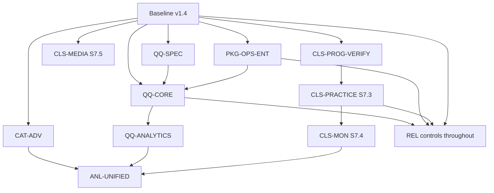

# SIAPEGAWAI — Roadmap Rekonsiliasi dan Dependensi Modul (APPROVED)

> **ID:** `SGP-ROADMAP-2026-11-10-APPROVED-01`  
> **Tanggal:** 10 November 2026 (WIB)  
> **Status:** **APPROVED untuk arah produk per 10 November 2026; belum di-commit/push, fitur roadmap belum diimplementasikan**  
> **Rujukan induk:** `IMPLEMENTATION-PLAN-v2.3.md` (disetujui, revisi dari v2.2)  
> **Sumber fakta historis:** `SIAPEGAWAI-LAPORAN-IMPLEMENTASI-DAN-ROADMAP-v1.4.md` (9 November 2026) dan `commit-report-siapegawai.txt`  
> **Sumber keputusan baru:** feedback pemilik 10 November 2026 mengenai Latihan Kelas, Quiz Kilat, Analisis Kemampuan dan Git/handover  
> **Bukan:** release notes, inventaris schema definitif, konfirmasi kesiapan produksi, atau keputusan untuk langsung coding.

## 1. Tujuan pembaruan

Mempertahankan seluruh tahapan yang telah dilaporkan sampai **v1.4 / S7.2** tanpa menamainya ulang, sementara pekerjaan ke depan mempunyai nama dan dependensi yang tidak rancu. Rencana baru memakai ID pekerjaan stabil. Label angka tahap dalam laporan/plan lama tidak otomatis dinomori ulang. Laporan v1.4 tetap **arsip sejarah**, bukan dokumen yang diperbarui diam-diam.

## 2. Baseline dan tingkat kepercayaan

| Aspek | Bukti tersedia | Status untuk perencanaan |
|---|---|---|
| Fondasi akun, bank soal, CAT, keamanan dan kelas S7.2 | Laporan v1.4 + source GitHub yang diperiksa selektif pada review S7.3 | **IMPLEMENTED menurut laporan; tidak dilakukan tes baru saat revisi dokumen** |
| Hasil pengujian | Laporan Git 9 Nov: **87 passed / 653 assertions** dan Vite build PASS | **Historis**, bukan bukti hasil rerun pada SHA `df190d4` |
| SHA Git 9 Nov | `3a15e6e` dalam laporan commit/push | **Reported pushed** pada tanggal laporan |
| SHA dokumen yang diverifikasi | `df190d4` ada di GitHub dan parent-nya `3a15e6e` | **Commit exists**, tetapi HEAD `main` remote terbaru dan HEAD lokal belum dicocokkan |
| `main`, docs lokal | Metadata GitHub mencatat default branch `main`; laporan Git menyebut `docs/` dan `.env.siapegawai.example` untracked pada 9 Nov | Kondisi **hari ini** dan local working tree **belum terverifikasi** |
| Browser revoke→regrant progres materi | Tes otomatis ada; alur admin UI regrant belum dilaporkan tuntas | **OPEN / `CLS-PROG-VERIFY`** |
| Siap produksi | Gap QA, legal, backup/restore dan UI masih terbuka | **NOT READY / UNVERIFIED** |

**Verifikasi API:** `GET https://api.github.com/repos/nur-aris07/siapegawai/commits?sha=main&per_page=5` telah diupayakan dalam review, tetapi daftar objek commit/HEAD tidak dapat diekstrak dengan andal. Halaman commit `https://github.com/nur-aris07/siapegawai/commit/df190d4` berhasil mengonfirmasi commit dan parent-nya. Karena itu dokumen ini **tidak menyatakan commit terbaru remote**. Di akhir tahap coding/dokumentasi yang nanti diterima, perlu cocokkan `HEAD`, `origin/main`, remote branch spesifik dan API setelah push. Tidak ada akses ke `E:\NewChapter1\project\siapegawai` dari sesi review ini.

## 3. Pemisahan domain produk — keputusan yang dikunci

| Domain | Model produk | Timer & feedback | Hak akses / histori / analisis |
|---|---|---|---|
| **CAT/Tryout** | Simulasi ujian; engine yang telah ada dipertahankan | Satu durasi sesi sesuai CAT saat ini; pembahasan sesuai aturan existing | Riwayat dan skor CAT sendiri; bukan nilai resmi CPNS |
| **Latihan Kelas — Class Practice (`CLS-PRACTICE`)** | Evaluasi kelas/materi, admin menentukan kumpulan soal terbit | **Satu durasi pengerjaan per sesi**; skor dan review sesudah submit/timeout | Enrollment active; hasil/attempt kelas terpisah dari CAT dan progres completion materi |
| **Quiz Kilat — Quick Quiz (`QQ-CORE`)** | *Do First, Then Evaluate to Be Better*; admin-curated (Model A) | **Timer per soal**, jawaban langsung terkunci; feedback benar/salah/tidak dijawab + kunci + ringkasan selama **3 detik tetap** sebelum soal berikut | Hak akses melalui entitlement/kuota QQ global peserta; histori & waktu respons terpisah; review mendalam setelah seluruh soal |
| **Analisis Kemampuan** | Interpretasi performa sesuai konteks | Tidak mengubah mekanisme soal atau skor sumber | Satu menu boleh memuat kategori domain; analisis terpadu (lanjutan) tidak mencampur persentase lintas domain mentah |

**QQ content policy saat ini:** sekitar **30–40 soal** per quiz sebagai target konten awal (bukan minimum/maximum constraint final), jelas dan relatif singkat; admin menentukan susunan, waktu per soal pada level quiz, dan validasi pembahasan. Peserta hanya memilih quiz terbit; **tanpa generator otomatis**. Peserta boleh mengulang judul sama sepanjang punya hak dan kuota.

**QQ daily quota:** satu kuota harian per peserta **dibagi seluruh judul Quiz Kilat**, berasal dari entitlement/paket. Contoh lima sesi sehari **hanya ilustrasi**, bukan keputusan besaran kuota. Reset, zona waktu, debit, timeout, koneksi terputus, refund dan batas abuse adalah urusan `QQ-SPEC` nanti. Detail schema/route/engine dan nilai timer per soal **tidak diputuskan sekarang**.

## 4. Pemetaan angka lama dan ID stabil

| Nama lama | ID yang dipakai ke depan | Status |
|---|---|---|
| `S7.2` | `CLS-PROG-VERIFY` untuk satu verifikasi tersisa | Pekerjaan verifikasi, **bukan ulang implementasi** |
| `S7.3 / CLS-QUIZ` | **`S7.3 / CLS-PRACTICE`** | Rename konsep; draft 01 lama disimpan sebagai catatan historis |
| `S7.4 / CLS-MON` | `CLS-MON` | Tetap, mengolah progres kelas + hasil Latihan Kelas |
| `S7.5 / CLS-MEDIA` | `CLS-MEDIA` | Tetap |
| `S8` pada plan asli v2.2 | `REL-*` | **Release readiness** historis, tetap lintas fitur |
| `S8` pada laporan roadmap v1.4 | `CAT-ADV` | **Peningkatan penilaian CAT** yang berbeda dari `REL-*` |
| `S9 / PKG-OPS` | `PKG-OPS` / `PKG-OPS-ENT` | Tetap katalog/entitlement/manual grant, **bukan** payment gateway |
| `S10 / REL` laporan v1.4 | `REL-*` | Membawa tanggung jawab release readiness S8 lama |
| Modul baru (belum punya nomor) | **`QQ-SPEC`, `QQ-CORE`, `QQ-ANALYTICS`** | Work ID baru; pemberian nomor tahapan ditunda |
| Analisis lintas modul baru | **`ANL-DOMAIN`, `ANL-UNIFIED`** | Work ID baru; analisis terpadu bukan MVP S7.3/QQ awal |

**Jangan** melakukan global search-and-replace `CLS-QUIZ` pada laporan historis yang sudah diterbitkan. Beri alias saat referensi kembali, dan revisi draft S7.3 baru setelah masuk pembahasan teknis. Jangan menamai tabel/model baru sebagai sudah final sebelum audit source.

## 5. Urutan dan dependensi rekomendasi

**Interpretasi:** `QQ-SPEC` dapat dianalisis lebih awal karena kebutuhan produk sudah jelas, tetapi implementasi `QQ-CORE` yang mencakup kuota berentitlement menunggu `PKG-OPS-ENT` yang memadai. `CLS-MON` disarankan lebih dulu untuk menyelesaikan alur kelas sebelum menjadikan QQ prioritas implementasi; **bukan** dependensi teknis langsung terhadap `QQ-CORE`. `REL-*` adalah kontrol pada setiap tahapan dan gate rilis, bukan hanya pekerjaan di ujung. `ANL-UNIFIED` adalah horizon lanjutan, tidak diwajibkan untuk release bertahap.

## 6. Work breakdown dan output acceptance

| Prioritas kerja | Work ID | Deliverable terukur | Dependensi / batas |
|---|---|---|---|
| Gate wajib | `CLS-PROG-VERIFY` | Bukti regrant UI S7.2 mengembalikan completion, persen benar, tidak ada duplikasi; akses revoked ditolak | Baseline v1.4, browser admin-peserta, query read-only |
| Berikutnya | **`CLS-PRACTICE-01`** | Editorial latihan, pinned published versions, draft/publish/archive, audit, tes authz | `CLS-PROG-VERIFY`, audit migrations/bank soal/kelas; keputusan produk S7.3 |
| Berikutnya | **`CLS-PRACTICE-02`** | Attempt, durasi sesi, resume/autosave, submit, skor/review, riwayat kelas, tes positif-negatif | `CLS-PRACTICE-01`; semua skor terpisah dari CAT |
| Berikutnya | `CLS-MON-01/02` | Monitoring admin progres materi dan hasil Latihan Kelas, termasuk revoked, izin dan pagination | S7.2 + `CLS-PRACTICE`; tidak membangun unified analytics |
| Jalur konten | `CLS-MEDIA-01/02` | Struktur materi/bab/PDF/video berizin, aturan progres per versi materi | Policy upload/download privat & review konten |
| Jalur penilaian | `CAT-ADV-01/02` | Aturan skor valid dan versioned untuk simulasi CPNS, numerik fixtures | Rujukan aturan CPNS pada saat dikerjakan, tidak merusak skor lama |
| Jalur entitlement | `PKG-OPS-ENT` | Paket/entitlement & hak quota QQ yang dapat diperiksa server, audit, expiry | Bisnis akses/kuota disetujui; **tanpa asumsi checkout/payment gateway** |
| Desain terpisah | **`QQ-SPEC`** | ADR Quiz Kilat: timer per soal, locking, feedback tepat 3s, review, quota, error handling, relasi hak akses, test/UAT | Tidak ada kode/migration pada pekerjaan spesifikasi |
| Setelah dua prasyarat | **`QQ-CORE`** | Admin-curated quiz, timer per soal, feedback, review, kuota lintas judul, keamanan, test | `QQ-SPEC` dan `PKG-OPS-ENT`, bank versi terbit |
| Setelah QQ aktif | `QQ-ANALYTICS` | Ketepatan, waktu respons, timeout, perubahan hasil berulang per kategori | Data QQ nyata/terverifikasi; domain tersendiri |
| Lanjutan | `ANL-UNIFIED` | Definisi analisis lintas CAT, kelas, QQ dan rekomendasi berbasis konteks | Ketiga sumber stabil + aturan interpretasi/privacy disetujui |
| Lintas semua | `REL-*` | CSP/XSS/IDOR, responsive, a11y, database restore, legal, performance dan deployment | Setiap tahap punya gate; release memerlukan sign-off khusus |

## 7. Keputusan yang ditetapkan vs yang belum

### Sudah ditetapkan (produk)

- S7.3 = **Latihan Kelas (Class Practice)**, mekanisme umum draft 01 dipertahankan dan didetailkan nanti.
- CAT tetap, tidak refactor sistem yang sudah berfungsi hanya karena QQ.
- Latihan Kelas, CAT, QQ memiliki histori dan analisis yang dibedakan; progres materi S7.2 tidak otomatis berubah karena skor latihan.
- QQ **Model A admin** dengan penilaian respons cepat, timer individual tiap soal; waktu per soal ditetapkan pada level quiz.
- Feedback langsung saat jawab/timeout, **jeda tepat 3 detik**, lalu auto next; lock tidak dapat diubah; seluruh sesi diakhiri review lengkap tanpa timer.
- QQ target konten sekitar 30–40 soal; bukan ketentuan DDL saat ini.
- Kuota QQ **global harian per peserta** berdasar entitlement/paket, bukan per quiz, dan judul boleh diulang ketika eligible.
- Analisis CAT dan QQ tetap dibedakan di menu Analisis Kemampuan; unified analytics lanjutan.
- Setelah tahap diterima harus ada Git commit/push **yang benar-benar terverifikasi**, lalu handover baseline dan rencana tahap baru.

### Terbuka / jangan diputuskan terselubung

- S7.3 D-01 s.d. D-06: durasi opsional atau wajib, limit attempts, pembahasan, revoke vs akses hasil, archive dengan attempt aktif, relasi materi.
- Pilihan nama teknis model/tabel/routes Latihan Kelas setelah inspeksi source; draft 01 lama menggunakan nama `class_quiz_*` sementara.
- QQ rentang detik per soal, jumlah soal sebagai minimum/batas maksimum atau editorial saja, perawatan quiz setelah published, aturan answer timeout dan status rancangan engine.
- Quota entitlement: default jumlah, definisi satu sesi terpakai, zona reset, alokasi gratis, transaksi atomik, timeout/retry/refund, offline, multi-tab, akses ketika paket habis.
- Desain logging respons waktu yang dapat dipertanggungjawabkan dalam jaringan tak stabil, tanpa menganggap jam/browser tepercaya.
- Komposisi analisis terpadu, bobot metrik, privacy, validasi statistik, dan kapan prioritasnya tinggi.
- Git branch/remote/merge yang akan dipakai dan commit terbaru aktual dari working tree + GitHub API.

## 8. Gate kontrol perubahan, Git dan handover

Kebijakan per tahap: **Implementasi → pengujian → review/acceptance → tahap diterima → stage file scope saja → commit → push → verifikasi SHA branch yang benar → handover**. Jika blocker masih ada, status tetap **BLOCKED** dan commit final tidak dibuat. Jika commit sementara untuk keamanan diperlukan, labeli **WIP**, bukan 'DONE'. Bukti source/tes/remote harus dipisah.

Sebelum Git final, periksa `git status --short --branch`, `git branch --show-current`, `git rev-parse HEAD`, `git fetch origin`, `git rev-parse origin/main`, `git diff --name-status`, `git diff --check` serta daftar file untracked. Untuk dokumentasi hasil review ini **tidak ada Git staging, commit atau push** karena belum ada persetujuan pemilik dan tidak ada akses local repo. Setelah disetujui, gunakan `git add -- <path-terverifikasi>` yang mengikuti diff aktual, review staged diff, dan verifikasi commit remote dengan API `?sha=<branch>` atau full SHA.

Simpan handover per tahap dengan: status AC, perubahan file dan migration, tes/log/UAT, risiko & data historis, SHA awal/akhir lokal-remote-main (jika berbeda), sinkronisasi, untracked yang tersisa, dan rencana scope/dependensi/test tahap selanjutnya. Template lengkap ada di Implementation Plan v2.3 §19.

## 9. Rencana tindakan berikut setelah dokumen disetujui

1. **Saat ini (APPROVED / GIT PENDING):** pemilik telah menyetujui v2.3 dan roadmap pada 10 November 2026. Persiapkan publikasi Git dokumentasi; jangan klaim SHA hasil commit baru sebelum diverifikasi.
2. **Publikasi dokumen yang telah disetujui:** cek working tree lokal, path docs yang memang ingin diterbitkan, status branch/remote dan konten bebas secret; siapkan commit dokumentasi yang sesuai kondisi aktual, push ke remote branch yang disepakati, verifikasi SHA melalui GitHub API dan `git ls-remote`. Tulis handover `DOC-PLAN-REV` untuk mencatat perubahan dokumen dan baseline baru. **Bukan** commit aplikasi S7.3.
3. **Kembali ke S7.3:** tutup `CLS-PROG-VERIFY`; rekonsiliasi baseline Laravel; ubah draft S7.3 menjadi `CLS-PRACTICE` dengan hasil audit; catat keputusan teknis yang belum final; setelah sepakat baru implementasi lewat installer mandiri dan test.
4. **QQ tetap roadmap:** pekerjaan spesifikasi dan implementasi QQ dibuka pada waktu yang disepakati, tidak ikut installer S7.3.

## 10. Sumber rujukan dan riwayat revisi

- **Dokumen historis:** `IMPLEMENTATION-PLAN-v2.2.md` (8 Nov 2026), `SIAPEGAWAI-LAPORAN-IMPLEMENTASI-DAN-ROADMAP-v1.4.md` (9 Nov 2026), `commit-report-siapegawai.txt` (9 Nov 2026).
- **Rancangan teknis lama:** `SGP-PLAN-CLS-QUIZ-S7.3-DRAFT-01.md` (10 Nov 2026), disimpan untuk traceability, **belum diganti di repository atau dihapus**.
- **Desain:** `DESIGN-SYSTEM-AND-VISUAL-CONTRACT.md`, `VISUAL-ACCEPTANCE-CHECKLIST.md`, prototipe v4.
- **Keputusan baru:** feedback pemilik tanggal 10 Nov 2026 (Latihan Kelas, Quick Quiz, analisis, Git completion/handover).
- **GitHub API (metode verifikasi, bukan data SHA yang berhasil dibaca):** https://api.github.com/repos/nur-aris07/siapegawai/commits dan GitHub REST API documentation.

**Penutup:** Semua item di luar baseline v1.4 bertanda *PLANNED/OPEN* kecuali keputusan konsep produk yang memang dinyatakan disepakati. Dokumen ini tidak mengubah source, migration, ataupun status release Siapegawai.
