> **CATATAN HISTORIS (11 November 2026):** v1.0 ini digantikan untuk keputusan produk dan engineering oleh [`QQ-SPEC-ADR-v1.1.md`](./QQ-SPEC-ADR-v1.1.md) berdasarkan feedback final pemilik produk. Konten lama dipertahankan untuk penelusuran keputusan; butir yang bertentangan pada v1.0 tidak berlaku lagi.

# QQ-SPEC — Architecture Decision Record: Quiz Kilat

**Document ID:** `QQ-SPEC-ADR-01`  
**Version / date:** v1.0 / 10 November 2026  
**Status:** **DRAFT FOR PRODUCT/TECHNICAL ACCEPTANCE — no QQ implementation approved**  
**Baseline source reviewed:** Siapegawai Laravel 13 source overlay through `c66e6e35221f5e8fa3be7bb41527ed2aa1f06a92` (HEAD SHA from operator's Git evidence).  
**Scope:** technical blueprint and executable acceptance criteria, **not** application code, database migration, entitlement grant, or a release decision.

## 1. Source of truth and provenance

1. **Approved product decisions:** `docs/plans/IMPLEMENTATION-PLAN-v2.3.md`, especially §§1.4, 7.7–7.8, 13.3, 17A–17B; `docs/roadmaps/SIAPEGAWAI-ROADMAP-REKONSILIASI-2026-11-10.md`, §§3, 5–7.
2. **Visual/UX constraints:** `docs/design/DESIGN-SYSTEM-AND-VISUAL-CONTRACT.md`, `docs/design/VISUAL-ACCEPTANCE-CHECKLIST.md`, `docs/design/ADMIN-WORKSPACE-REFERENCE.md`; this docs-only patch adds the first two **verbatim** from the user-supplied copies, retaining their own DRAFT REVIEW labels while treating explicitly tagged v4 visual baselines and product decisions as binding. Use the four shells, Vite/CSP, Siapegawai design tokens and admin Yajra pattern.
3. **Source audit (snapshot, not MySQL verification):** `question_versions` and `question_options` support published-version pinning; `access_grants` supports generic time-bound grants **but no daily QQ quota field**; `question_versions.explanation` contains a general explanation, with **no separate short-feedback field** for the mandatory three-second view; `tryout_attempts` and `class_practice_attempts` already exist and must remain separate; no QQ routes/models/migrations currently in the inspected source. See `database/migrations/2026_11_08_000002_create_siapegawai_registration_tables.php`, `000004_create_question_bank_tables.php`, `000006_create_member_tryout_attempts.php`, and `2026_11_10_000011_create_class_practices.php`.
4. **Evidence boundary:** the most recent operator QA was **121 tests / 994 assertions** on the previous CLS-MEDIA-02 implementation. This ADR does not claim any QQ tests, Vite changes, browser QA, or production readiness.

## 2. Invariants that are ALREADY DECIDED by the product owner

| ID | Immutable product requirement |
|---|---|
| P-01 | Name **Quiz Kilat**, separate from CAT/Tryout and Latihan Kelas; philosophy **“Do First, Then Evaluate to Be Better.”** |
| P-02 | **Model A: admin-curated** title, description, order, published question versions and question-level time limit configured **once per quiz**; no automatic generation or student-built quizzes. |
| P-03 | Editorial target **approximately 30–40 questions**, not a final database min/max. |
| P-04 | Individual countdown **per question**, not one countdown for the entire session. |
| P-05 | On answer or timeout: **immediate irrevocable lock**; feedback says correct/incorrect/unanswered and shows correct answer plus *brief* explanation. |
| P-06 | Feedback is displayed for **3 fixed seconds**, then transitions to the next question; its timer only begins when that question is shown (see network precision caveat). |
| P-07 | At session end, show full **untimed review** of every question, own response, key, and detailed explanation. |
| P-08 | **Single daily quota per participant shared across ALL Quiz Kilat titles**, driven by package/entitlement; repeat the same title when still eligible. The example “five per day” is **not an approved limit**. |
| P-09 | QQ answers, response times, attempts and analytics are **not merged** with CAT results, class-practice results, or S7.2 learning completion. |
| P-10 | `QQ-CORE` cannot start without accepted `QQ-SPEC`, adequate `PKG-OPS-ENT`, and a stable published question bank. No checkout, payment gateway or new actor role. |

## 3. Scope boundaries

**QQ-SPEC deliverable:** state model, timing/locking semantics, proposed storage architecture, quota integration contract, security/privacy, operator flow, test/UAT matrix, decision register and implementation gates. The document may be committed under `docs/specs/` without altering runtime behavior.

**Explicit non-scope:** database migration, Laravel controllers/routes, Vue/React, new CSS/JS, seed quiz data, quota grant in production, automatic checkout, changing existing CAT scoring, class-practice attempts, material completion, blended analytics, or calling the result a real CPNS score.

## 4. Proposed domain architecture (requires acceptance)

Keep the QQ domain isolated:

- **Editorial module** `QuickQuiz` / `QuickQuizItem`: draft → published → archived. A publish action pins immutable `question_version_id` and display order. Snapshot category/topic labels just as class practice does; no automatic change after bank-question revision. Admin publication is confirmation-gated and audited. A separate **admin-reviewed short-feedback text** per pinned quiz item/edition is proposed because the existing `question_versions` schema only has the general `explanation`; do not automatically truncate an explanation and call it editorially approved. Existing published quiz stays immutable; revising creates another published edition **if approved as a separate implementation decision**.
- **Attempt module** `QuickQuizAttempt` / `QuickQuizResponse`: one owned attempt, pinned quiz edition and ordered question items; one unique response record per item. Store the server-based question issue/deadline/lock timestamps and response classification. No client-provided score/clock is trusted.
- **Access module** `QuickQuizEntitlementResolver` and `QuickQuizQuotaLedger`: supplied by `PKG-OPS-ENT`; the QQ engine **consumes an authenticated, atomic eligibility/quota interface**. Reusing the existing generic `access_grants` without quota policy is not sufficient.
- **Result module** returns a separate QQ history, session result and untimed review. `QQ-ANALYTICS` later consumes QQ-owned response-time/accuracy data; do not write to `tryout_attempts`, `class_practice_attempts`, or `learning_material_progress`.

### Proposed minimum persisted fields (conceptual, NOT a final migration)

| Logical record | Minimum content |
|---|---|
| Quiz | title, description, status, **seconds_per_question** (admin-configured positive integer; valid range OPEN), published edition, publication metadata, creator |
| Published item | quiz edition, order, pinned question version, subject/topic snapshots, approved short feedback for the 3s phase |
| Attempt | quiz edition, user, current item index, state, started/finished UTC, quota consumption reference, idempotency identity |
| Attempt response | attempt + item unique, selected option or NULL, `issued_at`, `deadline_at`, `locked_at`, `lock_reason` (`answered`/`timeout`), response duration in milliseconds, correctness snapshot |
| Quota ledger / entitlement | participant, quota local calendar date, entitlement policy snapshot, atomic consumed/reserved counter or immutable usage events, attempt reference, refund/audit references if applicable |

**Schema quality:** FK and uniqueness; indexes for `(user_id, status)`, `(quiz_id, status)`, `(attempt_id, item_id)`, and `(user_id, bucket_date)`; timestamps in UTC with enough precision for seconds and response durations; restrict deletion of published historical references. Final table names, SQL constraints and indexes must be reviewed against MariaDB local and MySQL target before migrations.

## 5. Authoritative state machine and server protocol

State names below are **technical proposals**, not UI strings:

```mermaid
stateDiagram-v2
  [*] --> eligible
  eligible --> active: start authorized; allocate quota atomically
  active --> locked_feedback: accept answer OR server detects timeout
  locked_feedback --> active: feedback 3s elapsed; next item issued
  locked_feedback --> finished: last item locked
  active --> active: reconnect / read current item
  locked_feedback --> locked_feedback: reconnect / idempotent response
  finished --> [*]: result + untimed review
```

**A. Start and quota:** authenticated active participant clicks Start. Server in one DB transaction locks the applicable quota row, checks entitlement and remaining daily quota, creates/returns an idempotent attempt, records exactly **one** quota consumption, and issues the first item. A duplicate click with the same idempotency identity must return the same attempt, never a second debit. Multiple tabs cannot overspend; require transaction row lock/unique constraint and concurrency tests. An unfinished attempt should be resumable, not silently replaced with another paid attempt. No free daily allowance is assumed.

**B. Question issue:** server returns only the **current question** text/options, not the key or upcoming question data, plus trusted `server_now` and `deadline_at`. UI derives countdown from server-time offset for display. The server records question issue/start time; the browser clock is advisory only. Next-item timing starts when the server issues that item after advancing, approximating actual visibility. **Exact alignment to pixels-on-screen is impossible to prove over variable network latency**; this gap needs explicit performance/UX acceptance rather than claiming a mathematically exact start at render time.

**C. Lock:** POST answer contains an allowed option label and idempotency identity for the current item; server checks ownership, active account/session, current item, deadline, and `question_version_id` snapshot. **Server receive/transaction time** determines on-time/late. An on-time answer is persisted and scored once, along with `locked_at` and measured response time. If deadline has passed, persist **timeout/unanswered** (NULL option) even if a late answer arrives; never reopen or replace a locked response. Duplicate POST returns already locked outcome; a different answer on replay cannot modify the result. Two simultaneous POSTs deterministically accept at most one answer; the lock must be transactional, not an optimistic client variable.

**D. Feedback — exactly 3 seconds shown:** only **after** confirmed lock, return correct answer and **brief** explanation for that item. Client displays feedback for **3,000 ms measured from the moment feedback is actually rendered**. Server persists a minimum `feedback_not_before` threshold to reject premature `advance` requests. After client 3-second display, it requests the next question; its countdown begins at issue and not during the previous feedback. In a background tab, offline state, or throttled JS, it may remain longer than 3 seconds; it MUST NOT skip feedback or silently start the next question's timer. When reconnecting, re-present the locked item's feedback as needed and continue safely. The *fixed 3s* guarantee applies to the intended foreground happy path; no UI can guarantee exact 3.000s under OS suspension or unreachable network. This must be an explicit UAT limitation.

**E. Timeout without input:** next request/read/worker sees expired `deadline_at` and locks the item as timeout, then enters feedback. Server finalization never relies on `setInterval` being accurate or browser remaining online. Timeout counts as **not answered**, separately from an explicit wrong choice. If the final item locks, mark session finished **after its 3s feedback has been displayed/advanced**, enabling full review.

**F. Result and review:** use pinned published options/keys; current score is a **proposed simple correct/total percentage**, pending decision QD-08 about TKP and other weighted types. Return detailed review only for a finished attempt and its owner, never leak future answers or other users' records. Do not present result as official BKN/CPNS score.

**G. Resilience:** GET current session is idempotent. Delayed/reordered autosave/retry cannot advance `current_item` twice. Each state transition compares expected item index and current status within a DB transaction. HTTP 409 carries stable recoverable state; HTTP 422 for malformed answers; 403 for unauthorized; 429 for rate limit; authenticated resume can reconstruct the current state even after reload, with no additional quota consumption.

## 6. Quota/entitlement contract and open business policy

The actual access policy is specified in **`PKG-OPS-ENT-QQ-CONTRACT-v1.0.md`**. These rules must be implemented by `PKG-OPS-ENT` before QQ-CORE:

1. Only active participant accounts with a currently valid QQ entitlement may start; no entitlement means **not eligible**, not unlimited.
2. Daily budget is user-global over **all titles**. Retry/resume of the same attempt does not consume again; starting another after finishing consumes if remaining.
3. Start/quota consumption is atomic; concurrency and multi-tab races must not overdraw. Allocate once using row locking + a uniqueness/idempotency constraint.
4. User-visible remaining quota and reset time must match the authoritative server ledger. No hardcoded example quota.
5. Source of grant is a manual, auditable package/entitlement workflow with effective times; no automatic billing.
6. Business decisions **not finalized**: quota number per entitlement, free allocation, reset timezone, grant overlap policy, expired entitlement mid-attempt, admin refund process, outage handling, policy changes mid-day, max in-progress age. Those are explicit QQ-CORE blockers, not implementation assumptions.

## 7. Route and component sketch (proposal, NOT registered routes)

| UI action | Candidate route/method | Server behavior |
|---|---|---|
| Admin list & AJAX | `GET /admin/quiz-kilat` → feature `index()` | HTML or Yajra JSON on same URL; permission checks for both |
| Admin draft/create | `GET/POST /admin/quiz-kilat/buat` and `/admin/quiz-kilat` | Review question versions, validation, audit |
| Admin publish/archive | `POST /admin/quiz-kilat/{quiz}/terbit`, `/arsip` | Confirm, pin versions, refuse invalid/quasi-empty content |
| Member list | `GET /quiz-kilat` | Published eligible titles plus genuine quota and upcoming reset |
| Start | `POST /quiz-kilat/{quiz}/mulai` | Atomic quota check and attempt creation |
| Current item | `GET /quiz-kilat/sesi/{attempt}` | Scope user, send current item only, no key until locked |
| Lock answer | `POST /quiz-kilat/sesi/{attempt}/jawaban` | One-time transactional lock, idempotent |
| Advance | `POST /quiz-kilat/sesi/{attempt}/lanjut` | Respect feedback timing; issue next item |
| Result | `GET /quiz-kilat/sesi/{attempt}/hasil` | Finished-only, full untimed review |

Use existing `auth`, `EnsureActiveAccount`, role checks, CSRF, rate limiting and admin session security. Keep controller/service files **feature-focused**, do not create a monolith or add a `.../data` endpoint for Yajra. All URLs and names above can change at the QQ-CORE implementation gate after source inspection; this ADR alone does not create live endpoints.

## 8. Visual/UX specification — Visual Contract is binding

- **Admin** (`layouts/admin`): dense but readable table/toolbar; `Yajra` only for large admin list on `index()` same URL; search live without reloading; detail/editor sections with 16/24/32px rhythm, borders/dividers not stacked decorative cards. Show Draft / Published / Archived as meaningful statuses.
- **Participant** (`layouts/workspace`): list of quiz titles with authentic counts/entitlement; no fake quota or duplicate CAT menu. Start screen shows **number of questions**, **seconds/question** and the fact that answers cannot be changed. During quiz: one visible question at a time, large legible timer, options with labels, clear answer-lock affordance, answer status/3s feedback, no back-to-edit; results and detailed review untimed.
- **Mobile:** 320/375px, desktop 1366/1440px, intermediate 768/1024px. No horizontal overflow, no clipped timer, touch targets/focus-visible, `prefers-reduced-motion`, contrast and readable countdown. All new screens require **New** visual classification and owner approval of representative mockups before extensive implementation.
- **Security:** Vite CSS/JS, no inline script/style/`onclick`, no `eval`, CSP compatible, text-only rendering of untrusted questions. Never leak answer keys in HTML/page-data for the next/current unlocked question. Use `notify` adapter for transient errors but permanent inline errors for network failure, expiry and quota denied.
- **Accessibility caveat:** 3s feedback is an approved business rule but may be insufficient for screen readers or slower readers. Provide an accessible descriptive status and unlimited final review; explore a non-interfering accessible replay/pause mechanism **without silently changing P-06** (decision QD-12).

## 9. Threat model and protections

| Threat | Control / evidence required |
|---|---|
| Client modifies time or submits after deadline | Ignore client clock, server timestamps and deadline validation, server-side timeout |
| Second browser tab, double-click, request replay | Atomic entitlement ledger; idempotent start; attempt current index locked |
| Answer tampering or guessing other member's attempt | Owner-scoped queries, route policy, item ID bound to attempt, ignore client score |
| Future answer leakage | Send only current unanswered item, never key until locked; review only finished session |
| Publishing edited bank question silently changes old results | Pin immutable `question_version_id` on publication + snapshots |
| Abandoned session / quota circumvention | TTL/timeout policy and no auto refund without explicit auditable rule |
| JS disabled/offline/back navigation | Clear error/resume on reconnect, state server-owned, no ghost attempts |
| CSS/JS injection via question body | Blade escaped output, `textContent`, strict CSP, no embedded untrusted HTML |
| Grade/accuracy misrepresentation | Label QQ as independent practice, not CAT or official CPNS score |
| Access revoked, account suspended, grant expired | Fresh active-account and entitlement checks according to finalized mid-session policy |

## 10. Test matrix (not yet run)

| ID | Scenario | Expected condition |
|---|---|---|
| QQ-T01 | Guest/participant suspended/admin start | Unauthorized/forbidden; no debit |
| QQ-T02 | Active user without QQ grant | Denied; no attempt or quota usage |
| QQ-T03 | Admin publishes quiz with pinned revisions | Old question content/key stable after bank revision |
| QQ-T04 | Two concurrent starts (same/different title) with remaining=1 | At most 1 new debit and 1 eligible new attempt |
| QQ-T05 | Double-click same start idempotency identity | One attempt, one quota debit |
| QQ-T06 | User solves item inside deadline | Permanently locked, feedback (no next question key leak) |
| QQ-T07 | User submits at/after server deadline | Timeout; late response cannot overwrite |
| QQ-T08 | Two simultaneous answers with different labels | One definitive lock; consistent score |
| QQ-T09 | Replayed `advance` / wrong item index | No skipped item, no double timer |
| QQ-T10 | Feedback timing under nominal network | Displays 3s, next timer starts after feedback |
| QQ-T11 | Background tab/network loss during feedback | Safe pause/reconciliation; no silent timer start |
| QQ-T12 | Reload/resume same attempt | Same item/state, no second quota debit |
| QQ-T13 | Shared daily quota across two quiz titles | Consumption visible on both; exhausted blocks both |
| QQ-T14 | Repeat same title after completed | Allowed if valid entitlement + quota |
| QQ-T15 | Midnight reset in configured timezone / DST boundary | Exactly one date-bucket transition; no duplicate claims |
| QQ-T16 | Grant revocation/expiry mid-session | Behavior matches **accepted** policy, not accidental behavior |
| QQ-T17 | Last item timeout then feedback | Session finishes once; result no timeout-free edit |
| QQ-T18 | Result/review access by another user | 403/404, no private answer leakage |
| QQ-T19 | CAT/Class Practice/S7.2 regression | Historical attempts, results and progress unchanged |
| QQ-T20 | CSP, keyboard, 320/375/768/1024/1366/1440 screenshots | Visual and accessibility gate documented independently |

**Test approach:** Laravel RefreshDatabase on dedicated `siapegawai_testing`, controlled server-clock (`Carbon::setTestNow` or injected clock), DB-concurrent request integration testing, boundary/latency tests, manual browser/UAT and visual screenshots. Existing `php artisan test`, `npm run build`, migration check and Git HEAD/remote verification remain mandatory later. Unit tests alone cannot validate network-visible 3-second feedback.

## 11. Decision register (OPEN means QQ-CORE cannot assume a value)

| ID | Decision still to accept | Proposed engineering direction; **NOT owner-approved** |
|---|---|---|
| QD-01 | Seconds per question: minimum, maximum and default | Positive integer configured per quiz, clamp/reject via server validation; test several values rather than hardcode one here |
| QD-02 | Exact question count hard limits | 30–40 as editorial target only until an explicit constraint is approved |
| QD-03 | Quota per entitlement / free quota | Configurable positive per-package daily allowance; **no assumed number** and no implicit free allowance |
| QD-04 | Quota reset timezone/date | Server-owned timezone policy, display reset explicitly; possible `Asia/Jakarta` proposed only, **not approved** |
| QD-05 | When quota is consumed/refunded | Debit exactly once on successful start+first issue; no automatic refund on disconnect; admin adjustments audited |
| QD-06 | Multiple/overlapping grants | Deterministic policy (e.g. highest active entitlement, not additive) must be approved |
| QD-07 | Quota changes mid-day / grant expires mid-attempt | Snapshot policy at start; distinguish inability to start new attempt from right to finish existing one; choose policy explicitly |
| QD-08 | QQ scoring for weighted TKP/question types | Recommend binary accuracy `% correct` for quick feedback, **not** silently applying CAT score weights |
| QD-09 | Abandonment TTL / finalization on offline | Persist current deadline and lock expired; explicit unfinished policy, never trust client offline timestamp |
| QD-10 | Resuming when feedback 3s passed in background | Keep locked feedback until foreground client can present it, then advance; no idle-time quota abuse |
| QD-11 | Re-publishing quiz after edit | Versioned editions; immutable pinned edition for existing attempts; no in-place edit of published structure |
| QD-12 | Accessibility alternative for fixed feedback | Repeat/review accessible mode without changing the 3s nominal active-session behavior |
| QD-13 | Server timestamp precision and latency budget | Measure RTT and slow device behavior; set measurable acceptance threshold, never promise zero network delay |
| QD-14 | Refund/dispute/manual support permission | Superadmin-only signed adjustment with audit + unique ledger transaction reference |
| QD-15 | Brief feedback content vs full explanation | Add admin-reviewed short-feedback per pinned quiz item; full published explanation retained for final review; never truncate silently |

**No silent approval:** the product constraints in §2 are approved; the engineering choices in §11 are proposals requiring sign-off before `QQ-CORE`. `PKG-OPS-ENT` may be implemented incrementally when these quota decisions have been accepted.

## 12. Work breakdown and gates

1. **QQ-SPEC:** review this ADR + entitlement contract, resolve QD-01 through QD-15, accept storyboard/mockups, record explicit decision and provenance. **No migration/code.**
2. **PKG-OPS-ENT:** implement time-bound, audited, server-evaluated QQ entitlements and a race-safe shared daily quota ledger, admin UI, test DB transactions; no payment gateway.
3. **QQ-CORE-01:** admin editorial of quiz drafts and published question version pinning, authorization, test and visual acceptance.
4. **QQ-CORE-02:** authenticated timer/locking/feedback engine, quota consumption, recovery, separate result/review, feature/concurrency tests and browser latency UAT.
5. **QQ-ANALYTICS:** scoped per-domain accuracy and response-time views after real QQ data are stable.
6. **REL:** open visual/browser UAT S7.4/S7.5 and security/accessibility/release gates must remain independently tracked.

## 13. Acceptance / sign-off

- [ ] Product owner confirms open decision register or records exception-by-exception approvals.
- [ ] Engineering verifies timer/transaction design against actual MySQL/MariaDB integration and test harness.
- [ ] UI mockups for new admin/participant QQ pages receive Visual Contract acceptance.
- [ ] `PKG-OPS-ENT` eligibility/quota contract is finalized before QQ runtime migration.
- [ ] Implementation work item, database evolution, rollback, installer, QA and Git gates defined separately.

**QQ-SPEC v1.0 is a complete REVIEWABLE technical proposal, not an approved runtime policy.**
